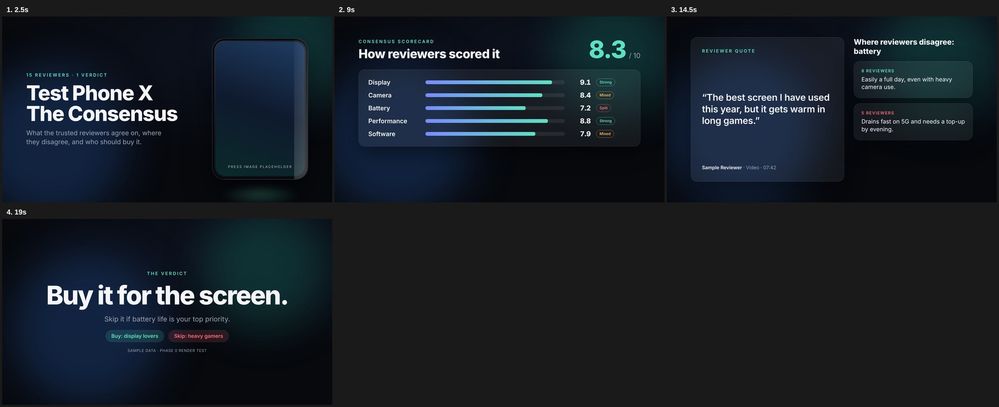

# Production playbook

The one reference doc for this repo. `CLAUDE.md` holds the short rules every session must follow; this file holds
everything else: the full specs, how-tos, measurements and the lessons behind each rule. Every rule says **why**, so a
future session can tell when a rule applies and when it doesn't.

It replaces `HANDOFF.md`, `docs/documentary-playbook.md`, `docs/documentary-production.md`, `docs/fetch-video.md` and
`docs/phase0-report.md` (merged here in Oct 2026). Per-project READMEs and briefs stay next to their projects as records.

**Contents**
- Part A: How we work. 1 Owner and delivery · 2 Claude models · 3 Parallel sessions · 4 Quality first (4.1 Creative director)
- Part B: Documentaries. 4a Channel, language and audience rules · 5 The look · 6 Workflow and engines · 7 Script and voice · 8 Media sourcing ·
  9 Realistic animation · 10 HyperFrames · 11 Sound · 12 Facts, honesty and rights · 13 Render and deliver (13c: how YouTube finds
  our videos) · 14 Pre-render review · 15 Lessons log
- Part C: Phone consensus pipeline. 16 Product and spec · 17 Claude in the pipeline · 18 Architecture and stages ·
  19 Control flow, secrets, evals · 20 Build phases · 21 Phase 0 measurements
- Part D: 22 Recommendations
- Part E: the owner's channel charter (verbatim)
- Part F: the owner's production handoff guide and style examples for English films (verbatim, 2026-10-15)
- Part G: the owner's 180-second hyper-visual format directive and blueprint (verbatim, 2026-10-20; rules in §4a-9)
- Part H: the owner's Indian conversational narration blueprint (verbatim, 2026-10-20; rules in §4a-10)

---

# Part A: How we work

## 1. Owner and delivery

- **Kishore works only from an Android phone** (GitHub app, Termux, SSH to a VPS, the Claude app). No PC.
  *Why:* every step must run in a cloud session, GitHub Actions or the VPS, and every result must be viewable on a phone.
- **Deliverables a phone can open:** a **Google Drive** link for the MP4 in the owner's `Creator` folder (1080p ≈ 200–330 MB,
  4K ≈ 1 GB), a contact sheet PNG/JPG, the SRT and the YouTube description, sent with `SendUserFile` (30 MB cap per file).
  **Google Drive replaces Gofile (owner, 2026-10-13).** *Why:* the owner already keeps a `Creator` folder there and opens it
  in the Drive app on the phone; Gofile links expire and need a browser. How:
  - **Drive layout (owner, 2026-10-15):** `Creator/English/<slug>/` and `Creator/Telugu/<slug>/`, one folder per video
    (the channel is the film's narration language, `lang.txt`); channel art in `<Channel>/_Channel/`; material for both
    channels in `Creator/_Shared (both channels)/`. Nothing loose in `Creator/`. *Why:* the owner runs two channels and
    finds a film's files on the phone by channel, then by video. Folder names are the repo slugs.
  - Videos: `scripts/upload_gdrive.sh --sub <Channel>/<slug> FILE…` (pinned rclone, uploads to `Creator/<Channel>/<slug>/`,
    prints a view link), e.g. `--sub English/insurance-ombudsman`.
    The Google Drive connector can't carry video-sized files (content goes through the tool call), so the script needs
    **`GDRIVE_RCLONE_TOKEN`**, a one-time setup on the phone: Termux → `pkg install rclone` → `rclone authorize "drive"`
    → sign in with the Drive account that owns `Creator` in the browser that opens → copy the one-line JSON it prints →
    Claude app → environment settings → Environment variables → `GDRIVE_RCLONE_TOKEN=<that line>`. New sessions pick it
    up. Until it exists, deliver the MP4 with `scripts/upload_gofile.sh` and say so.
    Two quirks (2026-10-13): the Claude app's environment field strips the JSON braces and the `access_token` key
    and drops the `expiry`, so `upload_gdrive.sh` rebuilds the JSON from whatever is left (the refresh token is
    enough). Links it prints are private file links; the owner opens them signed in. The script never turns on
    "anyone with the link" sharing. The first two uploads (the VO blocks) did get link sharing before this fix.
  - Small text deliverables (description, SRT, `review.md`, `claims.csv`) can go up through the connector
    (`create_file` with `parentId` = the Creator folder `1NOCNjqPX5dOzKpp71oyEIIj0xoF-W68M`, `disableConversionToGoogleType`).
  - Owner footage and clips for a film: the owner drops them in `Creator/<Channel>/<slug>/` (zips are fine); sessions read them with the
    connector (`search_files` with `parentId`, `download_file_content`). Report in plain words: what changed,
  what is still a stand-in, any rights or Content ID risk.
- **Git:** all work lands on `main`. *Why:* in Oct 2026 nine stale session branches hid finished work; one branch keeps
  everything findable. Parallel sessions (§3) each push to their own branch and folder, and the coordinator merges them
  into `main` the same day, then deletes the branch.
- **Once the owner approves a cut, stop editing it.** Deliver exactly that cut (upscale, captions), nothing more.
  *Why:* on breath-hold, slipping in further edits after approval cost a review round.
- English first; keep all script and on-screen text i18n-ready (Telugu is already in use for the documentaries).
- **Owner setup status (2026-10-08).** Done: cloud environment *Full Access* (Gofile, Dailymotion, NASA and the rest of §8.1
  reachable); `PIXABAY_API_KEY` as an environment variable (verified from a new session: search, 4K download). Optional, add
  only when a video needs it: `YT_COOKIES` repo secret (YouTube via the Fetch workflows), `UNSPLASH_ACCESS_KEY`,
  `FREESOUND_TOKEN`, a NARA key, `ANTHROPIC_API_KEY` repo secret (only for API stages in GitHub Actions; cloud sessions
  don't need it). Pexels has paused new keys. Keys go in the environment settings (Edit → Environment variables; network
  secrets don't fit APIs that take the key in the URL, like Pixabay), never in chat or the repo. A new variable reaches
  only sessions started after it was saved.

## 2. Claude models: what they can do and where we use them

Facts from the Claude API reference bundled with Claude Code (cached 2026-10-06). Re-check with the Models API
(`client.models.retrieve(id)`) before relying on a number; prices and limits change.

| Model | ID | Context / max output | Price in / out per MTok | Best at (for us) |
|---|---|---|---|---|
| **Claude Opus 5.5** (default) | `claude-opus-5-5` | 1M / 128K (300K on Batch, beta) | $4 / $20 · cache read $0.20 · batch −50% | Everything that matters: research synthesis, fact-check, script, HyperFrames code, visual QA |
| Claude Fable 5.1 (most capable) | `claude-fable-5-1` | 1M / 128K | $10 / $50 · cache read $0.25 | Hardest reasoning and long autonomous work. Use only when the owner asks; 2.5× Opus price |
| Claude Sonnet 5.5 | `claude-sonnet-5-5` | 1M / 128K | $2 / $10 | High-volume work where Opus quality isn't needed. **Not used by default** |
| Claude Haiku 5.5 | `claude-haiku-5-5` | 1M / 128K | $0.10 / $0.50 (≤100K prompt) | Cheap bulk classification. **Not used by default** |

**What Opus 5.5 is good at, and how we use it**
- **Reads images precisely.** Even at `low` effort it reads charts, diagrams and screenshots more accurately than Opus 5
  did at its highest. Dense or technical images still gain from higher resolution and from letting it crop and zoom with
  PIL/OpenCV in a container. *Use:* contact-sheet review of every asset, frame QA of renders, checking that on-screen data
  matches the VO (the 168/90 monitor mistake, §15).
- **Doesn't invent sources.** Much less likely to state a figure or cite a source the inputs don't support; more
  detail-oriented on large inputs (a date on the wrong weekday, a chart that doesn't match the figures). *Use:* fact-check
  pass on every script, at `max` effort.
- **Agentic coding.** At its default `medium` effort it matched Opus 5's `high` on multistep repo work with half the tokens.
  *Use:* writing HyperFrames compositions, engines and assembly code; render → snapshot → look → fix loops.
- **1M context.** All transcripts, articles and the script fit in one call: cross-source synthesis without chunking.
- **Design defaults.** Asked for visuals with no direction, it falls back on a few stock styles, and "avoid a generic
  look" just swaps one default for another. **Name the specific patterns to avoid** (§5 lists ours), look at the first
  result, and extend the list.
- **Limits.** Input is text and images only: no video or audio. Video is checked through extracted frames and contact
  sheets; audio through transcripts, `silencedetect` and `volumedetect`. Knowledge stops at June 2026, so every fact comes
  from collected sources.

**API rules** (enforced in `pipeline/llm.py`; details in `CLAUDE.md`): thinking is always on and can't be disabled;
set depth with `output_config.effort` (API default is `medium`, so always set it); forced `tool_choice` returns a 400,
so get JSON with `output_config.format`; read only `text` blocks; check `stop_reason` for `refusal`/`max_tokens`;
stream big requests; cache the shared prefix in `system` with a 1h TTL; enable the server-side refusal fallback.

## 3. Parallel sessions: finishing faster without cutting quality

**Facts (Oct 2026; sources: code.claude.com/docs/en/cloud-environments, /claude-code-on-the-web, /sub-agents, plus
measurements in a session):**
- **Each cloud session is its own VM:** about 4 vCPU, 16 GB RAM and 30 GB disk. N sessions = N× CPU for rendering.
- **Subagents** (the Agent tool inside one session) share that session's VM and CPU (up to 20 at once). They speed up
  waiting work (web research, fact-checks, reading contact sheets), not CPU work.
- **No documented cap** on concurrent cloud sessions, but all sessions **share the account's usage limits**: 6 sessions
  burn usage about 6× faster. No separate compute charge.
- **All sessions share the same outbound IP range** (Anthropic's proxy). Rate limits (Wikimedia 429, YouTube bot checks)
  hit every session at once, so **parallel sessions don't speed up media downloads**; they make 429s worse.
- **Idle VMs pause after a few minutes and can be reclaimed**, losing running jobs. Watch long renders with Monitor so the
  session stays active; start them with `nohup`.
- The GitHub proxy rejects **branch deletions and tag pushes** from sessions (the owner deletes branches in the browser).
- A coordinator session can start and steer others with the `create_session` / `send_message` / `get_session` /
  `list_events` / `archive_session` tools.

**Plan for one 10-minute documentary** (expected wall clock ~1–1.5 h instead of 3–4 h):
| Session | Job | Output |
|---|---|---|
| S0 coordinator | Locks script, VO and EDL on `main`; splits the EDL into ~2.5-min blocks at dip-to-black points; pins encode settings (size, fps, codec, GOP, bitrate cap, audio format) so parts join without re-encoding; starts the others | `projects/<slug>/edl.csv`, `parts.json` |
| S1 sourcing (one only) | All downloads at a polite rate, contact sheets, `media_manifest.csv`; subagents for parallel searching on hosts that don't rate-limit | manifest, contact sheets, URL list |
| S2–S3 animation | One HyperFrames/Three.js scene folder each (`video/<project>/<scene>/`), native 4K render | scene MP4s |
| S4–S7 render shards | Each pulls assets, renders its EDL rows | `projects/<slug>/parts/N/part.mp4` |
| S0 final | Concat (`ffmpeg -f concat -c copy`), music bed and ducking over the full length (never per part, to avoid seams), pre-render review, delivery | master MP4, contact sheet, SRT |

**Measured (2026-10-13, Jet Engine Paradox):** four scene sessions plus the coordinator hit the account's
**5-hour usage limit about 10 minutes after the scene sessions started**, before any of them had pushed anything.
All five stopped until the reset. *So:* run at most two heavy sessions beside the coordinator. Have each session push
code and upload renders after every finished scene, not at the end. Start the next pair only when the first pair is done.

**Rules:** each session owns one folder and one branch (no merge conflicts); same effort and quality in every shard; media
over 100 MB never goes in git (hand over by URL list and re-download, or a release asset/LFS after a test upload); archive
sessions when done; 6–8 sessions is the sensible maximum.
**Handing large files between sessions (tested 2026-10-13):** Litterbox (catbox.moe's temporary host, ≤ 1 GB per file,
kept 72 h) works both ways from the cloud: `curl -F reqtype=fileupload -F time=72h -F fileToUpload=@f.mp4
https://litterbox.catbox.moe/resources/internals/api.php` prints a direct URL, `curl -L <url>` gets it back byte-identical
(md5 checked). Commit `<file>.url` text (URL + md5) to the session's branch; the receiver fetches the branch and downloads.
Gofile does not work for this: guests can upload, but the contents API answers `error-notPremium` and a direct download
redirects. Gofile stays the owner's delivery link. Only our own renders and our own licensed assets go to Litterbox. Every new session runs `.claude/hooks/session-start.sh`
(npm install with vendoring, `.venv` with all extras, library fetch), so it is ready to render when it starts.
The `/parallel-render` skill walks through the whole procedure.

## 4. Quality first: never trim effort for speed

The owner's rule (Oct 2026): **accuracy and the best output matter more than speed.**
- Run Claude at full strength: `high` or `xhigh` effort for building, `max` for fact-checks (the lighter scope in §12) and final reviews. Never lower
  effort, skip a QA round, drop a fact-check or shrink research to finish sooner. *Why:* a wrong claim or a slide-like
  shot on a public channel costs more than an hour of compute.
- Get speed from **parallelism** (§3), caching and pre-rendering expensive layers, never from doing less.
- Research deeply: several independent sources per fact, the real event footage before stock, and a contact sheet of every
  asset before it goes into a cut.
- Fast mode stays off unless the owner asks (it costs 2× and only speeds up output tokens).

### 4.1 Creative director: rules are a reference, not a ceiling (owner, 2026-10-24)
> "Always should be creative director for everything. Be creative always and be smart and always stick to rules.
> Rules not the ceiling, they are for reference. Creative brains don't have limits." (owner, 2026-10-24, given for
> the new Built on Bharat channel and asked to apply here too)

Claude is the **creative director** of every film: angle, story, narration, look, motion, sound, thumbnail, title and
description. *Why:* YouTube judges each video on its own and rewards what viewers are glad they watched (§13c); a film
that looks like everyone else's, or like our own last film, gives them no reason to choose it.
- **Craft rules are a floor and a reference.** Pacing numbers, act structure, chapter lengths, looks and formats in this
  playbook record what worked and what failed, with the reason. Know the reason; when a better idea serves the viewer
  more, break the craft rule on purpose, write why in the project's `treatment.md` or `review.md`, check it in review,
  and log the result in §15.
- **Hard lines never bend:** facts only from sources and the fact-check gate (§12), honesty labels, licences and rights,
  the compliance gates (synthetic disclosure, health context, SEBI education-only lane, Press Council suicide norms,
  ban list: §4a), no fakes of real people or voices, no Whisper, and the owner's explicit decisions. Creativity works
  inside these, never around them.
- **Never settle for the first idea.** For every film: 3+ angles, 3+ cold opens, 3+ thumbnail concepts; pick the best
  with a reason. Design 2–3 signature moments per film that people remember and share (a match cut, a 3D cutaway that
  finally makes the mechanism click, a silence before the reveal).
- **A creative treatment before the script** (`projects/<slug>/treatment.md`, one page): logline with its tension; the
  feeling at the start, the low point and the end; the angle that makes ours different from the 3 strongest films on
  the subject; the film's own art direction; the signature moments; the sound palette; the package (§13c).
- **Smart, not just bold:** every creative choice must make the story clearer, the emotion stronger or the curiosity
  sharper. If it only looks clever, cut it.
- **Ask the owner with choices.** The owner answers by selecting options on the phone. For his decisions (topic,
  voice, anything paid, a change to his rules) use the AskUserQuestion tool: 2–4 clear options, the recommended one
  first marked "(Recommended)", a one-line reason each. Decide everything else and say what you decided.

---

# Part B: Documentaries ("Be Practical with Kishore")

Applies to every narrated documentary or explainer (`projects/<slug>/`, `video/<project>/`, `episodes/<slug>/`).
The phone-review content rules (Part C) don't apply here.

**Role:** executive documentary director and motion-graphics engineer, at the standard of Vox, MagnatesMedia, Polymatter,
ColdFusion and Think Deep. **Goal:** turn a voiceover and a factual script into a cinematic, motion-heavy film. It must
look like a broadcast documentary or investigative film, **never a slide deck, corporate presentation or photo slideshow**.

**Owner's channel charter (2026-10-08, verbatim in Part E; it wins where it is stricter).** How it maps onto this playbook:
- **Mission and voice:** the "super-channel" for Telugu viewers: hooks with emotional urgency, a dark cinematic sound, clear
  chronology, Vox/Johnny Harris-style 2.5D visuals, and only peer-reviewed or primary legal sources. Narrator persona: the
  street-smart elder brother (అన్నయ్య), conversational Telugu, never victim-blaming (blame the system, not the viewer).
- **Four acts** (for English films the owner's 2026-10-15 structure in §4a-4 replaces this: lived-reality hook + open loop →
  forensic dissection → citizen's action plan → outro): (1) visceral hook (the charter's 0:00–1:15; timings are now proportions, see §4b), drone + ticking clock; (2) systemic betrayal / investigation, live-browsing
  mock-ups and highlighters; (3) climax and shock reveal, with **1.5 s of total music silence before the core truth and a
  braam/thud as the proof lands**; (4) practical defence: actionable, reassuring steps, warm outro. Science films map the
  same way: myth → mechanism → the real evidence → what you can safely do. A "Trojan horse" hook: open on the popular
  mystery, resolve it with verified truth (this pairs with §12: the fact-check decides what "truth" is).
- **Citation tag on every factual claim:** a small bracket tag, e.g. `[NATURE (1982) | HARVARD MONK STUDY]`, bottom right
  above the logo bug (`cite` column in `projects/fire-and-ice/assemble.py`).
- **Bunty script format** (ElevenLabs): blocks of **4,000–4,500 characters**, hard cap 5,000 (owner, 2026-10-09: the
  `eleven_v3` per-request limit; it replaces the charter's 100–130 words / 1,200 characters), as many blocks as the script
  needs. Count characters, not words. Listen to every block: if one skips, repeats or drifts in tone, regenerate it, and if
  that recurs, split the block at a paragraph; commas and full stops
  plus `...` for dramatic pauses (owner amended 2026-10-08); no stage directions, `!`, quotes or dashes; numbers as English
  number words in Telugu script (ఫైవ్ థౌసండ్, owner confirmed 2026-10-08); acronyms letter by letter in Telugu script;
  common English terms transliterated. *Why (owner):* prevents skipped characters, buffer drops and truncated takes.
  `scripts/align_script.py` still times these blocks (one sentence per TSV row).
- **Sound matrix:** VO peaks −2 to −3 dB; BGM −24 to −26 dB under speech; −12 dB in pauses (0.5 s ramps); 0 (silence) for
  1.5 s before reveals; impacts −6 to −8 dB; clicks/typing/whoosh −8 to −10 dB. Supersedes the −18 to −22 dB in §11.
  Master stays −14 LUFS, −1 dBTP.
- **Cadence:** visual reset every **3.5–5.0 s** (owner, 2026-10-15, §4a-4; replaces the charter's 3.0–3.5 s and the 2.5–4 s rule).
- **Engines:** the charter names FFmpeg and Python PIL/Matplotlib; HyperFrames (CLAUDE.md) stays the animation engine and
  FFmpeg the assembler, both running in cloud sessions because the owner has no PC (Termux can still run `assemble.py`).

### 4a. Channel, language and audience rules (research, 2026-10-08)
> **Owner's directive (2026-10-09): competitors are a reference, never a ceiling.** The channel studies (§4a, §4b) exist
> only to understand natural spoken Telugu, tone and cadence. Never treat a competitor's depth, format or length as the
> target: every film aims to outclass every existing video on its subject in research depth (primary sources, money
> trails, data), narrative tension, visual storytelling and retention, at the Johnny Harris / Vox standard.
Distilled from `docs/research/reports/Telugu YouTube audience and style.md` (30 evidence-graded rules with sources; notes
in `docs/research/research_notes/`). The charter stays in force; where the evidence disagrees, the owner decides (list at
the end). *Why this exists:* the big Telugu channels already win on warmth, presence and volume; none shows sources on
screen. Visible proof is this channel's edge, and it is what YouTube's satisfaction signals and policies reward.

**The market (measured 2026-10-08).** Day Trader Telugu 2.7M subs and Money Purse 2.12M (7–8 uploads a week, 17–27 min
daily shows); Kowshik Maridi's own channel 662K in about 8 months (the Boss Wallah audience followed his face); Think Deep
2.24M, V R Raja 1.78M + 1.93M, NB Show 1.33M (1–2 uploads a day, 9–18 min). Every channel's all-time top videos are
**evergreen** beginner explainers, mythology/science and "what happened that day" stories, not daily news. Viewers praise
warmth, sincerity and the patient "tuition master"; they punish thumbnails the video contradicts, long intros ("video
starts 2:32"), one-sided framing (the chit-fund backlash) and news made late for views. Thumbnails share one template
(AI-art scene, real face, 2–3 huge red/yellow words). No competitor shows a source on screen.

**Hook, structure, pacing**
- Deliver the thumbnail's promise on screen **by 0:30**, with no channel intro before it (YouTube's "intro" metric counts
  viewers still watching at 30 s). Act 1 may run to 1:15 only if the payoff lands by 0:30. (Strong)
- **No fixed length** (owner, 2026-10-09): the topic sets the runtime; every minute must earn its place. Built as
  **chapters of 2–4 min**, each with its own question and payoff;
  YouTube chapters in the description (00:00, at least three, each ≥ 10 s). (Moderate: viewing engagement medians cap
  near 6 min in a 6.9M-session study; Telugu explainers of 10–18 min hold millions of views.)
- Energetic delivery throughout; "reassuring" never means slow. Visual reset every 3.5–5.0 s with continuous motion (owner, 2026-10-15).
- The 1.5 s silence + braam is **untested**: use it once or twice per film and check the retention curve at those
  timestamps after publishing.
- **Every film gets its own art direction** (palette, texture family, motif) and varied act lengths, so the four-act
  engine never looks templated (YouTube's July 2025 "inauthentic content" rule demonetises mass-produced templates).
- Prefer evergreen topics: money and prices, scams, disasters, mythology-vs-evidence, body and space science, financial
  history (a Harshad Mehta story did 1.3M on Day Trader), plus a monthly "what changes from the 1st" explainer.

**Voice and Telugu (scripts and TTS)**
- ElevenLabs: Telugu works only on **`eleven_v3` / `eleven_v4` with `language_code: "te"`**; never Multilingual v2 or Flash
  v2.5 (re-check the models page each project). A professional voice clone runs on v4.
- All TTS text in **Telugu script**, English loanwords included (writing them in Telugu script cut code-mix word errors
  from ~0.8 to ~0.2 in one study); Latin script appears only on screen. Acronyms as people say them: spaced letters
  (ఆర్ బి ఐ) or a word (సిబిల్, ఇస్రో); gloss each once.
- Dramatic pauses: `...` is allowed in TTS text (owner's decision, 2026-10-08; ElevenLabs' own guidance uses it for
  pauses). Use it at real beats only (before a reveal, after a question), at most one per sentence. Listen to every take:
  if a block skips or cuts words around a `...`, regenerate it with a comma there and make the pause in the edit
  (`VO_PAUSE`). The other bans stand: no `!`, quotes, dashes or stage directions.
- One idea per sentence (about 8–15 words); no `;`, brackets, slashes, `&`, `#` or emoji in TTS text.
- **Spoken Telugu, heavy Tenglish** (owner, 2026-10-09; replaces the "one English word per clause" rule): talk the way
  NB Show talks, English words and short phrases wherever people really say them. No grandhika endings (-ము, వచ్చెను,
  -బడు passives). In TTS text every English word is still written in Telugu script. Full guide: §4b.
- **Dialect-neutral:** pan-regional words; never call one region's Telugu "pure" or another's "slang"; never a dialect for
  comedy or villains; "మన తెలంగాణ, మన ఆంధ్ర" framing. Test new voices with listeners from both states.
- **Ban list** (script, guests and clips): చండాలం and its forms; కటిక చీకటి (use కారు చీకటి); caste names as adjectives;
  proverbs that insult disability or gender. Name a caste only if essential and sourced. At most one proverb per segment.
  *Why:* SC/ST Atrocities Act cases have hit Telugu TV channels and a YouTuber over on-air caste remarks, and courts treat
  social media as "public view".
- Persona: the elder brother **and** the patient tuition teacher; warm, sincere, never yelling.

**Audience: emotions and sensitivities**
- Debt is mainstream, not shameful-rare: AP 43.7% and Telangana 37.2% of adults in debt (MoSPI 2020–21, highest in India);
  Telangana had the most debt-linked suicides in 2022 (NCRB, 1,163). Shame is the collector's weapon (loan apps messaged
  relatives and morphed photos). **Stories make the mechanism the villain, never the victim, and end with a practical
  exit** (verified portals, helplines).
- Steelman lived institutions (chits, gold loans, local lenders) with both sides' numbers; righteous anger targets
  documented wrongdoing, not "corporates" in general. No moralising about IT workers' "lifestyle inflation" without data.
- Suicide: Press Council of India / WHO norms: no method, place or victim images; "died by suicide"; a helpline on the end
  card (verify the current Tele-MANAS number at the source before use).
- Politics: attribute every contested figure ("NCRB says", "BRS claims"), show rival parties' numbers, no party colours or
  symbols; stars' cases stay allegations.
- Trust: 93% of investors rate finfluencers credible (SEBI survey 2025) and WhatsApp is the top misinformation source, so
  visible sourcing reads as respect. For debunks, show the original claim with its real date and source, not just "FAKE".

**Sources, packaging, distribution**
- Citation tag on every claim (charter), a **timestamped source list in the description**, a `Correction: [timestamp]` line
  for any error (YouTube shows a correction card), and the fact-check gate independent of polish. Sources: peer-reviewed
  papers, court rulings and regulator texts, plus primary official statistics (NCRB, MoSPI, RBI), labelled as such.
- Thumbnail: 2–4 large Telugu-script words, one concrete number or object, a real photo or footage frame, **delivered
  literally in the film**. No AI images of real people, baked-in "views" badges or unrelated politicians. Title: a Telugu
  hook plus English search keywords.
- Test 2–3 genuinely different packages with Test & Compare (judged on watch-time share; desktop Studio only, so the
  coordinator runs it).
- Cut 9:16 Shorts from each film's scenes with the related-video link; seek mentions from large non-finance Telugu creators.

**Compliance gates (hard, beside the fact-check)**
- Synthetic content: answer "Altered content = Yes" for any realistic synthetic scene of a real event or place; label
  browser mock-ups "SIMULATION" (no real-looking screenshots of real banks); illustrations "ILLUSTRATION". Cloning the
  owner's own voice is exempt from disclosure.
- Health: state the WHO/ICMR position, the mainstream view and a real skeptic beat; no realistic synthetic medical scenes.
- Finance (SEBI finfluencer rules): education only, no buy/sell/hold or IPO apply/avoid calls on named securities, no return
  promises; price charts of named stocks end at least 30 days before publishing (three months until the rule is
  clarified); "Educational only, not SEBI-registered" on screen and in the description; no broker affiliate links.
  Verify the circular texts on sebi.gov.in before the first finance film.

**Owner's decisions on the research questions (2026-10-08)**
1. Numbers: keep the charter's English number words in Telugu script (ఫైవ్ థౌసండ్, ట్వెంటీ లాక్స్), not Telugu number
   words. Decimals and percentages stay as the charter says (అర శాతం).
2. Voice: keep ElevenLabs "Bunty". No clone of the owner's voice.
3. Pauses: `...` allowed (see the voice rules above); the edit-made pause is the fallback when a take breaks.
4. Competitor audio: the owner asked for other routes instead of a phone listen. Tried 2026-10-08: listings work from the
   cloud; media from the container and from GitHub's runners hit YouTube's bot check. A VPS-runner try was cancelled:
   switching machines to dodge the block counts as routing around it (the auto-mode check stopped it). **Owner's call:
   skip the competitor measurement**; judge pacing, music and hooks from our own retention curves after publishing.
   If it is ever wanted: `YT_COOKIES` (§8.5) or Termux, then `scripts/study_opening.py` on the 18 picks in
   `docs/research/research_notes/Telugu YouTube audience and style/competitor_picks.tsv`.
   **2026-10-09:** the cloud was bot-blocked again; the owner chose Termux. `scripts/termux_study_picks.sh` fetches captions,
   full audio and the first 3 min at 360p for the 18 picks, zips and uploads to Gofile (study only, never used in films).
   **Measured the same day** (`competitor_measurements_2026-10-09.md` in the notes folder): Bunty's pace already matches
   NB Show; the hits master at −12.6 to −14.3 LUFS; the biggest hits cut about every 3.7 s; nobody opens with a greeting.
   The script-craft results are in §4b. (Gofile folders download from the cloud with headless Chromium: the API needs a
   website token that only the page's own script produces.)

### 4a-2. English narration by default (owner, 2026-10-11)
*Why:* the owner found Telugu-only films get low reach and fewer views; simple English widens the audience to all of
India while the topics stay India-first. Rules:
- **Simple Indian English**, not "international" English: words a school-educated Indian uses every day (pay, spend, bill,
  money, salary, loan, interest, due date), lakh and crore, rupees; no idioms, no rare words, no American slang. One idea
  per sentence, mostly 6–14 words. Same persona and craft as §4b (elder brother, talk don't read, ask then answer, `...`
  before a reveal, `?` on questions, a mid-film relevance turn).
- **TTS text:** numbers and amounts as words ("thirty thousand rupees", "twenty twenty five"), acronyms as normal capitals
  written phonetically for the voice (§4a-4: R-B-I, E-M-I, Sibill); no digits, `₹`, `!`, double quotes, brackets or `&`;
  em-dashes `—` are allowed for mid-thought pivots (owner, 2026-10-15). Voice Bunty on `eleven_v4`
  with `language_code: "en"` (check the first block for accent and pace before generating the rest).
- **Words a Class 8 student knows** (owner, 2026-10-11: "even simpler"): bill (not statement), last date (not due date,
  after the first mention), loan (not debt, outstanding), "still pending" (not owe), maths, cancelled (not set aside),
  good things (not benefits). Keep the real term when viewers will meet it on their bill, and explain it once in plain
  words ("interest free period: for these days, you pay zero interest").
- **No emotion cues** in the blocks handed to the owner (owner, 2026-10-11): leave the `emotion` column empty; the words
  and punctuation carry the feeling. Explain any must-keep term once in plain words.
- **Voice:** an Indian-accent English voice, not a US/UK narrator. Audition in ElevenLabs Voice Library (filter: English,
  accent Indian, male) with the same first paragraph: Bunty in English first (channel continuity), then conversational
  "elder brother" voices such as Aakash Aryan (Conversational and Steady), Aarav J (Cool and Wise Friend) and Rinoy
  (Professional Narrator); avoid ad, ASMR and over-dramatic narrator styles for explainers. Owner picks by ear; record the
  pick here.
- **Files:** `lang.txt` = `en` in the project folder makes the `en` column of `script.full.tsv` the VO and the `te`
  column an optional Telugu dub; `tools/build_script.py` lints English VO (`lint_en`) and builds the blocks from it.
- On-screen text, citation tags and the description were already English; nothing changes there.
- **One recording file with every VO change (owner, 2026-10-28: "give full text in one single md file along with same
  click to copy blocks").** `python3 scripts/vo_blocks.py projects/<slug>/vo.txt --prefix <xx> --title "<film>"` writes
  `projects/<slug>/vo_blocks.md`: word count and run time, voice settings, the full narration to read through, then the
  recording blocks as fenced code (under 1,500 characters, blank line between beats). Send it with SendUserFile **and**
  paste the blocks in the chat (§4a-4 rule stands). *Why:* the owner reads the whole script in one place on the phone and
  copies blocks from the same file.

### 4a-4. Owner's production guide for English films (2026-10-15)
The owner's *Production & Scriptwriting Handoff* and *Style Comparison* (verbatim in Part F) set the standard for every
English (Akash) film. They win over §4a-2 and the Part B charter where they differ. *Why (owner):* earlier English
scripts sounded like "a news reader / textbook drone": stacked short sentences made Akash drop pitch at every full stop,
lines like "Now let us understand…" sounded like a lecture, and raw acronyms were misread (`CIBIL` → "civil").

**Voice: the practical elder brother, talking across a table.**
- Never news-reader openers: "Now let us come to…", "First, one thing must be clear…", "Let us understand the maths in
  very simple words…", "In this video we will examine…".
- Lived Indian reality as the way in: salary day, WhatsApp family groups, auto rides, UPI, a police station, a bank
  branch, a night train. Acknowledge fear and confusion without talking down.
- **Sentence variety:** mix short punches with longer, flowing thoughts. Never three or more very short sentences in a
  row (the lint flags runs of 3+ sentences under 6 words). Use `...` where the listener needs half a second for a number
  or a reveal, `—` for a mid-thought pivot, `?` on every question.
- **Not cynical, not preachy:** never hopeless about India and never bashing its systems. Celebrate Indian engineering and
  capability, and examine the bottleneck honestly; the citizen who understands the system makes the country stronger.

**Phonetics for Akash (mandatory in VO text):** `Sibill` (CIBIL), `Loke Uh-daa-lut` (Lok Adalat), `Ray-rah` (RERA),
and letter acronyms with hyphens: `R-B-I`, `E-M-I`, `N-P-A`, `G-S-T`, `B-N-S-S`, `F-I-R`, `T-P-A`. Apply the same to
any acronym said letter by letter (R-D-S-O, R-F-I-D, C-R-S, L-H-B). Acronyms people say as a word stay as words (Isro,
Kavach). The English lint fails any bare capital acronym that is not on the project's word list. Amounts: the guide
allows `₹65,000` or `65 thousand rupees`; we keep **number words** in VO text ("sixty five thousand rupees") because
digits and lakh/crore grouping have been read the Western way.

**Structure (3 acts + outro, 8–12 min unless the topic truly needs more):**
1. **Lived-reality hook and open loop (0:00–~1:15):** an immediate Indian scenario, the popular myth (Trojan horse), and
   an **open loop inside the first 60 s** that names when the payoff comes ("around the eight minute mark, I will show
   you…"). The promised minute must be true in the final cut: check it against `align/` and fix the line if the edit
   moves it. Promise only what the film delivers (§12).
2. **Forensic dissection (~1:15–7:00):** the mechanism step by step; "what they tell you" vs "what the official document
   actually says"; real cases (court orders, CAG, inquiry reports). The 1.5 s silence + braam before the core reveal stays.
3. **Citizen's action plan (~7:00–10:30):** numbered steps the viewer can do (document → written escalation → statutory
   remedy), with **verified** helpline numbers and portals (each one is a claim row in `claims.csv`).
4. **Outro (~10:30–11:30):** connect the personal answer back to India's collective strength; one pinned-comment
   question; sign-off **"Know your rights. Stay practical. Jai Hind."** (adapt the first phrase to the topic if it
   doesn't fit).

**Visual direction (four pillars):** (1) document forensics: the real circular / order / report on paper texture,
yellow-orange kinetic highlighter on the clause, rubber stamps (`[VIOLATION]`, `[MANDATORY 60 DAYS]`); (2) interactive
maths models: never state a calculation, simulate it (dynamic ledger, balance bar turning green to red; worked sums as animated
HyperFrames simulations, not the whiteboard: see §4a-3 BOARD, owner 2026-10-16); (3) real geospatial and photographic evidence: satellite zooms, archive newspaper scans, official
press releases; (4) pacing: a visual reset every **3.5–5.0 s**, and **no unmotivated stock of anonymous office workers
typing**. Labels for illustrations, simulations and stand-ins (§5, §12) still apply.

**Script format:** every script ships a **screenplay view** (`screenplay.md`, built by `tools/build_script.py`):
`[TIME / SCENE] | [AUDIO VOICEOVER – AKASH] | [VISUAL FORENSICS & SOUND DESIGN]`, with `[VISUAL]`, `[ACTION]` and `[SFX]`
for every scene, plus the paste-ready voice blocks.

**Checklist before handing over a script** (the guide's §7): phonetics done; sounds like an elder brother, not a lecturer;
varied rhythm with `...` and `—`; every scene has visual forensics and SFX; open loop in the first 60 s; honours India
while telling the uncompromising truth. Facts still come only from `claims.csv` (§12): a style example in Part F is a
model of tone, never a source (its numbers are not verified).

**India maps (owner, 2026-10-16: "India map not good and accurate").** Draw India with its official boundary, never
land-only shapes that merge it with its neighbours: Natural Earth's India point-of-view countries
(`ne_10m_admin_0_countries_ind.geojson`, public domain) gives the outline India officially shows (full Jammu & Kashmir
and Ladakh, Arunachal Pradesh, Andaman & Nicobar and Lakshadweep kept even when tiny). Fill India, glow its edge, dim the
neighbours, state lines faint. Rail network: DataMeet Indian Railways (`github.com/datameet/railways`, CC0)
stop sequences, consecutive stops under 35 km apart joined (≈ 71,700 km against 69,439 route km); route corridors over
that graph (Delhi–Mumbai 1,377 km, Delhi–Howrah 1,440 km, both within 1% of the real distances). Natural Earth's own
railroads layer is too sparse (≈ 41,000 km). Overpass (OSM) is blocked from the cloud container. Builder:
`video/kavach-railway-reality/_D_tools/build_map.py`. Keep the whole country in frame unless a zoom is the point.

**Recording blocks in the chat (owner, 2026-10-15).** When a script is locked or a block changes, the reply itself carries
every block as its own fenced code block, ready to paste into ElevenLabs: a heading line above each (block number, length,
voice and settings, the file name to save as `voice/<code>-chN.mp3`), and nothing but the spoken text inside the fence.
*Why:* the owner works on a phone; a code block has a one-tap copy button, while a Drive `.md` or the repo needs opening,
selecting and scrolling. Drive and `bunty_blocks.md` stay as the record.

### 4a-3. Visual modes for explainers (owner, 2026-10-11)
*Why (owner):* "not only slides": viewers stay to the end when they see real life, watch the maths being worked out and
follow a character. Every explainer mixes, in this order of preference:
1. **REAL**: real footage of what the VO names (stock via the Pixabay API, Commons, credited news); a real cutaway inside
   any other shot that runs past ~4 s.
2. **MATHS AS ANIMATION** (owner, 2026-10-16, replaces BOARD): "Don't use that white board maths, use HyperFrames
   animations, but it should not look like a text slide; as much high-quality animation as possible for crystal-clear
   understanding." Every calculation is shown as the thing it describes, moving to scale: a train covering 36 m per
   tick of a stopwatch (not "130 ÷ 3.6"); a stop drawn as amber and crimson zones under a speed curve with a real-time
   readout and a TIME-LAPSE chip; a count filling a strip with a magnifier on one km; a 10×10 grid of 1% squares
   against a dashed "one tenth" row. Numbers ride on the picture as counters and dimension brackets; the sum itself
   appears at most once, small, in a lower-third (`OUR CALCULATION · …`). `video/lib/whiteboard` stays in the repo
   for other uses but is not used for maths unless the owner asks. *Why:* the whiteboard read as a text slide.
   Examples: `video/kavach-railway-reality/D1`, `D2`, `D3`, `D6`.
3. **CHARACTER: hand-drawn stick-figure scenes, as the situation and scene demand** (owner, 2026-10-24, after the
   stick-man demo `video/stickman/`, "The Paper Plane": "looks great … we can use these characters in future
   documentaries, not exact characters, as situation and scene demands"). This replaces the 2026-10-11 rule "No animated
   character" (that first test was a flat toon; the owner then asked for real clips instead).
   - **Not one mascot.** Each film designs the characters its scenes need: who they are (a borrower, a loco pilot, a
     shopkeeper, a family), clothes and props (saree, uniform, helmet, phone, ledger), colour accents and setting, in the
     film's own art direction (§5.3). Reuse the *rig and methods*, never the demo's exact look (red scarf, hair tuft, paper
     plane, beige meadow).
   - **When to use it:** to act out the viewer's own everyday situation, a hypothetical ("say you miss one E.M.I."), a
     process or mechanism with a human in it, an inner reaction (confusion, the idea, panic, relief) or a light comic
     beat. Real footage stays first for the real event, real places and real documents (REAL above, the 25–30% grit
     target, semantic lock): a character never stands in for footage that exists.
   - **Honesty:** a character is never a real, named person and never mimics one (no caricatures of officials or
     public figures); it is plainly a drawing, so no "ILLUSTRATIVE FOOTAGE" chip is needed, but numbers and claims it
     shows still come from `claims.csv`. Never the mechanism's victim mocked: the elder-brother voice applies to drawings too.
   - **Craft bar (from the demo):** feet planted while walking (no sliding), 2-bone IK for arms and legs, anticipation
     before and follow-through after every big action, eyes and head that track what matters (look-at), a face that
     changes with every beat (brows, blinks, mouth shapes), secondary motion (scarf, hair, dupatta, tie) driven by
     velocity, 12 fps line boil, a soft contact shadow, sound on every action. On a phone the figure fills ≥ 40% of the
     frame height in close shots; wide shots only to show scale or travel. Hold each readable pose 0.3–0.6 s.
   - **Fits the documentary rules:** it still obeys "a film, never a slide deck", the 3.5–5.0 s visual reset, ≥ 85%
     moving, and the three layers (a drawn world with texture, atmosphere, kinetic accents). Character scenes can sit
     over or beside real footage (a figure walking through a real photo, pointing at a real document) when the scene needs it.
   - **How:** HyperFrames SVG, everything a pure function of time: pose keyframe tracks, procedural walk, IK, face rig,
     a clock driven by a setter (§10). Start from `video/stickman/stick.js`; when the first film uses it, move the rig
     into `video/lib/` (body, walk, IK, face) and keep the story per scene. Cost: 17 s at 60 fps rendered in 2.5 min on
     4 workers. Sound is synthesised (`video/stickman/make_audio.py`) or CC0, logged as usual.
4. **PROOF**: credited screen recordings of the real source page (bank, RBI, court, news) under a magnifier.
5. **SIM**: labelled phone/bill simulations only where the viewer needs to see a screen.
Plan these per line in `visual-plan.md` (time from `align/`), before sourcing and scene work.
**Owner's review notes (2026-10-11):** (a) *common-sense fit*: show what the line is about in the film's context; for a
money film that is the spend or the payment (card machine, bill, wallet), never the event itself (a wedding ritual for
"a family function" was rejected). (b) *the character* was then dropped (back since 2026-10-24 as hand-drawn stick
figures, see 3). (c) *no foreign money*: drop clips
showing dollars or euros in a rupee film (about half the "money/bills" stock results); prefer cards, phones, bills.

### 4a-5. Indian audience psychology and retention architecture (owner, 2026-10-17)
*Why this exists:* most Indian viewers watch on a phone, with distractions around them (an often-quoted YouTube figure
says about 80% of watch time in India is on mobile; YouTube said in 2025 that Indian adults spend over 72 minutes a day on
YouTube). A film that feels like a lecture, or holds back what the thumbnail promised, loses half its viewers in the first
minute, and YouTube then stops recommending the channel's next films. Our own uploads show it (§4a-7). Every script and
edit follows these four laws. Where they are stricter than §4a or §4a-4, they win.

1. **Lede first, no delayed payoff.** If the title or thumbnail names an event, rule, scam or trap (Balasore, Cashless
   Denied, the Minimum Due trap), that exact thing is **on screen and in the VO within the first 25 s** (was 0:30 in §4a).
   **No exposition in the first 2 minutes:** no background, definitions or history before the viewer has seen the
   high-stakes conflict. The explanation is earned *after* the viewer knows what broke or where the trap is.
   *Seen in our data:* the Kavach film's title asks about Balasore, but Balasore arrives at 5:41 of 8:34.
2. **The 3-tier hook (0:00–1:00).**
   - **0:00–0:08, the visceral trigger:** motion and stakes from the first frame. No logo sting, no static phone mockup,
     no greeting. Start in the middle of the crisis.
   - **0:08–0:30, the thumbnail paradox:** deliver the thumbnail promise and state the paradox common sense can't answer.
   - **0:30–0:55, the open loop:** give the viewer an exact mission ("at six minutes forty, I'll show you the exact
     clause that…"). The minute must be true in the final cut; re-check it after every re-edit (§13a). *Seen:* the
     Kavach script promises Balasore "around the eight minute mark", but the uploaded reel v2 has Balasore at 5:41.
3. **Anti-lecture, blame the system.** The sharp, protective elder brother across a chai table, never a news reader,
   professor or corporate trainer. Banned openers: "Now let us understand…", "In this video we will examine…", "First,
   one must know…", "Let us look at the history…", and the softer "Today we'll…" agenda line. Never blame the viewer for
   not knowing the law; blame the fine print, the predatory design or the bottleneck.
4. **70/30 mixed-media realism.** Clean 3D or vector animation held alone for more than 4–5 s reads as a training module:
   inside a long explainer scene, cut in a real asset or make a strong angle change every 4–5 s. At least 25–30% of the
   visual track is real-world grit: archive news headlines, real street or trackside footage, gazette and circular PDFs
   with a kinetic highlighter, satellite imagery. The visual reset stays every 3.5–5.0 s (§5.1 rule 5).

### 4a-6. Sentence architecture: synthetic read vs human read (owner, 2026-10-17)
*Why:* ElevenLabs Akash (v4) infers pitch, warmth, tension and breath only from punctuation, sentence-length variety and
rhythm. Text written like a report (uniform 15–20-word sentences, passive corporate words, flat full stops) makes Akash
drop pitch the same way at every full stop: a drone. Text written like speech (a long visual sentence followed by a short
punch, `...` pauses, `—` pivots, `?` questions) reads like a person.

**The four rules**
1. **The breath test:** say each sentence aloud on one natural breath. Run out of air before the full stop and it is too
   long for Akash: it will sound rushed.
2. **Punctuation is musical notation:** `.` pitch drops, thought ends; `...` breath and about 0.5 s of held tension;
   `—` a conversational turn and a tempo change; `?` rises and pulls the listener in.
3. **No passive corporate grammar:** never "It has been observed that…" → "Look at what happened…"; never "Citizens must
   be aware…" → "Here's what they never tell you to your face…".
4. **Length contrast:** never three sentences of the same length in a row; follow a 20-word scene-setter with a
   4-word punch. This sits with §4a-4: never three or more very short sentences in a row either (the lint checks it).

**Before and after.** The examples teach rhythm only. Their facts were checked against our own fact-checks
(`projects/health-claim-trap/claims.csv` HC-08, `projects/kavach-railway-reality/fact-check.md`), and the VO text follows §4a-2:
number words, no digits, `₹`, `!` or double quotes. A real script re-verifies every fact (§12).

*Case 1, a cashless claim denied at the hospital.*
- ❌ Synthetic: "When a health insurance claim is rejected at the hospital, policyholders often experience severe financial
  confusion. Under the Insurance Regulatory and Development Authority rules, cashless approval should be processed
  smoothly. Now let us examine the five-year moratorium rule…" *Fails:* passive phrasing, uniform lengths, lecture turn.
- ✅ Human:
  > It's eleven thirty at night. Your discharge papers are stamped, the cab is waiting outside... and the man at the
  > T-P-A desk slides one sheet of paper across the counter. Three words, stamped in red. Cashless denied.
  > Now they want four lakh rupees from your savings before your family can leave that room — and all he says is, sir,
  > policy terms. Take a breath. That paper is not the final word. At five minutes forty, I'll show you the five year
  > rule that stops an insurer from rejecting a long-running policy for a pre-existing illness or a missed disclosure,
  > unless they can prove fraud.
  
  *Works:* a real place and hour, long lines against short ones, `...` for breath, `—` for the turn. (The original
  draft said the rule makes any rejection "illegal"; it covers non-disclosure and pre-existing grounds after five
  continuous years, fraud excepted, so the claim is narrowed.)

*Case 2, Balasore and Kavach.*
- ❌ Synthetic: "Automatic Train Protection systems like Kavach are designed to prevent collisions on Indian Railways… We
  must first analyse track signalling circuits and electronic interlocking…" *Fails:* turns some three hundred deaths
  into a case study and makes the viewer sit through definitions before any tension.
- ✅ Human:
  > Picture this. It's evening near Balasore, and the Coromandel Express is running at about one hundred and twenty
  > eight kilometres an hour... on a green signal. Clear line. Full speed. But ahead, the crossover is set the wrong
  > way — towards a loop line where a goods train is standing. Within hours, every phone in India asks the same thing.
  > Where was Kavach? Here's what the newsroom didn't explain... the signal itself was showing green. Feed a safety
  > computer the same wrong information, and it may believe the line is clear too.
  
  *Works:* present tense puts the viewer on the train, short bursts against slow pauses. (The original draft said Kavach
  "would have accelerated straight into that collision". Our fact-checked Kavach film says nobody can say yes or no for
  sure, and the Ministry told Parliament the crash was not linked to Kavach. Series continuity (§4a-4) forbids
  contradicting it, so the example stops at "may".)

*Case 3, the credit card minimum due.*
- ❌ Synthetic: "Credit card statements contain a minimum amount due figure that many consumers pay without realising the
  interest implications. Now let us look at the table…"
- ✅ Human:
  > You open your banking app on the fifth... and the bill says sixty five thousand rupees. But right below it, in bright
  > blue, there's a tiny number. Three thousand two hundred and fifty. Pay that, and the app says well done. What they
  > don't print on the front page... the moment you pay less than the full bill, your interest-free days are gone —
  > and interest runs on every swipe from the day you made it. Look at what happens next month.

### 4a-7. Channel performance and growth plan (measured 2026-10-17)
*Why this exists:* the owner asked where we are lagging and when the channel can earn. Numbers are the public channel
page on 2026-10-17 (joined 12 Aug 2026; 51 subscribers; 7 videos). CTR, average view duration and retention are only in
YouTube Studio: ask the owner for Studio screenshots (Reach and Engagement tabs per video) before the next decision.

| Video | Length | Age | Views |
|---|---|---|---|
| The $10 Billion Chip Gamble (semiconductor) | 10:50 | 10 d | 7,028 |
| India Landed on the Moon. Why Can't It Build a Jet Engine? | 9:23 | 2 d | 937 |
| Can't Pay Your Credit Card Bill? Know Your Rights (long cut) | 27:41 | 2 w | 439 |
| Credit Card Minimum Amount Due: The Interest Trap | 8:05 | 4 d | 50 |
| Cashless Claim Denied? The 5-Year IRDAI Rule | 8:46 | 2 d | 10 |
| Can't Pay Your Credit Card Minimum Due? What Happens Next | 11:29 | 3 d | 8 |
| Could Kavach Have Saved Balasore? | 8:35 | 2 h | 1 |

**What the data says (and the rule it gives us)**
1. **India's-capability stories pull views; consumer-rights explainers don't, yet.** The two "can India build it" films
   have 95% of all views. Personal-finance how-tos compete with huge channels for search, and a new channel has no search
   authority. *Rule:* lead with national engineering, strategy and "why can't India…" paradox films; carry money and
   rights topics inside a story with stakes, or as Shorts, until the channel has an audience.
2. **Too many uploads too close together.** Five long films in four days on a 51-subscriber channel: each gets only a
   small test batch of impressions, and three credit card films compete with each other. *Rule:* one to two long films a
   week, never two on the same topic within a fortnight.
3. **The title's brand suffix eats the mobile title.** "| Be Practical With Kishore" is 27 characters; phones show
   about the first 50–60. The one breakout title had no suffix. **Owner's decision (2026-10-17): keep the suffix**
   (§13a). So put the hook words first, so the part a phone shows carries the promise on its own.
4. **Delayed ledes and false open loops** (§4a-5): fix them in the edit before delivery.
5. **No Shorts.** Shorts don't count toward watch hours but are the cheapest way for a new channel to be found and to
   gain subscribers. *Rule:* cut two or three 30–50 s vertical Shorts from every film (the hook, the reveal), each
   linking to the full film.

**YouTube Studio data (owner's screenshots, 2026-10-17): YouTube IS recommending us; viewers leave in the first
45 s.**

| Video | Views | From recommendations (browse) | Avg view duration | Still watching at 0:30 |
|---|---|---|---|---|
| Chip Gamble (10:50) | 6,122 | 5.9K (96%) | 2:42 (25.1%) | 54% |
| Jet engine (9:22) | 985 | 976 (99%) | 1:58 (21.0%) | 47% |

Partner progress (Studio, data as of 12 Oct): 51 / 1,000 subscribers, **91 / 4,000 qualified watch hours**, 0 Shorts
views. Kavach: no retention data yet (2 days to process).

What the curves say:
1. **The problem is distribution-to-retention, not distribution.** Nearly all views come from the home feed and
   suggested, so titles and thumbnails earn clicks. (CTR and impressions are on the Reach tab; ask for it.)
2. **About two thirds of the viewers we lose are gone by about 0:45.** Both curves fall from about 95% to about 33–35% by
   0:40–0:45, then go almost flat: the people who pass the first minute mostly watch to the end. The body of our films
   works; **the first 45 seconds don't.**
3. **The drop lines up with our intro block.** In the jet engine film, J008 asks the thumbnail question at about 0:25,
   then J009 runs "Welcome to Be Practical with Kishore. Today, the story of…", a logo sting and a title card: the curve
   falls from 47% to about 33% across exactly that stretch. To a home-feed viewer, a welcome, sting and title card say
   "the real video hasn't started". The chip film opens on 2021 car parking lots and global percentages, not the
   $10 billion gamble its thumbnail shows, and loses 46% in 30 s.
4. **Real conflict makes people rewind.** The chip curve's only bump is at about 6:30–6:45: failed fabs, Foxconn walks
   away, "0 fabs". Stakes and real failure hold viewers better than background.
5. **Targets for the next films:** at least 65% at 0:30, at least 50% at 1:00, average view duration at least 35%.
   Hitting that roughly doubles watch hours per view, and YouTube widens browse distribution for videos that hold.
   **Owner's decisions (2026-10-17):** channel name and logo sting only at the end (§5.5 rule 5); first frame = the
   thumbnail's subject (§5.5 rule 1); title suffix kept; India-capability films first (point 1 above).
6. **Open question:** the synthetic voice may cost some early exits (viewers who notice TTS). We can't measure it
   from one channel; recheck once the intro fix is in place.

**Topic research (2026-10-21; full report `docs/research/reports/India content edge 2026-10-21.md`).** 95 YouTube
searches and about 440 India autocomplete phrases. Findings: (a) the jet-engine question is the most-covered India
defence topic (Vigyan Recharge 737K, Buddhi Media 336K and many more), and our thumbnail text sat under the timestamp
badge, so the film reached only defence fans who had already seen the answer; the chip film was a fresh, open "bet" with
a number on a one-object thumbnail; (b) low competition can mean low demand: "kavach" autocomplete returns only a movie
and a serial, and our Kavach film got 66 views in 4 days; (c) the open space is "India's missing pieces" told as a live
bet (rare earth magnets, pharma APIs, sovereign AI, fertiliser, NavIC, Indian chip design): people search these, and only
news clips or Hindi films answer them; (d) winners in this niche run 9–16 minutes. *Practice (recommended, not yet
owner-approved):* before choosing a topic, check YouTube autocomplete (`gl=IN`) for demand and the top 20 results for supply,
and skip topics where Hindi giants already have 1M+ films unless we have a mechanism nobody showed.

**Monetization maths** (YouTube Help, YPP overview, checked 2026-10-17). Ad revenue needs **1,000 subscribers and 4,000
public long-form watch hours in the last 12 months** (or 10 million Shorts views in 90 days). The lower tier (500 subs,
3 uploads in 90 days, 3,000 hours or 3 million Shorts views) unlocks memberships and Super Thanks only, no ad share;
India is eligible. At our measured average view of about 2 minutes 20 seconds, 4,000 hours needs about **1 lakh long-form
views**; at 4 minutes it needs about 60,000; at a typical 1 subscriber per 100–200 views, 1,000 subscribers is about **1–2 lakh views**. Earnings: Indian
finance and education RPM is commonly quoted at ₹50–150 per 1,000 views (agency estimates; English above regional
languages; October–December higher), so **1 lakh views ≈ ₹5,000–15,000**. Plan from the real RPM in Studio once known.

### 4a-8. Practical reality over paper rules (owner, 2026-10-12)
*Why (owner):* the channel is "Be Practical": viewers need what really happens to them, not only what the RBI or the bank
says. Rules:
- **Split by the viewer's real situation.** Never treat one amount or one case as everyone's: ₹10,000, ₹1 lakh,
  ₹2–5 lakh and ₹10 lakh+ play out differently (who calls, whether anyone visits, whether a court case is worth the
  bank's cost, what settlement looks like). Show the slab table on screen and say which slab the viewer is in.
- **Follow the money on both sides.** Explain why the other side acts as it does: recovery agency commission, cost of a
  field visit, court fees and lawyer costs against the amount, write-off and sale to collectors.
- **Every combination the viewer may have:** one card or several; several banks or several cards (plus a salary
  account, FD or loan) at the same bank; add-on cards; card-to-card rotation. Say what changes in each: shared limits,
  cross-default, set-off across accounts, other issuers cutting limits after a CIBIL hit, which bank chases first.
- **Real-life logistics count:** where the agency is based (mostly cities) vs where the person lives (a village Aadhaar
  address, a moved communication address), calls vs visits, what a "legal notice" SMS really is.
- **Rules still frame it:** state the RBI/legal rule first, then "but in real life…", and label each part: sourced fact,
  bank/agency practice (with source), or our reasoning ("OUR ESTIMATE"). Never pass practice off as law, or a guess as
  data. Never advise dodging a valid debt; the defence is knowing your rights and settling on paper.

### 4a-9. The 180-second hyper-visual explainer (owner, 2026-10-20)
**Status (owner, 2026-10-21): no longer the main format.** After the first 180-second film (UPI) and the topic
research (`docs/research/reports/India content edge 2026-10-21.md`: winners on India topics run 9–16 minutes; our only
pushed films are 9–11 minute India-capability documentaries), the owner said "go back to documentaries". Use this section
for the hook, chapter mechanics, HUD and Shorts cut from documentaries, and in full only when the owner asks for a
180-second film.

*Why (owner):* a 10-minute film that viewers leave at 2 minutes shows YouTube about 20% average percentage viewed (APV)
and loses browse reach; the same 2 minutes on a 2.5-minute film is about 75–85% APV, which YouTube pushes. Long films also
invite intros, history and padding. Our own data agrees (§4a-7): two thirds of the viewers we lose are gone by 0:45, and
the people who stay mostly finish. So the channel now makes **2–3 minute, 16:9 engineering explainers, each about one
mechanism**, in a dark blueprint look with a live telemetry HUD, published in themed sprints where each film hands the
viewer to the next. The owner's text is verbatim in Part G; the 50 films, in order, are in `config/roadmap-180s.yaml`.

**Where it applies:** every film in the roadmap, and any film the owner calls a 180-second explainer. Longer films the
owner asks for keep the other rules in Part B. Where this section and an older rule disagree for these films, this
section wins; everything not mentioned here (fact-check, rights, honesty labels, sound matrix, English VO rules, phonetics,
YouTube package, merged PR) still applies.

**Script**
1. **Length: about 320–440 words as a guide, never a cap** (145–160 words a minute, §4a-10, so roughly 2:10–3:00).
   Owner, 2026-10-20: "don't stick to 440 words; the narration should be good, that's our main priority." Go longer
   when clarity needs it (film 01 v11: ~580 words, ~3:50), and cut any line that doesn't earn its place.
   `scripts/spoken_english_check.py` reports the word count as a note, not a failure.
1a. **Explain with an everyday analogy and light humour (owner, 2026-10-20).** "No need to stick strictly to bank words
   or technical words; understanding for the audience is what matters." Show the real flow first, step by step, then
   carry it with one analogy the viewer lives with (film 01: NPCI phones the shop's bank; picked up and yes = success,
   picked up and no = failed, call dropped = processing; a cash lorry ten times a day for settlement). Technical terms
   appear only as small on-screen labels (TCC, RET) or once with a plain meaning. Humour is quick and visual (a third
   umpire review, a teacher's register, a biscuit packet paid twice), never at the viewer's expense, and every analogy
   must stay true to the sourced mechanism.
2. **The viewer's-questions test (owner, 2026-10-20).** Before writing, list the three questions a viewer in this
   situation is actually asking (for a stuck payment: where is my money right now, when exactly does it come back,
   what do I do now). The film must answer each one concretely, and the "how" must go **one layer deeper than common
   knowledge**: the real machinery from primary documents (for UPI: messages vs money, the 10 settlement batches at
   the RBI, deemed approved, the shop's bank filing TCC or RET), never a vague line like "it's waiting between two
   banks". The hook promises those answers ("I'll show you which bank, when it comes back, and the one mistake that
   makes you pay twice"). *Why:* film 01 v1–v4 explained "two steps" and the owner judged it "no technical depth,
   nothing cleared from the user's point of view": a viewer had no reason to watch.
3. **Single mechanism rule.** One observable mystery, one physical or code mechanism, one practical takeaway. No history,
   market size, funding, policy or geopolitics. This replaces the four acts (Part E) and the 8–12 minute structure
   (§4a-4) for these films.
4. **Six phases** (times are for a 3:00 film; scale them for shorter scripts):

   | Time | Phase | What happens |
   |---|---|---|
   | 0:00–0:10 | Zero-buffer hook | An everyday friction point or physical paradox, already in motion: the billing-counter standoff, a car at a toll gate at 80 km/h, an air hose snapping while the brakes lock. No greeting, intro or subscribe line. |
   | 0:10–0:30 | Constraint framing | The scale and the bottleneck: what must happen, how fast, how heavy (1,200 tonnes at 110 km/h). |
   | 0:30–1:30 | Layer 1: resting state | The cross-section at rest: lines, chambers, pressures, the A → B chain. |
   | 1:30–2:10 | Stress reveal | The trigger (pressure drop, voltage pulse, load spike); parts move, the HUD jumps. 1.5 s of music silence, then the thud, as the paradox resolves. |
   | 2:10–2:30 | Edge case | What happens when it fails (line break, blackout, packet loss) and how the design fails safe. |
   | 2:30–3:00 | Synthesis and bridge | The insight in one sentence, said twice; the last ~15 s bridge to the next film. |

   The hook names the thumbnail's subject, so lede-first (§4a-5 law 1) is met. The open loop with an exact minute
   (§4a-5 law 2, 0:30–0:55) is dropped: the whole film is the payoff.
5. **Say the key rule twice, as a triad.** When the film delivers its critical rule or safety takeaway, give the Rule,
   the Ruin (what happens if you break it) and the Reality (why the system works that way), §4a-10 rule 9, not the
   same sentence repeated.
6. **Bridge, never a silent logo.** The last ~15 s name the next roadmap film as a question: "Topic A works this way, but
   what about Topic B? Watch this next breakdown to find out." (`bridge` in the roadmap; re-word it if the fact-check
   changes a number). It runs over the end screen, so the logo end card and end-screen zones sit under live VO. The
   channel is still named only here (§5.5 rule 5). The 8–12 minute outro ("Know your rights. Stay practical. Jai Hind.")
   is replaced by the bridge; the pinned-comment question stays in the YouTube package.
7. **Voice:** the friendly, grounded peer, sharp and conversational, no fluff ("sodhi lekunda"), written to §4a-10
   (simple everyday English, questions, "you" and "I"; `scripts/spoken_english_check.py` passes). The English VO rules,
   sentence architecture (§4a-6) and Akash phonetics (§4a-4) apply unchanged. "Vocal inflection cues" are carried by
   punctuation (`...`, `—`, `?`), not bracket tags: the recording block stays clean text (owner, 2026-10-11: no emotion cues).

**Picture**
1. **Dark blueprint canvas** (`blueprint`, keys `bp_*`, in `config/brand.yaml`): `#0d1117` background, `#161b22` panels, a Cartesian
   grid in `#30363d`. Colour means something: amber `#d29922` pressure, heat, fuel; electric cyan `#58a6ff` RF, current,
   data packets; safety orange `#f0883e` friction, braking, stress, faults; muted slate `#8b949e` housings, return and
   vent lines; white `#e6edf3` / terminal green `#3fb950` HUD numbers, dimension lines, verified states. *How this fits
   §5.1 "no flat canvas":* the grid is never shown empty; there is always a moving cross-section or footage on it, plus
   grain and vignette (the three layers, §5.2).
2. **Real internal cross-sections, not surfaces.** Not a sticker: the aluminium dipole antenna, the charge-pump capacitor,
   the switching transistor. Not a wheel: the differential pressure lifting the hollow stem in the C3W distributor valve.
   Not a phone: the voice-coil actuators floating the lens barrel on leaf springs. Draw them from real reference photos
   and diagrams first (§9.2). Label each "ILLUSTRATION" or "SIMPLIFIED".
3. **Persistent telemetry HUD, top left**, tracking the film's real variable (MHz, V, kg/cm², ms, km/h), with normal and
   stressed values, changing exactly when the VO says so. Every HUD value is a fact-checked number or carries
   "ILLUSTRATIVE". The logo bug and citation tags move to the right-hand corners; there is no separate corner timer.
4. **Real people for the friction.** No wide stock or drone shots, and **no clip used twice in one film**. Real footage
   is for the hook and the human beats: tight micro-interactions (driver's view, hands on a phone or card machine, a
   face reacting) or real close-ups of the machine. "ILLUSTRATIVE FOOTAGE" on stand-ins as usual. The 25–30% real-footage
   target of §4a-5 law 4 doesn't apply: in these films the cutaway is the subject.
5. **Pacing:** hold each visual state **2.5–4.5 s**; no cut under 1.8 s (tiring), no state held over 5.0 s (attention
   drifts). This replaces the 3.5–5.0 s reset for these films. Inside a state the shot still never stops moving (§5.1).
6. **Single delta per cut:** change only one of camera angle, assembly geometry or state variable at each cut, so the
   viewer keeps their bearings.
7. **Labels: 3 words at most** per callout.
8. **Sync to 100 ms** (3 frames at 30 fps): every visual change hits its cue word. No Whisper (§7): in `script.tsv`,
   start a new row at every cue word so `scripts/align_script.py` gives that cue its own start time, then check the
   rows `align.md` flags by ear.

**Engines (owner, 2026-10-20: "choose the best for visualization"; measured the same day).**
- **HyperFrames (GSAP + SVG) for everything 2D:** the HUD, labels, network and packet flows, state machines, wave and
  field plots, counters. It replaces both Remotion and Manim CE in the owner's text: same jobs, one look, and every scene
  goes through the same lint/check/snapshot loop. Text and HUD always come from HyperFrames, never baked into 3D renders,
  so they stay sharp and can be re-timed to the VO without re-rendering.
- **Blender Cycles for the hero 3D cutaways** (the 2–4 shots per film that carry the mechanism: the valve at rest, the
  stress moment, the exploded assembly). *Why:* the directive asks for ultra-realistic PBR cross-sections; Cycles gives
  true metal reflections, soft shadows and contact occlusion that SwiftShader Three.js can't. Test scene:
  `video/lib/blender/cutaway_test.py` (`bpy==5.2.2` from pip, in its own venv). Measured on our 4 vCPU VM at 1920×1080:
  32 samples 68.5 s a frame; **8 samples + adaptive sampling + reduced bounces + OpenImageDenoise 27.3 s a frame,
  looking the same**. Renders come out as PNG frames, are encoded to a bitrate-capped clip and go into the HyperFrames
  composition as a video layer, with the HUD and labels on top. Fixed seed, no simulation bakes, so frames are repeatable.
  - **Where it renders:** a free Kaggle GPU (T4, 30 h a week; we already ran LatentSync there, §22) once the owner adds
    `KAGGLE_USERNAME` and `KAGGLE_KEY` as environment secrets. Until then, CPU in parallel sessions: a 4 s shot is 120
    frames, about 55 min on one VM, so ~30 s of hero 3D per film is ~7 VM-hours, split across 3 sessions (§3).
    The GPU speed is not measured yet: measure the first Kaggle run and log it in §15.
  - **Budget:** keep hero 3D to about 20–40 s per film; hold a Blender shot 2.5–4.5 s like any other state.
- **Three.js (in HyperFrames) for the rest of the 3D:** long camera moves, many labels pinned to 3D points, and
  world scenes like the Kavach railway (§9.4), at ~4 s a frame. Draw Three.js and Blender versions of the same object
  from the same references and colours so cuts between them match.
- **Not used:** Remotion (a second Chromium engine, §9.3) and Manim (HyperFrames SVG does the plots in the film's look).

**What to hand over when the owner assigns a roadmap topic** (the four blocks, in the chat):
1. **Telemetry HUD spec:** variables, units, normal and stressed values, and when each changes. Save as `projects/<slug>/hud.md`.
2. **Narration script**, word for word, 320–390 words, in a click-to-copy block in the recording-block format (§4a-2).
3. **Storyboard:** a timestamped table of camera angles, cross-sections, materials, HUD changes and real human shots, with
   the `[Visual Action]` cue for every line. This is the film's `screenplay.md` (TIME | AUDIO | VISUAL + HUD + SFX).
4. **End-screen bridge:** the exact VO line and the end-screen picture that link to the next film.
Then the normal pipeline: fact-check (the roadmap's mechanism notes are not facts), sourcing, EDL, scenes, review,
render, YouTube package.

**Publishing.** Upload in roadmap order: each bridge names the next film, so the next film should go up next, and its
end-screen element is added once it is live. Where a roadmap film has an earlier long film on the same subject
(`existing` in the roadmap: Kavach, the jet engine, chips), read that script first and keep its numbers (§4a-4 series
continuity).

**Open decisions for the owner (asked 2026-10-20):**
1. ~~Engines~~: decided 2026-10-20 (above). Still needed: Kaggle API key as environment secrets for GPU renders.
2. Order: the roadmap starts with eight money and payments films; §4a-7 (2026-10-17) said India-capability films first
   and money topics as Shorts. We follow the roadmap (the newer instruction) unless the owner says otherwise.
3. Upload pace: §4a-7 says one or two long films a week (50 films ≈ 6 months). Does that still hold for 3-minute films?

### 4a-10. Simple, friendly, interactive English for Indian listeners (owner, 2026-10-20)
*Why (owner):* "keep the narration more simple daily English for Indians … more friendly, more interactive," and give
the recording text for every video. Our first 180-second script (film 01 v1) was correct but sounded like a clipped
announcement: short flat statements, almost no questions, no narrator. This section is how every English VO is written
from now on; `scripts/spoken_english_check.py` measures it and must pass before a VO goes to the owner.

**What we measured (2026-10-20).** Openings (first 30–90 s) of Indian English explainers, transcripts read through the
search tool because YouTube blocks caption downloads from the container (study only; nothing goes into our films):

| Channel · video (views) | Avg words / sentence | Questions | "you" / 100 words | "I, we, let's" / 100 | Rare words |
|---|---|---|---|---|---|
| Think School · IT shift (1.2M) | 20.5 | 0% | 0.0 | 0.9 | 10.6% |
| Think School · 4F crisis (2.4M) | 11.4 | 22% | 1.9 | 3.9 | 5.3% |
| Akshat Shrivastava · market correction (673K) | 12.5 | 21% | 4.7 | 4.7 | 5.3% |
| CA Rachana Ranade · REC and PFC (153K) | 20.5 | 12% | 3.7 | 2.4 | 4.3% |
| CA Rachana Ranade · retirement (131K) | 23.6 | 0% | 6.1 | 1.2 | 3.2% |
| Science ABC · drinks run down the cup (5.5K, 543K subs) | 20.0 | 11% | 1.1 | 0.0 | 14.4% |
| Our film 01, v1 | 7.5 | 6% | 5.2 | 0.3 | 0.4% |
| Our film 01, v2 (this rule) | 8.3 | 21% | 5.4 | 1.3 | 0.0% |

Rare words = content words outside everyday English (wordfreq Zipf < 3.5), with Indian everyday words allowed. The
pattern: the channels Indians watch talk *to* the viewer and *as a person* ("let me tell you", "you know very well",
"right?"), ask the viewer's own question out loud ("natural question comes that hey if I have already invested … what
should I do?"), turn the hook into a little game ("Let's play a game. Imagine it's a normal day…": Warikoo, who now
records in Hindi), reassure ("your head starts spinning, right? But the truth is it's not tough. It was just never
explained simply." Rachana Ranade) and use everyday Indian anchors (salary, SIP, your pocket). The one channel full of
textbook words ("exasperating", "conundrum", "propensity") has the weakest views for its size.

**What the research says.**
- *Conversational style teaches better:* a meta-analysis of studies comparing "you/I" conversational text with formal
  text found learners learn more from the conversational version (Ginns, Martin & Marsh 2013, *Educational Psychology
  Review* 25: 445–472; the "personalization principle" in multimedia learning).
- *Short sentences are understood:* in the American Press Institute readability data, readers understood more than 90%
  at an average of 14 words a sentence and under 10% at 43 words (as cited by GOV.UK, which caps sentences at 25 words).
- *Most of our listeners hear English as a second language:* slower, clearer speech helps second-language listeners in
  several studies, though results are mixed (Easy Language speech-rate study, 2025, tested 130–190 wpm). Human Indian
  creators speak fast (≈ 140–225 wpm in our sample, from caption timestamps), but they have a face and a real voice; a TTS voice with no face
  needs more room, so the pace target is the blueprint's 145–160 wpm, not the creators' faster speech.
- *Indian English has its own friendly tags:* the invariant "isn't it?" is used most in Indian English among Asian
  Englishes (Parviainen 2016, cited in Degenhardt 2025, *Journal of Pragmatics*); "right?" is the pan-Indian check-in.
  We use those, not Hindi tags ("na", "yaar"), so viewers in every state feel included.

**Owner's narration blueprint (2026-10-20, verbatim in Part H; it wins where it is more specific).** It names the
register "Modern Educated Indian Conversational English": an experienced engineer explaining something over coffee,
direct and free of fluff, no academic formality and no foreign slang. Its points are folded into the rules below.
Where we keep a different rule: **no audio tags** like `[exhales]` in English VO (owner, 2026-10-11: no emotion cues;
the blueprint only shows them in an example), and **number words, not digits** (unchanged).

**The rules (the checker enforces the numbers).**
1. **Everyday words only.** The words an Indian uses at a shop, a bank counter or on a phone call: pay, money, bank,
   account, bill, salary, shop, phone, reply, wait, send, back. Say "payment", not "transaction"; "your bank", not
   "remitter"; "about", not "approximately"; "but", not "however"; "so", not "therefore". A technical word only when it
   is the thing the film is about, said once with its plain meaning ("the system calls it deemed — which simply means,
   not sure yet"). Indian everyday words are welcome: lakh, crore, kirana, chai, recharge. Grounded Indian phrases
   work: "at the end of the day", "on the ground", "makes zero sense", "take the hit". **Banned (Part H):** moreover,
   furthermore, in conclusion, it is imperative, harnessing, testament to, delve, thus, in accordance with, and the
   foreign slang y'all, stoked, no cap, buckle up, fam, touch base, living rent-free, ballpark.
2. **Active verbs, topic first.** Say what does what ("your bank takes the money out"), never a noun pile ("the
   execution of the debit instruction"). Put the thing first when it helps: "The shop's bank — it never replied."
   Chain short clauses with and, but, so, not with although or whereas.
3. **Talk to one person.** "You" in most sentences (≥ 3 per 100 words); put the viewer in the scene.
4. **Be a person.** The narrator speaks as "I", "me", "let's" where it sounds natural ("My one rule", "the way I
   remember it", "I know you have one"). Aim for about one per 100 words, but never force it: six independent audience
   reviews of film 01 flagged lines like "Let me walk you through" and "one thing I find really interesting" as
   YouTube-template filler, so the checker reports this as a note, not a failure.
5. **Ask, then answer.** At least one sentence in ten is a question: the viewer's own doubt in their words, a short
   self-question ("Why? Because…"), quiz-style splits ("Paid a shop? … Sent it to a person? …").
6. **Signposts and check-ins** (at least two a film, never back to back): "Here's the catch", "Think about it", "Look at
   what happens next", "The reality is", "Now notice this", "Put simply", "…right?", "Makes sense?", "isn't it?".
   No Hindi tags ("na", "yaar"), so every state feels included.
7. **Rhythm: punch → expansion → checkpoint.** A 3–6-word punch states the fact, a 12–18-word sentence explains the
   mechanism, a 5–8-word line checks or asks. At least 15% of sentences are punches and 15% expansions; none over 25
   words; never three same-length sentences in a row; contractions as people speak (it's, I'll, don't, can't).
8. **Cold assertion in the first 8 seconds:** 0–3 s the fact or paradox ("Your phone says debited. The shop says nothing
   came."), 4–6 s the hidden tension ("both are telling the truth"), 7–8 s what the viewer gets ("I'll show you when it
   comes back"). No greeting, no channel name, no "in this video".
9. **Rules and warnings as a triad, not an echo:** the Rule ("Never pay a second time while the first still says
   pending"), the Ruin ("If the first one goes through later — you've paid twice"), the Reality ("Pending isn't failed.
   It just means… not sure yet"). This is how the 180-second films "say the key rule twice" (§4a-9).
10. **End sections moving forward:** resolve the point, then open the next one ("That's how a stuck payment comes home.
    But what happens when a payment goes right?"). Instead of "like and subscribe", one useful ask: "Cleared your doubt?
    Send it to that friend who always pays twice."
11. **Reassure, never lecture.** "Relax, it's not lost." No "Let us understand", no "Hello friends" (§4a-5, §4a-6).
12. **Same honesty.** Simpler words never change a fact: every simplified line must still match its claims row.

**Writing for the TTS (Part H):** one beat per line, and in the recording blocks a **blank line between beats** (the
engine takes a breath there); a spaced dash ( — ) for a short stop before a number or punchline, `...` for a turn or
reveal; **no semicolons** (the engine collapses them); **acronyms with dots: U.P.I., N.P.C.I., R.B.I., Q.R.** (the
blueprint's most reliable letter-by-letter form; this replaces the hyphenated U-P-I of §4a-4 for Akash: if a take
reads the dots as long pauses, go back to hyphens for that film and note it in §15); units in words ("two
milliseconds", "one-twenty hertz", "ten kilograms per square centimetre").

**Pace: 145–160 words a minute** (Part H: under 140 tests the patience of urban viewers, over 170 hurts
comprehension on hard topics). A 320–390-word script is then about 2:00–2:40. After recording, measure the real pace
from `align/`; if Akash reads under 145, regenerate with a speed of 1.05–1.1.

**Recording text for every film:** every English film's reply to the owner pastes the VO as click-to-copy recording
blocks (§4a-2): Akash, Eleven v4, stability 0.65, similarity 0.85, style 0.15, speaker boost on, blocks under 1,500
characters (§9.3), a blank line between beats, each block with its file name. Run
`python3 scripts/spoken_english_check.py projects/<slug>/vo.txt` first.

### 4a-11. Independent audience review of every audio script (owner, 2026-10-20)
*Why (owner):* "What actually are we talking about? Look at the hook." Film 01's hook opened on "your phone says
debited" without ever saying it was a U.P.I. payment at a shop: we had read the script so many times that we could no
longer hear it as a stranger. From now on every narration gets an outside ear before the owner sees it.

**How:** when a VO draft passes `scripts/spoken_english_check.py` and `claims_check.py`, start a **new cloud session
with no repository attached** (`create_session` without `source_url`, so it cannot read our rules, research or earlier
drafts) and send it `prompts/audience_review_v1.md` with the title and the narration exactly as it will be recorded.
It plays five Indian viewers (student, kirana owner with English as a second language, retired teacher, software
engineer, a commuter on a noisy bus) and reports: is the topic clear in 10 seconds, where they would swipe, can they
explain the core idea and the practical answer in their own words, robotic or unclear lines, which jokes land, the
question still in their head, scores, the top 5 fixes with rewritten lines, and a verdict.

**Then:** apply the fixes that keep every fact true (a reviewer rewrite can never add a fact; check each changed line
against `claims.csv`), re-run both checkers, and send the owner the recording blocks together with a short summary of
the review (scores, what changed, and anything we chose not to change and why). If the verdict is "not ready", fix and
review again. Save the reviewer's report as `projects/<slug>/review_audience_vN.md`. Archive the review session when
done.

### 4a-12. Immersive narration: the lean-in craft (owner, 2026-10-24)
> "Narration is the most important thing. Not like teacher, not like news reader, not like flat. We should hold
> audience, they should get immersive experience, they should lean into story." (owner, 2026-10-24, for Built on
> Bharat; applied here too)

*Why:* recommendations follow how viewers respond (§13c), and our own curves lose two thirds of the leavers in the
first 45 s (§4a-7). §4a-4, §4a-6 and §4a-10 set the voice, the sentence architecture and the words; this section adds
the storytelling that makes people lean in. It works with Rule → Ruin → Reality and the elder-brother voice, not
against them.

**The three voices we never use.**
The same facts in each voice, so the difference is clear. *(Chandrayaan-3 is used only to teach the craft. Its facts
are well known, but a real film still puts every line through §12.)*

**The teacher** explains before the viewer cares: definitions first, an agenda, "X is a Y".
> ❌ "Chandrayaan-3 was India's third lunar mission. Its objective was to demonstrate a safe soft landing on the Moon.
> To understand its importance, let us first look at what a soft landing is."

**The news reader** summarises the ending first and lets big adjectives do the work. Passive, no person, no moment.
> ❌ "In a historic achievement, India became the first nation to land near the lunar south pole, a milestone that was
> celebrated across the country."

**The flat voice** has every sentence the same length and weight. No questions, no turns, no silence.
> ❌ "The lander began its descent in the evening. The engines slowed it down. The team watched the data. The lander
> touched down safely. The country celebrated the landing."

**The storyteller** puts you inside the moment, withholds the ending, and makes you need the next line.
> ✅ "Evening, twenty third of August, twenty twenty three. A control room in Bengaluru... and nobody is touching
> anything. They can't. The lander is falling towards the Moon on its own, and for these last minutes, no human can
> help it. Four years ago, India tried this exact thing — and lost the lander in the final minutes. Same room. A lot
> of the same faces. And now the whole country is watching... one small dot on a screen."

*Why the last one works:* a time, a place and a moment; a tension you can feel ("nobody is touching anything"); the
stakes in human terms (the last attempt failed, the same faces); a question the viewer now holds (will it land?);
long lines against short ones; `...` and `—` giving the voice room to breathe and turn.

**What makes a viewer lean in.**
1. **Start in the middle of the moment.** The first line is inside a scene that is already moving, never before it.
2. **Specific beats general.** One time, one place, one person, one object ("one small dot on a screen"), never
   "scientists worked hard for many years".
3. **Chain with "but" and "so", never "and then".** Every beat is caused by the last one or works against it. A run of
   "and then… and then…" is a list, and a list loses people. (Writers' rule of thumb, popularised by Trey Parker and
   Matt Stone.)
4. **Curiosity loops at three sizes.** One **film loop** (opened by 0:55, paid at the end). One **chapter loop** per
   chapter (a question opened at the start, answered 2–4 minutes later). **Small loops every 20–40 seconds** (a
   withheld detail, "but there was a problem nobody had noticed yet"). Close one loop and open the next in the same
   breath. Never open a loop the film doesn't close, or the viewer feels cheated.
5. **Give half, keep half.** Curiosity is strongest when people know enough to see the gap (Loewenstein 1994,
   *Psychological Bulletin* 116: 75–98, "information gap" theory). So give the reference point first ("India had
   already failed once, in the last two minutes"), then the gap ("what changed in four years?").
6. **Stakes in human terms.** Who loses what if this fails: a family's savings, a town's jobs, a scientist's career,
   the country's pride. Rupees and what they meant then ("a year's salary for a mill worker").
7. **Put the viewer inside.** Present tense for scenes; "you" placed in the scene ("Stand on that platform. The
   heat comes off the rails in waves."); one or two senses per scene, never a pile of adjectives. People who feel
   carried into a story are more moved by it and believe it more (Green & Brock 2000, *Journal of Personality and
   Social Psychology* 79: 701–721, "narrative transportation").
8. **One point of view per chapter.** Tell it through someone's eyes, with what they knew then, not what we know now.
   When we know more than they did, say so ("He didn't know it yet, but…"): it pulls the viewer forward.
9. **Turns.** Every chapter has an expectation and a reversal. If nothing surprises the viewer for two minutes, the
   chapter is too long or in the wrong order.
10. **Show the emotion, don't name it.** Never "it was an emotional moment". Show the hands that won't stay still, the
    silence before the cheer, the scientist who takes his glasses off. Real reactions only.
11. **Rhythm and breath.** A long, flowing line, then a short punch. The key line on its own. A pause before the
    reveal; sometimes the music stops and the voice says nothing at all.
12. **Talk like a person.** Contractions, plain words, the odd aside ("and this is the part I love"), "I" used
    rarely and only when it sounds real. Ask the viewer's own question out loud, then answer it.
13. **Plant and pay off.** Plant an object, a line or a person early; bring it back at the end with new meaning.
14. **End on an image and a feeling,** never a summary. Then one forward line into the next film.
15. **Leave room for the picture.** Never describe what is already on screen ("here we see a steel plant"). The words
    add what the picture can't: the stakes, the thought, the number, the irony. Let real sound carry 2–6 seconds with
    no voice at big moments.
16. **Anchor dates in lived memory (owner, 2026-10-28).** A bare date ("the third of March, twenty twenty") is a
    calendar entry; the event the viewer lived through is a picture they already carry. Name that event the way people
    in India say it, then the date: "Think back to the Corona days. Not the lockdown yet — this is three weeks before
    it." Others: demonetisation night, the Chandrayaan-3 landing, the 1991 opening of the economy, the World Cup final,
    the U.P.I. boom. Rules: (a) the anchor is a sourced fact like any other, with its own claims row (exact gaps such as
    "three weeks before" are checked against primary dates); (b) only events most viewers remember, never a private
    or regional one that needs explaining; (c) never use a tragedy for colour: name it plainly and keep the film's own
    subject in front; (d) no claims about what "everyone" was doing unless a source shows it (panic buying, empty
    shelves). *Why (owner):* while recording the pharma film, "twenty twenty" alone didn't put him in the scene; saying
    Corona did.

**The lean-in test (every paragraph, before recording).**
Write the script as the film's `screenplay.md` with a **Q column**: the question the viewer is holding during that
paragraph. Then check each paragraph:
- [ ] **What is the viewer waiting to find out right now?** If the Q cell is empty, they swipe: add a question or cut.
- [ ] Is there a person, a place and a moment, or is it a summary?
- [ ] Is there a "but" or a "so" in it, or is it "and then"?
- [ ] Read it aloud. Would a teacher, a news reader or a flat voice say it this way? Then rewrite it.
- [ ] Can it go without the film losing anything? Then it goes.
- [ ] Does the last line pull into the next paragraph?

**In the audience review** (§4a-11), ask the reviewer for a **lean-in map**: every ~30 s marked *leaning in*,
*neutral* or *drifting*, plus any line that sounds like a teacher, a news reader or a flat voice. If any viewer drifts
in the first minute, fix and review again.

### 4b. Talk, don't read: spoken Telugu narration (owner, 2026-10-09)
*Why:* the owner's rule is that a script must never sound like someone reading; it must sound like a person talking. The
Telugu leaders win on warmth and presence (§4a), and a written-register script read by TTS sounds like a news bulletin.
Refined 2026-10-09 with the measured transcripts of 18 competitor videos (numbers below are from that study).

**Voice and register**
- Write the way the owner would explain it to a younger cousin over chai: one idea per sentence, mostly 6–14 words, then
  an occasional very short line for punch ("అదే ట్రాప్.").
- **Heavy Tenglish, like NB Show:** English words and short phrases where Telugu people really use them (loan, EMI, bank,
  actually, simple గా, full clarity, same thing, game changer). The sentence frame and the verbs stay Telugu. In the TTS
  text every English word is in Telugu script (సింపుల్ గా, యాక్చువల్ గా); on screen Latin is fine.
- **Address:** మీరు for the viewer, మనం for shared feelings, discoveries and the practical-defence act ("మనం ఇప్పుడు
  చూద్దాం", "మనలో చాలామందికి ఇది జరిగింది"). Never నువ్వు.
- **Spoken forms, not written ones:** చేస్తాం / వెళ్ళాడు / ఉంది కదా, not చేయుదుము / వెళ్ళెను. Banned newspaper
  connectors: ఈ నేపథ్యంలో, ఈ క్రమంలో, అనంతరం, తద్వారా, కావున, సదరు, పేర్కొన్నారు, వెల్లడించారు. Say: తర్వాత, అందుకే,
  అంటే, చెప్పారు, బయటపెట్టారు.
- **Talk-markers** carry the feel of a conversation; use them, without repeating any one in back-to-back sentences:
  అసలు, ఇక్కడే, చూడండి, కదా, అంటే, సరే, ఇప్పుడు ఏమైందంటే, ఒక్క నిమిషం, ఆలోచించండి, నిజం చెప్పాలంటే.
- **Ask, then answer:** pose the question the viewer is thinking, pause, answer it ("మరి బ్యాంక్ ఎందుకు ఊరుకుంది?
  ... ఎందుకంటే...").
- **Glue words, measured** (per 1,000 words in the competitors' speech): కదా 5–9 (Kowshik, Money Purse, Day Trader),
  సో 5–11, అంటే 4–13, అండి / -ండి 5–8 (NB Show, Kowshik, V R Raja), అన్నమాట up to 6.5 (Kowshik), నేను 1–6. Our first
  script had almost none, which is exactly what makes text sound read. Aim for roughly 3–8 per 1,000 words each of కదా,
  సో, అంటే and అండి, plus the narrator's own నేను ("నేను చెప్తాను", "నాకు అనిపించింది") a few times a film; never the same
  marker in back-to-back sentences. Bunty reads Telugu script, so write them exactly as spoken.
- **Devices that work:** repetition for a number ("టెన్ కాదు, ట్వెంటీ కాదు, సిక్స్టీ నైన్"); one named everyday example
  (a person, a salary, a phone); a mid-film relevance turn ("ఇది మిమ్మల్ని డైరెక్ట్ గా ఎఫెక్ట్ చేస్తుంది"); an English line
  followed by its Telugu meaning with అంటే.
- **Pace:** Bunty already speaks at NB Show's pace (≈ 14.3 vs 14.0–14.4 characters/s); keep sentences short (NB Show's
  median is 8–10 words) and let commas and `...` make the pauses (NB Show leaves 10–13 pauses of 0.8 s+ per minute).

**How to start**
- Never open with "నమస్కారం, ఈ రోజు మనం... గురించి తెలుసుకుందాం". None of the 18 measured videos opens with a greeting.
  Open with one of the five patterns the hits use: a **cold-open story scene** (NB Show), a **bold claim with stakes**
  (NB Show, Day Trader), the **myth everyone believes** (Think Deep), a **stakes list + promise** ("ఈ వీడియోలో పిన్ టు
  పిన్ ఎక్స్ప్లెయిన్ చేస్తా, లాస్ట్ వరకు చూడండి", Kowshik) or a **question chain** ("అసలు ఇది ఏంటి? ఎలా వర్క్
  అవుతుంది? ఎవరికి లాభం, ఎవరికి నష్టం? నష్టం ఎవరికో తెలుసా... మనకే", Kowshik). Name and greeting come right after the
  hook (NB Show flashes its name sting at 0:02), and the thumbnail's promise lands by 0:30. **Our channel no longer
  copies this** (owner, 2026-10-17, §4a-7): no greeting or name sting inside the film; the name comes only at the end.
- Subscribe asks: Kowshik asks at 21–26 s and Money Purse at 22–33 s, right after the promise; Think Deep and NB Show only
  at the end. One short ask right after the promise and one at the end is the common shape.

**Emotion through words and rhythm** (Bunty takes no emotion tags, so the text carries the feeling)
| Moment | How the text does it |
|---|---|
| Urgency (hook) | short sentences, direct questions, present tense ("ఇది మీకు కూడా జరగొచ్చు.") |
| Empathy | name the feeling plainly, no blame ("ఇది మీ తప్పు కాదు. సిస్టమ్ అలా డిజైన్ చేశారు.") |
| Righteous anger | concrete facts and numbers, then one short verdict line; anger at the mechanism, never the viewer |
| Reveal | build with two or three short lines, `...`, then the truth in one plain sentence |
| Reassurance (defence) | longer, calmer sentences, మనం, numbered practical steps said in speech ("ఫస్ట్ ఏం చేయాలంటే...") |
| Outro | warm and personal, like ending a phone call with family; then an opinion question for the comments with concrete options (NB Show, Kowshik), like/subscribe, "మళ్ళీ కలుద్దాం" (Kowshik, NB Show and Day Trader all sign off with "జై హింద్") |

**Length and structure**
- The topic sets the runtime (owner, 2026-10-09). The four acts are proportions, not timestamps: hook about 10–15%,
  betrayal 30–35%, reveal 20–25%, defence 25–30%. Cut anything that doesn't move the story; never pad to reach a length.

**Grammar, clarity and pronunciation (owner review, 2026-10-09).** The first Digital Arrest script failed the owner's
listen on three counts; each is now a lint rule in `tools/build_script.py`:
- *Acronyms:* spaced letters are misread because single letters are also words (ఈ = "this", ఓ = "oh/a"): Bunty said
  "ee D ni" and "oh tp lo". Write them as Telugu media do, as one word with long vowels: సీబీఐ, ఈడీ, ఓటీపీ, ఆర్బీఐ,
  ఎఫ్ఐఆర్, ఐపీఎస్, బీఎన్ఎస్ఎస్, ఏపీకే, ఎఫ్డీ, ఐడీ, ఐఫోర్సీ (I4C), సీఈవో, యూఎన్, డీకే బసు; URLs as said
  (సైబర్క్రైమ్ డాట్ గవ్ డాట్ ఇన్). Spell out an unpronounceable one instead (CFCFRMS → "ఈ సిస్టమ్ని ఐఫోర్సీ నడుపుతుంది").
  Gloss each acronym once ("ఈడీ, అంటే ఎన్ఫోర్స్మెంట్ డైరెక్టరేట్").
- *Questions:* end every real question with `?` (ఏముంటుంది?, తెలుసా?, ఎవరు?). A full stop makes Bunty read it flat.
- *Case endings* join the noun (పెద్దమనిషికి, కేసులో, ఫ్యామిలీకి, జైలులో). Skip the ZWNJ after a virama (లైన్లోకి):
  pronunciation is the same and it costs characters.
- *Clarity:* every sentence has a subject and a verb; reported speech is framed (`… అని అంటాడు`); name the person when
  "ఆయన/ఆమె" could point to two people; numbers stay English number words (సిక్స్ మంత్స్, not ఆరు నెలలు).

**Emotion cues (eleven_v4, owner 2026-10-09).** Each line may carry one audio tag in the `emotion` column, from the list in
`tools/build_script.py` (`[serious]`, `[tense]`, `[softly]`, `[sad]`, `[curious]`, `[shocked]`, `[urgent]`, `[firm]`,
`[warmly]`, `[hopeful]`, `[empathetic]`, `[dramatic pause]` …). Tag only where the feeling changes. Tags count toward the
5,000-character cap. Test block 1 first; if v4 reads a tag aloud, use the tag-free `bunty_blocks_clean.md`.

**Read-aloud test (every block, before TTS):** say it out loud. If any sentence sounds like a newspaper, a textbook or a
government notice, rewrite it. If you run out of breath, split it.

**ElevenLabs blocks:** 4,000–4,500 characters each, cap 5,000 (`eleven_v3` limit); break at a natural paragraph or scene
change, never mid-thought. Keep the punctuation rules in §4 (commas, full stops, `...`; no `!`, quotes, dashes or tags).

## 5. The look

### 5.1 Zero-tolerance rules (and why)
1. **No presentation cards, no delayed lede:** no full-screen text boxes, bullet lists, icon cards, summary slides or
   question-mark graphics on flat backgrounds, and the thumbnail's subject is on screen within 25 s (§4a-5). *Why:*
   breath-hold v1 was exactly that, and the owner's verdict was "a boring PowerPoint"; delayed reveals lose mobile
   viewers in the first 30 s (owner, 2026-10-17).
2. **No static canvas:** a motionless photo or flat colour never stays over **1.5 s**; a plain CSS gradient never counts as
   a background. The canvas always has camera motion, particle atmosphere or live video.
3. **85% real motion:** at least 85% of the runtime is moving video, screen recordings, kinetic data animation or B-roll.
   Stills are for authentic archival evidence only, and always animated (§5.4).
4. **Text ≤ 15% of the screen**, only as 2–4-word lower-thirds, locations/dates/telemetry, counters, timers and meters, or a
   one-line credit. Never paragraphs or lists.
5. **Visual reset every 3.5–5.0 s** (owner, 2026-10-15: a camera-angle shift, document push-in, kinetic callout or icon
   pop; was 2.5–4 s). *Why:* retention; long holds read as a slideshow, while cuts faster than the VO's thought felt
   choppy. The shot itself never stops moving (rule 2). Exceptions: LIVE clips and
   HyperFrames explainer scenes.
6. **Semantic lock:** every shot shows exactly what the VO says at that second (kidneys → renal animation, "CCTV
   isolation" → a high-angle surveillance view, "world record" → the actual attempt). *Why:* breath-hold showed a railway
   crowd for "the audience"; the owner rejected it. Generic B-roll only where the narration is generic.
7. **Real event footage beats stock**, and archive photos of the person from other years are a weak fallback. Hunt for the
   actual event first (§8).
8. **Avoid our known stock looks** (name them, per §2): floating glass cards, neon-on-black dashboards, centred title +
   subtitle on a gradient, icon grids, emoji, stock "scientist with test tube", generic space or lab filler.

### 5.2 Three layers in every frame
| Layer | Content | Rules |
|---|---|---|
| 1 Base (full screen) | Real footage, or a photo with continuous motion (Ken Burns 1.00→1.15 or a slow pan, parallax) | Never motionless |
| 2 Atmosphere | 35 mm grain, ~30% edge vignette, light leaks, optional 2.35:1 bars, low-opacity HUD/telemetry | Never hides the base |
| 3 Kinetic accents | Lower-thirds, counters, timers, callouts | Lower corners on a dark scrim, for readability on a phone |

### 5.3 Visual language by genre
Pick the genre before sourcing; it decides palette, media stack and accents.

| Genre | Palette | Media stack | Graphic accents |
|---|---|---|---|
| Science & medical | Deep navy, surgical teal, graphite | Electron-microscope loops, 3D anatomy, MRI/sonography, macro lab work, cell division | Focus callouts, animated yellow circles on the abnormality, telemetry grids |
| Biography & martial arts | Warm amber, chiaroscuro, 35 mm grain | Raw training footage, press conferences, archival newsreels, slow-motion performance, cultural demonstrations | Split screens, timecode counters, year stamps |
| Business & finance | Terminal charcoal, holographic chart sweeps | Trading floors, HQ aerials, currency printing, shipping lanes, factory automation | Isometric graphs, metric tickers, animated balance-sheet highlights |
| Tech, AI & digital | Matte black, electric cyan, neon phosphor | Data centres, circuit macros, browser UI mock-ups, terminals, wafer fabs | Terminal type, syntax highlights, network nodes |
| Philosophy, society & lifestyle | Desaturated monochrome with a saturated hero | Fast-motion crowds, commuter platforms, pupil macros, solitary landscapes | Pacing contrast: extreme speed, then sudden stillness |

### 5.4 Making stills move
When an authentic photo or document is irreplaceable:
1. **2.5D parallax:** cut the subject out (local model, `video/chipgamble/parallax.sh`); foreground scales toward 1.15×,
   background drifts to 0.95×.
2. **Atmosphere:** smoke, dust motes, light leaks or rain at ~15% opacity.
3. **Forensic magnifier:** on documents, scans or clippings, slide a magnifier or zoom circle over the exact line the VO
   reads; highlighter swipes on the exact words (`pdftotext -bbox`, as in the chip-gamble engine).
4. **Moving contact sheet:** 3–4 archival angles slide into a collage, one every ~1.5 s.

### 5.5 Owner's standing notes (from reviews; now rules)
1. The first frame shows the **thumbnail's own subject and claim** (owner, 2026-10-17). In a person-centred film the
   subject's **face and name are on screen within the first 15–20 s** (lower-third "NAME · born–died"); repeat the name
   lower-third when the VO says the name.
2. Stock or stand-in footage that could pass for the real event carries a permanent **"ILLUSTRATIVE FOOTAGE"** label
   (`+illus` in the EDL). Never give stock a CCTV/archival look; that look is for authentic footage only. Licensed stand-ins
   get honest tags ("ARCHIVE PHOTO · 2013", "B-ROLL").
3. **No on-screen data that contradicts the VO** (Prahlad v4 showed a monitor reading 168/90 under "vitals normal").
   Replace it with an honest, labelled graphic.
4. **No stock clip more than twice**; no filler space or lab footage. "When did what happen" gets a timeline graphic.
5. **Branding (owner, 2026-10-17):** the channel is named, with the logo sting, **only in the outro**; no welcome line,
   logo sting or title card anywhere earlier. A small logo bug sits in a corner throughout; end on the logo end card with
   subscribe and YouTube end-screen zones. Files in `assets/brand/`. *Why:* §4a-7, the welcome + sting + title card at
   0:25–0:45 is where our retention fell (jet engine: 47% → 33%).
6. **Science is explained with animation, never still plates** (§9). Label each "ILLUSTRATION", "ILLUSTRATIVE CURVE" or
   "HYPOTHESIS". *Why:* anatomy plates and microscopy stills were rejected on breath-hold.

### 5.6 Desk + doodle: our own look for money explainers (owner, 2026-10-12: "mix both")
*Why:* the owner called the whiteboard and its handwriting "outdated", then rejected the next idea (a dark glass-card
FinTech dashboard from an outside spec) before it was built, and asked for our own best method, ultra realistic, no ceiling.
**Research (2026-10-12):** 200 mid-video frames (YouTube auto-frames `i.ytimg.com/vi/<id>/maxres1-3.jpg`, study only) from
recent PolyMatter, How Money Works, Economics Explained, Business Casual, Vox, WSJ, CNBC, The Economist, Cleo Abram,
Wendover, Johnny Harris, Kurzgesagt and Think School videos. None used glass cards, neon dashboards or whiteboards; those
read as template or AI looks. The strongest frames put information **into a real world**: a price tag on a product, a
number pinned on an aerial map, a stamped paper document, a cutout photo in a real room. Vendor trend blogs (GDJ,
Renderforest, Genesis, 2026) say the same: texture, physical materials and "made" over clean corporate vector.
**Owner's decision (2026-10-12): mix both.** The photoreal **desk** for the big moments (the hook, every reveal, the
money that moves), the **doodle** mode (`video/lib/doodle`) for explaining: sketched objects and metaphors drawn on in
Rough.js, items popping in with a sound each (pop, whoosh, scribble, rip, thud, clink; `make_sfx.py`), 2–3-word labels in
clean type, no handwriting (characters: stick-figure scenes, §4a-3 item 3, since 2026-10-24). *Why doodle:* the research of current doodle channels (Sprouts) showed the
dated part of our whiteboard was the handwriting, not the drawing.
**The desk method:** money is shown as photoreal physical objects on one desk, rendered in Three.js inside HyperFrames
(`video/lib/moneytable`): a printed bill, a phone, metal coins that move (100 × ₹1 = ₹100, so a split is visible as two
piles), printed tent cards, stamps, receipts, a wall calendar. **Words live on objects** (printed, engraved, on a screen),
not pasted over the picture; one mono kicker + one bold line (Bricolage Grotesque 800, JetBrains Mono) is the only overlay.
Dark room, a warm practical pool of light (spot, soft shadow), walnut desk (Poly Haven CC0 PBR), HDRI reflections, ACES,
vignette, slow breathing camera. Real Indian footage still carries every real-life beat (§4a-3); the desk replaces the
BOARD mode. Every figure on an object still traces to `claims.csv` or the project's maths tool, with an OUR CALCULATION /
SIMULATION tag. Avoid: glass cards, neon, gradient canvases, floating icon grids, handwriting.

## 6. Workflow and engines

Every video follows three steps, and each produces a file the owner can read on a phone:
1. **Asset manifest** (`asset-manifest.md` + `media_manifest.csv`): ID, file name, description, platform, exact search
   query, licence, credit, EDL slots. Before any code.
2. **EDL** (`edl.csv` / `edl.md`): timecode → asset → motion → overlay → text → sound and ducking cues → LIVE/VO_PAUSE rows.
3. **Assembly code** bound to the project's `assets/` folder; every scene's base layer is moving.

**Engines in the repo** (pick one per video; see §22 for the plan to unify them):
| Engine | Used for | Strengths |
|---|---|---|
| `video/chipgamble/engine.py` (HyperFrames, Python part specs) | The $10 Billion Chip Gamble | Scenes keyed to **spoken phrases** (`T("Enter Tata Electronics")`) resolved against word timestamps, so cuts land on words; 2.5D parallax, world map with routes, real documents with highlighter, data overlays, on-screen credits, `credits.py` |
| `projects/<slug>/assemble.py` (FFmpeg/Python, EDL CSV) | Prahlad Jani | Footage-led cuts; LIVE/VO_PAUSE breaks; per-shot cache (`out/tmp*/NNN.key`); `--check` for missing assets; HyperFrames inserts rendered separately |
| `video/doc/` (HyperFrames: `edl.mjs` → `make_registry.py` → `build.mjs`) | Breath-hold | Owner files in `assets/` win over stand-ins; canvas science animations (`_shared/anims.js`); live audio in sync |

Rebuild commands live with each project: `video/chipgamble/README.md`, `projects/prahlad-jani-drdo/README.md`,
`runs/breath-hold/README.md` and `assets/README.md` (owner footage drop-in for `video/doc/`). Part boundaries must sit on
beat edges; in `video/doc/` a pause beat (`{ pause: t, len }`) inserts silence, `single: true` keeps one continuous shot,
`mediaStart` sets the in-point, `live` + `liveGain` play the clip's own audio in sync.
Remotion and MoviePy are not installed; ask before adding them.

## 7. Script and voice
**Estimating VO length before TTS (2026-10-09):** `scripts/estimate_vo.py SCRIPT [--srt est.srt]` gives each block's
length, the total and estimated line cues, and flags blocks outside 4,000–4,500 characters or over 5,000. Bunty speaks
about **14.3 characters per second** (spaces and punctuation included; ~123 words/min), so **4,000 characters ≈ 4:40 and
4,500 ≈ 5:15**. Model fitted on fire-and-ice's 65 lines; held out, take totals land within 1%, lines ±0.5 s, starts
drift up to ~3.5 s. Prahlad Jani ran ~13.5 c/s, so plan with ±7%. Use it to size acts and draft the EDL; final timings
always come from `align_script.py` on the real VO. Re-fit the coefficients as more Bunty takes are aligned.


- **Timing comes from silence detection + the script, never from Whisper** (owner's rule, Oct 2026). No Whisper for
  transcription or translation. *Why:* Whisper on Telugu dropped 20–30 s stretches, looped, output Kannada script, hit
  token limits and cost CPU hours; and machine translation re-orders Telugu's SOV clauses into English SVO, so translated
  word timings drift out of sync with the picture. The script is already correct and in spoken order: only the line
  timings are needed.
- **Method: deterministic silence-to-script mapping** (`scripts/align_script.py VOICE.mp3 script.tsv --out <dir>`):
  1. `silencedetect` (−30 dB, pauses ≥ 0.15 s) finds every pause.
  2. The script is one spoken line per row: `te<TAB>en` (English optional). Split long sentences into rows where you want
     subtitle cuts. `te | en` works too, and ElevenLabs audio tags in `[brackets]` are ignored. The text
     never needs to "match" the audio's length: only each line's share of the text is used, and every boundary snaps to
     a real pause, so faster or slower reads and longer pauses don't matter. Missing or changed words only shift that
     line, which gets flagged. ElevenLabs keeps the exact text of every generation under History: copy it from there.
  3. Lines map in order to runs of consecutive speech chunks. A plain chunk N → line N mapping drifts (breath-hold: 116
     chunks at d=0.35 for 80 lines; some sentences pause mid-way, some have no pause between them), so a dynamic programme
     picks which pauses are line boundaries: each line's speech time matches its share of the script's letters, longer
     pauses and punctuation inside a line (where speakers pause) are preferred.
  4. Output: `align.json` (line, start, end, te, en, confidence), `subtitles.te.srt`, `subtitles.en.srt` (English text on
     the Telugu timing, one cue per line: no SOV/SVO drift), `align.md` (lines to check by ear).
  5. Attach visuals with `slots.csv` (semantic lock, §5.1).
- **Pauses between lines are never dead air** (hook of fire-and-ice: 20 pauses of 0.3–0.7 s, 11% of the runtime):
  - *Picture:* `slots.csv` gives every line a picture slot that runs until 0.15 s before the next line speaks, so the
    timeline has no holes and every cut lands in a pause ("cutting on the breath"), with the new shot leading the voice.
  - *Subtitles:* pauses up to 1 s keep the cue on screen until the next line (no blinking); longer ones leave a short gap.
  - *Sound:* the music bed lifts in each pause (it is ducked under speech) and whooshes or impacts land on the cuts.
    Pauses over 1 s become `VO_PAUSE` beats (ambience, a diegetic sound, a held reaction shot, §11).
- **Measured** on the breath-hold VO (7:05, 80 lines) against hand-checked speech onsets: all 80 lines in order, 75 starts
  within 0.15 s, ends median 0.05 s off; the only real miss (a one-word sentence opener attached to the previous line,
  0.94 s) was among the 9 lines flagged "check" (boundary that could sit one pause earlier or later). Listen to flagged
  lines only, and fix by splitting or merging script rows, or `--min-pause`.
- **No script?** Ask the owner for it (the owner writes or approves every VO script). Whisper only if the owner explicitly asks.
- **Voice:** the owner's recording preferred (helps YouTube's review of AI-heavy content); ElevenLabs VO in short blocks so
  retakes are cheap. Never synthesise a real person's voice or quote.
- **Subtitles:** from `scripts/align_script.py` (te + en); `scripts/make_srt.py` shifts them for programme time when
  breaks are inserted; rebuild after any timing change. Telugu translations of LIVE
  clips go in the EDL `subtitle` column.

## 8. Media sourcing

Tested from a cloud session on 2026-10-08 (HTTP status with `curl -L`; "yt" = `yt-dlp --simulate` worked). Sites change:
re-test a source when it fails, and update this table. Licence rows marked ✱ need checking per item.

### 8.1 What works from the cloud container
| Need | Source | Access | Key? | Licence for a monetised YouTube channel | Status |
|---|---|---|---|---|---|
| News / event | **Dailymotion** | `api.dailymotion.com/videos?search=` + yt-dlp | no | uploader's copyright: short, credited excerpts | 200, yt (often 240–480p) |
| News / event | **Internet Archive** | `advancedsearch.php` (`licenseurl:*`), `/metadata/<id>`, `/download/`; `youtube-*` mirrors | no | per item; Prelinger mostly PD/CC | 200, yt |
| News / event | Instagram reels (official, news pages) | yt-dlp; wait between requests | no | uploader's copyright: credited excerpts | works, 429 after a burst |
| News / event | Facebook public video | yt-dlp | no | uploader's copyright | yt |
| News / event | News articles | `yt-dlp --simulate <article URL>` reveals embedded reels/YouTube IDs | no | — | works |
| News / event | Agency galleries (e.g. IANS via socialnews.xyz) | WebFetch the gallery, curl the full-size `…F.jpg` | no | agency copyright: credit ✱ | works |
| News / event | TV News Archive / GDELT TV | `archive.org/details/tv`, `api.gdeltproject.org/api/v2/tv/tv` | no | research use ✱ | 200 |
| News / event | EU Audiovisual Service, UN AV Library | site | no | free with credit ✱ | 200 |
| India | DD News, newsonair (AIR) pages | site | no | copyrighted ✱ | 200 |
| India | ism.gov.in (SEMICON India gallery, press PDFs) | site | no | government, credit ✱ | used in chip gamble |
| Space / science | **NASA Images** | `images-api.nasa.gov/search` → `collection.json` → `~orig.mp4` | no | public domain (no logos/endorsement) | 200 |
| Space / science | NASA SVS | `svs.gsfc.nasa.gov/api/search/` | no | public domain | 200 |
| Space / science | **ESA** | `esa.int/ESA_Multimedia`, `dlmultimedia.esa.int` | no | many CC BY-SA 3.0 IGO; some ESA Standard ✱ | 200 |
| Space / science | **ESO** | `cdn.eso.org/videos/...` | no | CC BY 4.0 | 200 |
| Science | **Europe PMC** | `ebi.ac.uk/europepmc/webservices/rest/search` | no | CC BY yes, CC BY-NC no | 200 |
| Science | NCBI E-utilities (PMC) | `eutils.ncbi.nlm.nih.gov/.../esearch.fcgi?db=pmc` | optional | per article | 200 |
| Science | **Wellcome Collection** | `api.wellcomecollection.org/catalogue/v2/images` + IIIF | no | **filter**: many are CC BY-NC | 200 |
| Science | NIH 3D, CDC PHIL, NIH Flickr | site | no | mostly PD / CC0 / CC BY ✱ | 200 |
| B-roll | **Coverr** | `projects/prahlad-jani-drdo/tools/fetch_assets.py search coverr` (skip premium/temp/AI) | no (API needs key) | Coverr licence, commercial OK | 200 |
| B-roll | **Pixabay** (video up to 4K, photos ≤ 1280 px) | `scripts/stock_fetch.py search/get pixabay video|photo` (API + `cdn.pixabay.com`, tested 2026-10-08) | `PIXABAY_API_KEY` env | Pixabay Content License, commercial OK, no attribution required (we credit). **AI-generated items are mixed into results: the tool hides them** | 200 |
| B-roll | Vidsplay | site | no | free with attribution ✱ | 200 |
| Photos | **Openverse** | `api.openverse.org/v1/images/?license_type=commercial` (`scripts/openverse_fetch.py`, page_size ≤ 20, download with curl) | no | CC0 / BY / BY-SA | 200 |
| Photos | **Wikimedia Commons** | `scripts/commons_fetch.py`; files via `Special:FilePath/<name>?width=960` or `upload.wikimedia.org` thumbs at standard widths (250/500/960/1280/1920) with a descriptive User-Agent | no | per file (`extmetadata`) | files 200; **search API 429** at times |
| Photos | Library of Congress | `loc.gov/photos/?q=…&fo=json`, `tile.loc.gov` | no | per item ("no known restrictions") | 200 |
| Photos | Smithsonian Open Access | `api.si.edu/openaccess/api/v1.0/search` | free key (`DEMO_KEY` works) | CC0 items | 200 |
| Photos | Met Museum | `collectionapi.metmuseum.org/.../objects/<id>` → `primaryImage` | no | CC0 when `isPublicDomain` | 200 (search endpoint 410) |
| Photos | Rijksmuseum | `data.rijksmuseum.nl/search/collection` | no | CC0 / PD | 200 |
| Photos | Europeana | `api.europeana.eu/record/v2/search.json?reusability=open` | free key (`api2demo`) | per item | 200 |
| Audio | **Openverse audio** (Freesound previews) | `api.openverse.org/v1/audio/?license_type=commercial` | no | CC0 / BY | search 200; **`cdn.freesound.org` previews 403 from the cloud (2026-10-15)**: synthesise UI SFX in the mixer, take rail sound from clip audio, or the owner downloads |
| Music | Incompetech | site | no | CC BY 4.0 | 200 |
| Music | FreePD | site | no | CC0 | 200 |
| Music | ccMixter, Free Music Archive | `ccmixter.org/api/query`, site | no | per track; many NC: skip those | 200 |
| SFX | SoundBible | site | no | per clip ✱ | 200 |

### 8.2 Reachable with a free key (add as environment secrets; recommended)
Pexels (`api.pexels.com/videos/search`; **new API keys paused** in Oct 2026; `stock_fetch.py` supports it once
`PEXELS_API_KEY` exists): commercial use OK; the website 403s here but the API answers. **Owner's Pexels account (2026-10-22):** the owner has a Pexels
login but no API key (new keys paused). Account logins never go in the repo, docs or chat logs (store them only as
environment secrets), and a password is not a way in for sessions: the Pexels website 403s the cloud, and scripted website
logins are not a supported download route. Use: the owner downloads a named Pexels clip on the phone and drops it in
`Creator/<Channel>/<slug>/footage/` (pulled with `scripts/gdrive_pull.sh`), or `PEXELS_API_KEY` once Pexels issues keys again. Pixabay now works (§8.1). Unsplash (`api.unsplash.com`), Freesound (`freesound.org/apiv2`, CC0/BY/BY-NC per sound),
DVIDS (US military, public domain), NPS, Flickr API, NARA catalog (key by email to Catalog_API@nara.gov).

### 8.3 Blocked or not usable
| Source | Why |
|---|---|
| YouTube downloads | **Intermittent**: bot check / 403 most of the time, but a 720p download worked on 2026-10-08. Try `scripts/fetch_media.py` once; on a bot check, hand the exact URLs and ranges to the owner (§8.5). Metadata always resolves |
| Vimeo | yt-dlp now needs a login |
| Mixkit assets, Videvo, Mazwai (now Freepik) | 403 |
| C-SPAN, British Pathé, NOAA photo library, Sonniss, Musopen | 403 |
| PIB, Prasar Bharati archive, Films Division/NFDC, USGS, Cell Image Library, ESA/Hubble CDN | timeout / 502 / TLS errors |
| Gofile (delivery) | Works in the *Full Access* environment, but **replaced by Google Drive** (owner, 2026-10-13; §1). Fallback only |
| Google Drive API (`www.googleapis.com`) | **Reachable** (2026-10-13: 403 "unregistered caller" without a token, so the host is open); uploads need `GDRIVE_RCLONE_TOKEN` (§1) |
| Piped / Invidious YouTube mirrors | Dead |
| **Not allowed** even when reachable | Allen Institute (non-commercial, terms bar YouTube), JoVE and Science Photo Library (subscription/paid), **BBC Sound Effects** (RemArc: personal/educational only), AP Archive, Reuters, British Pathé (paid: ask first), anything NC or ND |

### 8.4 Fallback chains (best first)
- **News and event footage:** Dailymotion API + yt-dlp (search several uploads, keep the highest `height`) → archive.org
  (`youtube-*` mirrors, TV News Archive) → official reels on Instagram/Facebook and agency galleries → official agency
  sites (NASA, ESA, ESO, DD News, newsonair) → **owner fetches YouTube** on the VPS or phone (§8.5) → a credited article
  quote, flagged in the manifest.
- **India-specific footage:** Dailymotion → archive.org → DD News / newsonair pages → government galleries (ism.gov.in,
  ministry sites) → owner fetches PIB, Prasar Bharati or DD YouTube clips from the phone (mobile IPs are rarely blocked).
- **B-roll:** Pixabay API (`stock_fetch.py`, AI items hidden) → Coverr → NASA / ESA / ESO (space, Earth, labs) → Pexels
  (when a key exists) → archive.org Prelinger
  → owner downloads Mixkit/Videvo clips on the phone.
- **Archival photos:** Commons (`Special:FilePath`, back off on 429) → Openverse → Library of Congress, Smithsonian, Met,
  Rijksmuseum, Europeana → NARA (with a key). Check `https://en.wikipedia.org/w/api.php?...prop=pageimages` early: if a
  subject has no free photo, plan a credited article quote.
- **Science visuals:** HyperFrames animation first (house rule) → Europe PMC CC BY figures → Wellcome (CC BY/PD only) →
  NIH 3D, CDC PHIL, NASA.
- **Music:** YouTube Audio Library (owner downloads; free for monetised channels) → Incompetech (CC BY) / FreePD (CC0) →
  ccMixter / FMA tracks without NC → `scripts/make_bed.py` synthesised bed.
- **Sound effects:** Openverse audio (Freesound CC0/BY previews) → Freesound API with a token → SoundBible PD clips.

### 8.5 Getting YouTube footage legitimately
Never route around blocks with VPNs, proxies or alternative YouTube clients (the auto-mode permission check also blocks
this). Use one of:
0. **Fetch media for a video workflow** (for footage we will use: official channels, owner-cleared clips, CC). GitHub app →
   Actions → *Fetch media for a video* → slug + URLs separated by spaces, `URL@01:10-01:24` for a range, runner
   `self-hosted` for the VPS. The artifact has the MP4s, `fetched.csv` (title, uploader, licence) and timecoded contact
   sheets; save it to Google Drive for the session. Same script locally: `scripts/fetch_media.py OUT URL ...`.
1. **Fetch video workflow** (GitHub app → Actions → *Fetch video for study* → Run workflow → paste URL). The artifact has
   `video.mp4`, timestamped frames and contact sheets. Needs the `YT_COOKIES` secret: create a **throwaway** Google account
   (YouTube can flag accounts used for downloading; never the main or channel account), sign in at youtube.com in a
   private window of a browser with add-ons (e.g. Firefox for Android), export `cookies.txt` (Netscape format), close the
   window (stops cookie rotation), paste it into Settings → Secrets → Actions → `YT_COOKIES`. Re-export when runs fail
   with the bot check again. Choose `runner: self-hosted` to run on the VPS (helps only if its IP isn't flagged).
   The study workflow is **for analysing how other channels shoot**; their footage never goes in our videos.
2. **Phone (Termux, mobile IP), one command straight into Drive (owner, 2026-10-22): the default for footage we
   will use.** *Why:* YouTube 403s the cloud container and the VPS runner was offline twice (13 Oct, 22 Oct); the phone's
   mobile IP downloads fine, and Drive is where sessions already read from. The session writes the exact line for the owner:
   ```bash
   curl -sL https://raw.githubusercontent.com/mkmk749278/Creator/main/scripts/termux_fetch_to_drive.sh | bash -s -- \
     English/<slug> "URL" "URL@01:10-01:40"
   ```
   `scripts/termux_fetch_to_drive.sh` installs python, ffmpeg, nodejs, rclone and yt-dlp 2026.8.19 on first run, creates the
   rclone remote `creator` (one browser sign-in, rooted at the Creator folder), downloads each URL (`@MM:SS-MM:SS` = only
   that range, max 1080p) and copies the MP4s plus `fetched.csv` (title, uploader, duration) to
   `Creator/<Channel>/<slug>/footage/`. The session then runs
   `scripts/gdrive_pull.sh <Channel>/<slug>/footage projects/<slug>/assets/yt` (needs `GDRIVE_RCLONE_TOKEN`, §1).
   Still only short, credited excerpts of official or news footage the owner has cleared (§8.6).

### 8.6 Sourcing rules (and why)
- **Fact-check before sourcing** (`/fact-check` → `claims.csv` → `scripts/claims_check.py`): sourcing for a claim that turns
  out wrong wastes the most time.
- **Contact-sheet every asset before use**, labelled. About a third of search results were wrong (Kathakali for
  Kalaripayattu, tulips for "eyes", a box in grass for "CCTV camera", a bomb-blast photo).
- **Filter licences in code, never by eye** (`license_type=commercial` on Openverse; Wellcome's first "heart" hit was
  CC BY-NC). Verify each file's licence on its own page; one archive.org "public domain" freediving film was a mislabelled
  re-upload.
- **One sourcing session at a time** (§3): every session shares one IP, so parallel sourcing only multiplies 429s. Use
  subagents for parallel *searching* on hosts that don't rate-limit.
- Send a descriptive User-Agent with a contact address; download Flickr files with curl (its CDN 403s python-requests).
- Images: JPEG q90, longest side ≤ 2400 px, ≥ 1200 px wide, original colours. Clips: MP4 H.264 1920×1080 (pad or scale,
  never stretch), 30 fps, trimmed to the best 5–20 s; keep audio only for LIVE/diegetic use.
- `what_it_shows` in the manifest must be literally true ("Vidyut Jammwal at the Commando 2 trailer launch, 2017", not
  "the 2026 event").

### 8.7 Shared asset library (`library/`)
Licence-clean media reused across videos: HDRIs today; models, textures, music beds, stings and verified B-roll as they are
found. `library/manifest.csv` is the record (id, kind, file, licence, licence URL, attribution, source page, sha256).
Files ≤ 5 MB are committed under `library/<kind>/`; larger ones live in `library/_cache/` (gitignored) and come back with
`python3 scripts/library.py fetch` (the session hook runs it). Add with `scripts/library.py add --kind … --id … --url …
--title … --source-page … --author … --licence … --licence-url …`; it refuses non-commercial licences. `check` verifies
every row. A composition uses an item by referencing `vendor/library/<kind>/<file>`. *Why:* sourcing is the one step
parallel sessions can't speed up, so every licence-clean asset found once should never be searched for again.
Current items: `hdri/` studio_small_09 (neutral studio), brown_photostudio_02 (warm, biography), kloofendal_48d_partly_cloudy_puresky
(daylight sky), all Poly Haven CC0 at 1k.

## 9. Realistic animation

HyperFrames renders in headless Chrome with **SwiftShader (CPU) WebGL**, deterministically: everything must be a pure
function of time `t`. Today's 3D scenes (`video/prahlad/kidney3d`, `bladder3d`, `autophagy3d`; three 0.181.2) already use a
seeded RNG, `renderAt(t)` driven by `hf-seek` / `window.__hfThreeTime`, ACES tone mapping, physical materials and
RenderPass → UnrealBloom → OutputPass. Ranked upgrades (cost figures unverified unless marked; measure each on a 2 s shard
first):

1. **Real HDRI lighting instead of `RoomEnvironment`.** Biggest realism gain for almost no per-frame cost (PMREM is baked
   once). Poly Haven CC0 studio HDRIs at 1k–2k (reachable, HTTP 200). Keep the background a dark plate.
2. **Real models instead of procedural shapes.** Vendor `three/examples/jsm/loaders` (GLTF, RGBE/HDR, DRACO, KTX2; today
   `scripts/vendor-assets.mjs` copies only postprocessing, shaders, environments). Sources: BodyParts3D (CC BY-SA 2.1 JP) and
   Z-Anatomy (CC BY-SA 4.0) for anatomy; Smithsonian 3D (CC0 open access items); NASA 3D Resources; NIH 3D (licence per
   model). Sketchfab needs a token: download on the VPS. Convert to GLB, store under the scene's `assets/`, log the licence.
3. **PBR textures** (normal, roughness, AO) from ambientCG or Poly Haven (CC0): organic surfaces stop looking like plastic;
   texture lookups are cheap on a CPU renderer.
4. **One merged post-processing pass** with pmndrs `postprocessing` (bloom, vignette, noise, chromatic aberration, AgX tone
   mapping) and N8AO in its Performance preset at half resolution. Rough cost: grain/vignette/tone mapping ~5%, bloom
   15–30%, N8AO 30–60%, depth of field 30–80%.
5. **Grain and vignette in the FFmpeg assembly, not WebGL**, so 3D only pays for bloom and AO. Fake depth of field with a
   pre-blurred background plate.
6. **Cheap soft shadows:** one `PCFSoftShadowMap` light at 1024 or a baked contact-shadow texture; no VSM, no many-light
   shadows. Bake AO and lighting for static objects in Blender on the VPS.
7. **Organic motion from seeded noise as `f(t)`:** `simplex-noise` (MIT) with a seeded RNG (e.g. `mulberry32(42)`). Never
   step state from the previous frame: seeks jump and workers start mid-timeline.
8. **True 2.5D photo parallax:** depth map from Depth Anything V2 Small run offline (check its licence), then displace a
   subdivided plane in Three.js for a real camera dolly, filling the reveal with an inpainted or blurred plate. Better than
   the two-layer cutout in `video/chipgamble/parallax.sh`.
9. **Particles** (cells, blood, smoke) as InstancedMesh or Points positioned by seeded noise at `t`. Volumetric light as
   additive cone meshes with scrolled noise. GPU fluid sims are not seek-safe: use curl noise as a function of `t`, or
   pre-render the simulation to video.
10. **Clean diagrams:** GSAP + SVG (already in use). Lottie (`lottie-web`, MIT) works if driven by `goToAndStop(t*1000)`;
    a HyperFrames Lottie adapter is documented but untested here.

**Cost control (never by lowering quality):** pre-render each 3D insert once and composite it; native 4K only for hero
shots (others: 1080p render + Lanczos upscale, ~4× faster, unverified); `--quality draft` for review renders only;
`--workers 2–3` for WebGL (each worker is a Chrome with its own CPU renderer, within ~14 GB); limit transmission materials to
one or two hero objects (each re-renders the scene; ~30 min per 12 s); split long scenes into time-offset compositions and
render them in parallel sessions (§3), then `concat -c copy` with identical encoder settings.
**Vendored stack (Oct 2026)** and the reference scene `video/lib/realism-proof/` that uses all of it: three 0.181.2 with
every `examples/jsm` add-on (loaders: GLTF/Draco/KTX2/Meshopt, HDR/EXR; Lottie; utils), pmndrs `postprocessing` 6.39.5,
`n8ao` 2.0.1, `simplex-noise` 4.0.3, all pinned in `package.json`. `scripts/vendor-assets.mjs` copies them into a project
when its `index.html` mentions `vendor/three/`, `vendor/pp/` or `vendor/noise/`, plus any `vendor/library/<kind>/<file>`
from the shared library (§8.7). Import map: `three`, `three/addons/` and `three/examples/jsm/` → `./vendor/three/…`,
`postprocessing` → `./vendor/pp/postprocessing.js`, `n8ao` → `./vendor/pp/N8AO.js`, `simplex-noise` →
`./vendor/noise/simplex-noise.js`. Lessons from the proof scene:
- Async loads are safe: HyperFrames' Three adapter waits for `THREE.DefaultLoadingManager`, so HDRIs and models loaded with
  the default manager are in place before frame 0 is captured.
- Glossy surfaces show a 1k HDRI's pixels as blocks: keep roughness ≥ ~0.4 or use a 2k map for hero close-ups.
- Translucency via `opacity` + `depthWrite: false`, not `transmission` (which re-renders the scene per object).
- With pmndrs `postprocessing`, set `renderer.toneMapping = NoToneMapping` and tone-map in the effect pass (AgX); create the
  renderer with `antialias: false, stencil: false, depth: false` and the composer with `HalfFloatType`.
- Scenes read `window.BENCH` flags so `scripts/bench_render.py` can price each pass (results in §15).
- **Measured (2026-10-08, 1080p, 3 workers, pinned CLI):** full stack 51.8 s of render per output second; without N8AO
  26.6 (AO doubles the cost); without bloom 46.5 (bloom ~11%); bare scene 8.5. So: N8AO only on hero close-ups (bake or
  fake contact shadows elsewhere); bloom and HDRI are cheap enough to keep everywhere.
- `scripts/bench_render.py` and every render must use the repo's pinned CLI: `npx hyperframes` run outside the repo
  silently fetches the latest release (0.8.140 on 2026-10-08) instead of 0.8.103.
Three.js gotchas: module script with an importmap to `./vendor/three/`, GSAP timeline in a separate classic script;
`preserveDrawingBuffer: true`, `setPixelRatio(1)`, size from `root.dataset.width`; bloom makes the canvas opaque, so draw
the background inside the scene.
Sources: hyperframes.heygen.com (runtimes-and-3d, cli, performance), github.com/N8python/n8ao, api.polyhaven.com,
ambientcg.com, dbarchive.biosciencedbc.jp (BodyParts3D), z-anatomy.com, 3d.nih.gov, 3d-api.si.edu, nasa3d.arc.nasa.gov.

### 9.1 Scene library contract (`video/lib/<scene>/`)
Reusable, parameterised scenes that any documentary (and the unified engine, §22.1) can drop in. Every library scene:
- **One folder, one composition:** `video/lib/<scene>/index.html` (+ `assets/` for small scene-specific files) and a short
  `README.md`: what it shows, parameters, measured render cost, licence of every asset, a `preview.jpg` contact sheet.
- **Parameters, not edits:** `index.html` loads `params.js` first (`window.SCENE = {...}`): duration, texts, numbers,
  palette (genre tokens from §5.3), camera path, which highlight to show. All on-screen words come from `SCENE`, so the
  engine or a session re-uses the scene by writing a new `params.js`; the root `data-duration` must equal
  `SCENE.duration` (the engine rewrites both).
- **Deterministic:** everything is `f(t)` with seeded noise; async assets only through Three's default loading manager.
- **Honest labels:** a corner tag ("ILLUSTRATION", "ILLUSTRATIVE CURVE", "HYPOTHESIS") is on by default.
- **Measured:** reads `window.BENCH` flags for its expensive passes; README records `scripts/bench_render.py` numbers at
  1080p (and 4K for 3D hero scenes).
- **Checked:** lint and check pass; snapshots looked at; a 1080p sample rendered with the pinned CLI.
- New reusable assets (models, textures) go in `library/<kind>/` with a row for `library/manifest.csv` (sessions working
  in parallel write their rows to `video/lib/<scene>/library_rows.csv`; the coordinator merges them).
- No new npm/pip dependencies without the coordinator: propose them in the README.

### 9.2 Design from real photos first (owner, 2026-10-16)
*Why (owner):* "Before design anything observe the real photos first, accordingly you can make it realistic design."
The independent viewer review of the Kavach scenes found a generic "cab display" placeholder, a made-up screen layout,
signals that did not look Indian and a three-track Balasore layout when the real one has four. Before any scene that
draws real-world things, gather references (Commons categories via `list=categorymembers`, the files a Wikipedia article
uses via `prop=images`, PIB photos, the owner), keep them in the project's `assets/ref/`, contact-sheet them into
`qa/ref/`, and write `design-reference.md` (element → reference file → what to copy). Then draw from it: the real
screen layout and labels, the real livery and colours, the real signal heads and plates, the real track arrangement.
Commons: the search API rate-limits (429); category listings, `prop=images` and `Special:FilePath/<name>?width=960`
files with a descriptive User-Agent and 8–45 s gaps worked. Example: `projects/kavach-railway-reality/design-reference.md`.

### 9.3 Owner's CPU-only production guide (2026-10-16): what we use and why
The owner shared "Claude Code in Cloud Sessions: Master CPU-Only Production Playbook". Mapping:
- **FFmpeg virtual camera** (`zoompan`, `crop`, `overlay`, `vignette`): **use**. Documents, PIB pages and real photos
  get eased push-ins and pans in FFmpeg at assembly (cheap, real time); grain and vignette are added there too (§9).
- **Remotion**: not added. HyperFrames (pinned) is the same idea (Chromium + JS timeline → MP4 on CPU) and every
  scene, check and render tool here is built on it; a second engine would split the look and the checks.
- **Manim / Matplotlib / OpenCV**: not needed for the current films; braking curves, counters and charts are HyperFrames
  SVG scenes that share the film's look. Pillow + FFmpeg cover stills and contact sheets.
- **Client-side WebGL (send the owner an HTML file)**: not usable for a film, because the MP4 must contain the 3D.
  Three.js scenes render in the cloud on SwiftShader (≈ 27 s per output second without N8AO, §9), which is affordable.
- **No local video diffusion, no heavy physics bakes**: already our rule. Blender Cycles was on this list; since
  2026-10-20 it is used for the hero cutaways of the 180-second films (§4a-9), measured at 27 s a frame on CPU.
- **yt-dlp clips**: used when YouTube answers from the container; never routed around blocks (CLAUDE.md).
- **Akash V4 takes under 1,500 characters**: the guide's limit for English Akash takes, against our 4,000–4,500 for Bunty.
  Apply to the next English script's voice blocks and confirm with the owner.

### 9.4 3D railway world: lessons from the Kavach A scenes (2026-10-16)
`video/kavach-railway-reality/_A_lib/kav3d.js` is a reusable Three.js railway world built from reference photos
(broad-gauge track on PSC sleepers, WAP-style loco, LHB coaches, Indian 4-aspect signal, OHE, station Kavach cabinet,
relay racks, RFID tag, lattice tower, X-ray loco parts). Each item below cost a build:
- **Bloom on SwiftShader:** pmndrs `BloomEffect` with `mipmapBlur: true` left dark halos around bright objects; Kawase
  (`mipmapBlur: false, kernelSize: 4`) does not. **ACES** tone mapping pushed saturated cyan bloom below zero (red/green
  channels clip to 0, a dark ring); use **AgX**. `VignetteEffect` showed a hard elliptical edge on smooth skies; use a
  smoothstep radial vignette in the grain pass instead.
- **DOM labels pinned to 3D points:** call `camera.updateMatrixWorld()` before `Vector3.project()`. Three refreshes the
  view matrix only at render time, and seeks jump, so labels otherwise use the previous frame's camera (off by ~150 px).
- **GSAP clears the CSS `translate` property** on elements it transforms. Centre a pinned chip with a static wrapper
  (fixed width, negative margin), never with `translate` or `xPercent` on the animated element.
- **HyperFrames waits on `window.THREE.DefaultLoadingManager`:** set `window.THREE` and bracket async setup (fonts for
  canvas textures, HDRI) with `itemStart`/`itemEnd`.
- **Indian signal lamp order is Y, G, Y, R from the top: red is the bottom lamp,** on the post, in cab-screen icons and in
  every schematic. Signals stand to the left of the line (left-hand running).
- **Physics on screen must add up:** a "next signal 40 m" readout at 100 km/h shows a train running the red; size the
  scene from the stopping distance first (A1: brake 470 m short at 108 km/h, 1.1 m/s²).
- **Native 4K of a WebGL scene (Kavach, 2026-10-16):** `make_native_4k.mjs` sets the root to 3840×2160, so a renderer
  sized from `data-width` draws a true 4K buffer: ~12 s a frame (3× the 1080p cost) and DOM pins placed at 4K coordinates
  inside the 2× zoom stage (wrong place). `video/kavach-railway-reality/_tools/render_4k.sh` keeps the WebGL buffer at
  1920×1080 in the copy, so the canvas is scaled 2× while text and SVG render at true 4K: ~3.8 s a frame with 2 workers
  (a 15 s 3D scene ≈ 20–38 min); 2D scenes run at ~0.5 s a frame. The whole 46-scene, 8:34 film took ~3.5 h on one VM.
  Raw scene MP4s come out at ~100 Mbit/s; the reel re-encode caps at 40 Mbit/s. The queue is resumable (`.done`
  markers): after a VM pause, start the same list again.
- Render cost: about 4 s per frame at 1080p, 3 workers (shadows + bloom + FXAA + grain), so a 15 s 3D scene takes ~30 min.

## 10. HyperFrames (pinned `hyperframes@0.8.103`)

Rules are in `CLAUDE.md`. Gotchas we hit, each cost at least one render:
- `<video data-start>` inside a div with `data-start` fails `check` (StaticGuard). Video shots use an untimed wrapper
  (`data-vs`/`data-vd`) whose visibility the timeline toggles.
- The renderer paints video frames over sibling overlays in the same wrapper. Burn labels into clips with ffmpeg `drawtext`,
  or put overlays in a later layer.
- Never add tweens at negative positions: per-part timer keys from other parts inflated a 45 s part to 2477 s. Clip
  keyframes to `[0, dur]` per part.
- `tl.call` doesn't run on render seeks: use stacked elements and `tl.set`. No `letterSpacing` tweens.
- A plain `tl.seek(t)` suppresses `onUpdate`, so a proxy-clock redraw can silently never run in tests. Drive per-frame
  redraws from a setter on the tweened object (`set t(v) { render(v); }`, `video/stickman/stick.js`): setters run on every seek.
- The compiler can run an external `<script src>` before the body exists (`getElementById` → null). Have the file define
  an init function and call it, with the `window.__timelines` registration, from an inline script at the end of `<body>`.
- Character animation works (stick man demo, `video/stickman/`, 2026-10-24): procedural walk with planted feet, 2-bone IK,
  pose tracks, face rig, 12 fps line boil; 17 s at 60 fps rendered in 2.5 min on 4 workers.
- An SVG filter on a perfectly vertical or horizontal line renders nothing.
- `@font-face` goes in each `index.html` with root-relative paths; canvas fonts need a fallback (`Inter, Arial, sans-serif`)
  or the first frame renders in a serif.
- A `data-*` field named `src` collides with the scene "source footnote": use `img`.
- Canvas animations draw from a proxy tween's `onUpdate` using local time only (seeded RNG, pre-rendered sprites).
  `snapshot` may show a canvas at t=0; verify in Playwright by seeking and sampling pixels
  (set `window.__timelines = {}` before load).
- WebGL reads the 4K size from the root `data-width`.
- Large `filter: blur()` glows and `backdrop-filter` dominate software-GL capture time: pre-render them to an image or video.
- Lint wants scenes as sub-compositions (`data-composition-src`).
- Speed on the cloud's software GPU: ~8 s of wall time per second of 2D, ~50 s per second of 3D; 3D with transmission
  materials ≈ 30 min per 12 s.

## 11. Sound

- **The VO leads.** (Charter levels supersede: BGM −24 to −26 dB under speech, −12 dB in pauses; see Part B intro.)
  BGM at −18 to −22 dB under the VO (bed at −15 dB with sidechain ducking lands ~20 dB under), ducked by
  the VO **and** live clip audio, rising only in pauses. Loop music with crossfades (`long_bed`), never an audible restart.
- **The video is not locked to the VO length.** EDL break types:
  - **Diegetic cut:** when authentic footage appears, the VO stops and the asset's own sound plays for 2–6 s (a conch, a
    press statement, a monitor alarm, machinery), then the VO resumes after the peak.
  - **`LIVE`:** real speech (press conference, news report) plays with its own audio for as long as it needs, picture
    untouched, credited in a lower-third; never talk over real dialogue. Keep third-party excerpts short; never the whole clip.
  - **`VO_PAUSE`:** 2–4 s of real ambience. `vo_skip` drops a duplicated VO stretch after a break.
  Real archival audio (e.g. a CC BY clip on archive.org) beats an empty LIVE row.
- **Loudness:** two-pass **linear** normalisation to −14 LUFS integrated, −1 dBTP (one gain + limiter). *Why:* single-pass
  `loudnorm` pumped silent pauses up to narration level.
- **Pixabay music (owner, 2026-10-12):** our key has no music access and the site blocks scripts, so Claude shortlists
  tracks by reading their pages and the owner downloads them on the phone. **Only tracks whose page does not say
  "Content ID Registered"**: on 2026-10-12, 15 of the 21 tracks checked were registered (all 11 hopeful pianos), and a
  registered track gets a YouTube claim that can take the ad money. One bed per act (tension → curious → hopeful), a
  sound effect on every doodle item. Shortlist and mood map: `projects/cant-pay-minimum/music.md`.
- `scripts/make_bed.py` synthesises a royalty-free bed (drones, pads, heartbeat, bowls); `scripts/final_mix.sh` mixes.

## 12. Facts, honesty and rights

- **Facts only from collected sources**, checked on the web before they go on screen. Where reports disagree (15 vs 16
  minutes), say "as reported" and note the other figure in the description. Present claims as claims; on health topics
  include the mainstream scientific view and at least one real skeptic beat.
- **Lighter fact-check (owner, 2026-10-11).** *Why:* the full independent pass on Minimum Amount Due re-searched all ~95
  claims from zero at `max` effort (plus a captcha-gated RBI PDF and a day-by-day rebuild of the math) and used most of
  the 5-hour usage window; nearly every rule and bank term it checked was already sourced. Now:
  1. **The writer logs sources while researching:** a draft `claims.csv` with every claim's exact URL and verbatim quote,
     status `confirmed` only when the writer read the primary page (RBI/regulator text, the bank's own page, the court
     report, the data release) or two independent reports. Anything else is marked `unverified` (weak).
  2. **Strong rows are not re-researched.** The checker (fresh subagent, `max` effort) opens only the cited page to
     confirm the quote and the number match, and spends real searching only on weak rows, all numbers and dates, our own
     calculations (re-run the tool, check the method against the cited source) and on-screen tags.
  3. **After a script edit, re-check only the changed lines.**
  The gate (`scripts/claims_check.py`) and the rule "facts only from sources" are unchanged.
- **Label unmeasured claims** (heart rate, "40–50% less oxygen") as narration claims or illustrations. Quotes verbatim only.
- **Safety lines** (e.g. "don't try breath-holding without training") in the description and on the end card.
- **Every asset logged** with its licence in `media_manifest.csv` (ID, URL, owner, licence, date, EDL slots);
  `projects/prahlad-jani-drdo/tools/credits.py` and `video/chipgamble/credits.py` turn manifests into description credits.
- **Third-party news/event footage:** short excerpts that we comment on, credited on screen; never the whole clip. The owner
  cleared event clips, photos, film names and trailer footage for breath-hold; ask again for each new subject. Warn about
  Content ID risk (fan reels carry added music).
- **AI generation only where no real asset exists**; AI shots never depict a real, identifiable person or pose as evidence;
  labelled "ILLUSTRATION" and logged in `credits.md`.
- Paid archives (AP Archive, Reuters) for anything long: ask the owner first, with the cost.

## 13. Render and deliver

- HyperFrames: `npx hyperframes lint` → `check` → `snapshot` → look at the PNGs → fix → render with `--workers 4`.
- **4K:** for a new film, render natively (`scripts/make_native_4k.mjs` + `render --workers 4`; `video/prahlad/render_4k.sh`).
  For an already-approved 1080p cut, upscale with ffmpeg (`scale=3840:2160:flags=lanczos` + mild `unsharp`, ≈0.23× real
  time). Never `--resolution 4k` (4× slower, §21).
- FFmpeg assembly at 4K: oversample Ken Burns 1.25× (2× is fine at 1080p); dip to black at block changes; lightly sharpen
  upscaled 288p archive footage; **bitrate-cap every encode** (temporal grain made a 3.4 GB 1080p file).
- Footage prep: vertical reels → crop the clean band above burned-in captions, Lanczos-upscale, check every crop on a contact
  sheet (one cut off the face). Tall portraits: pre-crop a 16:9 band at the top (`object-fit: cover` gave a headless torso).
  Letterboxed trailers: `cropdetect`, then scale. Keep audio only on LIVE/diegetic clips (`-an` for the rest). Pick in-points
  from 1 fps timecoded contact sheets.
- **Long jobs:** a backgrounded Bash command dies at its time limit (30 min default). Start renders with `nohup … &` and
  watch with Monitor. `assemble.py` caches every shot (`out/tmp*/NNN.key`), so re-runs only re-render changed rows; the key
  includes the script's mtime, so editing `assemble.py` invalidates the whole cache. One render at a time per session (~14 GB memory cgroup); kill stray loops first. If ffmpeg dies with
  an empty error, check `memory.failcnt`/`dmesg` for OOM.
- **Shell traps:** never `pkill -f <pattern>` in a command line that contains the pattern (it kills its own shell; use
  `[x]yz`). Never name a shell function after a command it calls (`cut(){ … | cut; }` forked ~1,500 shells and OOM-killed
  renders).
- **Deliver:** `scripts/upload_gdrive.sh --sub <Channel>/<slug>` to the owner's Drive `Creator` folder (§1); upload the master and
  a 720p copy. `scripts/upload_gofile.sh` only as a fallback while `GDRIVE_RCLONE_TOKEN` is missing. Commit sources, EDL, registry, transcripts, SRT and description; large
  footage stays out of git (`assets/video/*`, `assets/raw/`, `projects/*/assets/`, renders).

### 13a. YouTube package and close-out after every final video (owner, 2026-10-17)

*Why:* the owner uploads from the YouTube Studio app on a phone. A ready thumbnail and text they can copy with one tap
(the copy button on a fenced code block in the GitHub and Claude apps) remove all typing and guesswork; merging and
closing the session keeps `main` complete and stops idle sessions using the shared limit.

1. **Thumbnail: built for curiosity, not as a slide (owner, 2026-10-22: "we are failing at thumbnail, that's why
   low CTR").** 1280×720 JPG, built as HTML in `projects/<slug>/youtube/thumb/` and shot with `shoot.mjs`. Follow
   §13b. The old navy-and-gold card template is retired. Make at least three concepts, run
   `scripts/thumb_feed.py` (phone feed + "Up next" size) and an independent click panel, then deliver a main and an
   A/B challenger for Test & Compare.
2. **Title in a click-to-copy block.** A plain fenced code block holding exactly one line, ending
   `| Be Practical With Kishore`, ≤ 100 characters in all (YouTube's limit), no `!`, the hook first and search words
   after it. Offer one or two alternatives, each in its own block.
3. **Description in a click-to-copy block: simple description and timestamps, nothing else** (owner, 2026-10-17:
   "always give the simple description and timestamps, no references, no sources, nothing"). 2–4 short lines in everyday
   words (§4a-2) on what the video shows, then `CHAPTERS` with timestamps starting at `0:00` (at least 3, each ≥ 10 s
   apart, so YouTube makes chapters). No sources, references, credits, disclaimers, hashtags or links in the block.
   Take the timestamps from the exact file the owner uploads (a scenes-only reel and the full film have different
   times: Kavach, 2026-10-17). *Why:* the owner pastes it on a phone and wants it short; sources stay in `claims.csv`.
4. Save as `projects/<slug>/youtube/description.md` (title and description blocks) next to the thumbnails, send the
   thumbnail JPGs and `description.md` with `SendUserFile`, and paste the title and description blocks in the final
   chat reply as well.
5. **Close-out:** commit, push the session branch, open a PR to `main`, merge it (merge commit), confirm the merge,
   tell the owner which branch to delete, then archive the session (`archive_session`).

### 13b. Thumbnails that make people curious (owner, 2026-10-22)
**Curiosity is the most important thing on a thumbnail (owner, 2026-10-22).** It comes before the theme, the
brand colours, explaining the topic and looking clean. The one test for every thumbnail: *does a viewer who
sees it for one second on a phone feel a question they need the video to answer?* If not, it fails, however good it
looks. Every rule below serves that test.

*Why:* our thumbnails got low CTR. Every one was the same dark navy card: yellow text on the right, a mock document
on the left, a red pill, 6–12 words, and labels like "SIMULATION". In the feed they read as an info slide, not a
story. They also **answered** the question ("STEP 4 OMBUDSMAN", "5-YEAR RULE", "OUR SAND. CHINA'S MAGNET."), so
nothing was left to click for. Side by side with the new concepts at phone size (`qa/thumbs/feed_small.png`,
rare earth film), the old cards disappear.

**Rules**
1. **One real thing, big.** Use one hero object or moment the viewer recognises in under a second: a hand holding the
   thing, a vehicle, a phone, a face. Prefer real photos (stock or our footage frame); composite only to put the
   film's object into a real scene, never AI people.
2. **A visual question.** Something in the picture must look wrong, surprising or out of scale: a coin-sized magnet
   that "halved Bajaj", a red circle on a part of an everyday scooter. If nothing in the image raises a question, it
   is a slide.
3. **Words add, never repeat, never answer.** Use 2–4 words, max 5. They add what the title doesn't say (a name, a
   number, a stake) and leave the answer for the video. Use "THIS" pointing at the object; a number with a sign (−47%);
   a stake ("CAN STOP THIS"). Don't use a full sentence, the title's own words or the conclusion.
4. **Bright or high contrast, not navy.** YouTube's app is dark mode, so a dark navy card sinks. Use a light
   background, or a real photo with one dark side panel behind the text. Use one accent colour (yellow or red) on one
   word.
5. **Phone test.** Check at 168×94 with the duration badge (`scripts/thumb_feed.py`). Nothing important goes in
   the bottom-right corner (badge). The text must be readable and the object recognisable at that size.
6. **Honest.** Every word and image is paid off in the film, ideally in the first 30 s (§4a-5). "THIS HALVED BAJAJ"
   is sourced (Chetak about 20,000 → under 11,000 a month). Don't promise what the film doesn't show.
7. **A face is the strongest lever.** When the owner sends real photos of himself (surprised, pointing, holding the
   object), put his face on the side opposite the text. Never generate or fake a face.
8. **Test.** Upload a main thumbnail plus at least one challenger in YouTube Studio → Test & Compare. Write the winner
   and its CTR here after 2 weeks.

### 13c. How YouTube finds our videos, and curiosity in the package (analysis, 2026-10-24)
> "Making the curiosity is also the most important thing: thumbnail, title and YouTube description simple, yet how
> actually our video comes up when someone searches on YouTube … match how the YouTube algorithm works for search,
> suggestions, browse features." (owner, 2026-10-24, for Built on Bharat; applied here too)

**How the system works (what YouTube itself says).**
Sources: YouTube Help *How YouTube search works* (answer 16090438), *Discovery and performance FAQs* (141805), *Tips
for video descriptions* (12948449), *Add tags* (146402), *Traffic sources* (1714921), *Test & compare* (13861714),
youtube.com/howyoutubeworks (recommendations), and YouTube's growth and discovery lead Todd Beaupré on Creator Insider
(interviews reported by Search Engine Journal, 2025, and PPC Land, 1 Sept 2026, from an auto transcript). Read on
2026-10-24; links at the end of this section. Third-party "algorithm guides" were read too, but only the official points are treated as
fact. Precise weights you see on blogs ("the first 30 s count 40%") are guesses, not YouTube figures.

**It pulls, it doesn't push.** "A lot of creators think of YouTube as pushing videos out to a bunch of people, but it's
actually more the reverse" (Beaupré). When a viewer opens the app, the system picks, for that one person, the videos
it expects them to watch and be glad they watched. *So:* there is no "the algorithm" to please, only viewers. Each film
must be the best choice for a specific kind of viewer at the moment they see it.

**It judges each video on its own.** "The algorithm for Discovery is focused more on individual videos"; there is no
penalty box for a weak video or a break, and historical data is not over-weighted when it doesn't predict the next
video (Beaupré). Old videos can come back when a topic becomes relevant again. *So:* evergreen films keep earning; a
flop doesn't sink the channel; never delete or rush.

**What it measures.** Viewing behaviour (what people watch, skip and search for), "absolute and relative watch time",
likes and dislikes ("some of the hundreds of signals"), "Not interested" feedback, and satisfaction surveys (YouTube
Help 141805, howyoutubeworks). Beaupré: "No metric on its own is a good indicator of value" and "We don't want to just
assume that all time is valuable": surveys separate time spent from time people were glad they spent. *So:* a click the
film doesn't pay off (clickbait) can hurt more than it helps, and a viewer who finishes satisfied is the real win.

**Three doors, three different rules.**
| Door (Studio traffic source) | What it is | What decides it | What we control |
|---|---|---|---|
| **YouTube search** | Results for a typed query | **Relevance** (how well the title, description, tags and *video content* match the query), **engagement** (e.g. watch time for that query), **quality** (channels showing expertise, authority and trust on the topic), plus the viewer's own history (Help 16090438) | The words people type, in the title, description, chapters and the spoken narration (YouTube reads the captions); accurate captions uploaded; real depth on the topic |
| **Browse features** | Home feed, subscriptions, Watch Later, Explore (Help 1714921) | The viewer's interests and history, and how similar viewers responded to the video (Help 141805) | The thumbnail and title (that is all the viewer sees), and the satisfaction of those who clicked |
| **Suggested videos** | "Up next" beside and after other videos, and links in descriptions (Help 1714921) | What the viewer is likely to watch next, given what they're watching and their history. "Not simply just because it's related": it follows what viewers actually watch together (Beaupré) | Films that people who watch big India documentaries also want; our own series, playlists and end screens chaining one film into the next |

**New channels.** With no viewer history, the system matches what the video is about with viewers' topic interests;
if no interested audience emerges, impressions stop (Beaupré, Sept 2026, as reported). New uploads reach people who
have never watched the channel within the first hour, and the system learns separately for subscribers and non-subscribers.
Beaupré's advice to a small channel: go deep into one audience rather than wide, and build a catalogue so a viewer who
finds you can watch more. *So:* stay in one clear lane (§4a-7, the "India's Missing Pieces" lane), make every film's subject unmistakable from its
title, thumbnail and first minute, and group films into series.

**Subscribers are not the audience.** "Even your best videos, 90% of the time, your subscribed audience isn't deciding
to watch," and a 10% or lower click-through rate is normal (Beaupré). *So:* package every film for a stranger, not for
fans.

**Series hold viewers.** "Viewers don't want to be picking up the remote every five to 10 minutes to make a new video
decision" (Beaupré, about living-room viewing). Playlists and series keep a session going.

**Upload frequency doesn't drive growth.** "Growth in views across uploads is not correlated with time between uploads"
(Help 141805). *So:* never rush a film to keep a schedule. Quality first, always.

**Tags barely matter.** "Tags play a minimal role in your video's discovery"; they help only when the subject is
commonly misspelled. "Your video's title, thumbnail, and description are more important" (Help 146402). Stuffing
tags into a description breaks the spam policy.

**Descriptions do matter for search.** YouTube's own tips: pick 1–2 main words that describe the video and feature
them prominently in both the description and the title; "pretend you're searching for your video, what would you type
into the search bar?"; the first few lines are what viewers see first; every video needs a unique description; use
chapters; link playlists (Help 12948449).

**Chapters reach Google too.** Google Search shows "key moments" for videos and gives priority to the ones a creator
sets, including "the exact timestamps and labels in the video description" for YouTube videos (Google Search Central,
video structured data). Chapter titles are search phrases in their own right.

**Thumbnail tests are judged on watch time, not clicks.** Test & Compare shows up to three thumbnails evenly and picks
the one with the highest **watch time share**, because a click-only winner "may determine a different winning
thumbnail" than one people keep watching (Help 13861714). Title testing is rolling out to some channels. *So:* the
best package is the one that attracts the viewers who will stay.

**Misleading packaging is against the rules.** Titles should "accurately represent the content"; avoid "deceiving,
misleading, clickbaity or sensational" titles and thumbnails (Help 141805).

**Language.** Channels that dub most of their watch time do better, and translated titles and descriptions should be
uploaded with the dubs (Beaupré, 2025). A later step for us (Hindi/Telugu dubs: §4a-7, research report §8).

**What this means for us.**
1. **Package first.** Before the script, draft the title, the thumbnail idea and the search terms in the project's
   brief. They are the promise; the first 30 s deliver it (§4a-5) and the film pays it off.
2. **Curiosity first, keywords second, honesty always.** The pair must make a stranger feel a question only the film
   answers (§13b), while the title and description carry the words people type, and everything is true.
3. **Write for one viewer.** The brief names who the film is for and the big videos they already watch; suggested
   traffic comes from sitting next to those.
4. **Search words from real searches:** YouTube autocomplete (`gl=IN`, `hl=en`), the top 20 results, Google Trends
   India, and Studio's **Research** tab and per-video **search terms** report. Save
   `projects/<slug>/research/search_terms.md`: one main phrase, 2–4 secondary phrases, the curiosity question.
5. **The narration says the main phrase naturally** in the first minute (YouTube reads the video content). Never forced.
6. **Upload our exact captions** (the SRT from the locked script) with every film.
7. **Series and chains:** every film in a series playlist ("India's Missing Pieces"), the end screen pointing to the
   next film, a pinned-comment question (§4a-4 outro).
8. **Test every film:** three thumbnails in Test & Compare from the first hour (titles too when Studio offers it).
   It picks by watch-time share, so the winner is the one that attracts viewers who stay. Record winners in §15.

**Curiosity: the heart of the package.** People get curious when they know *some* of something and can see the gap
(Loewenstein 1994). So the package gives a known reference point and opens a specific gap: not vague mystery, and
never the answer. The title carries the subject and the search words; the thumbnail carries the emotion and the visual
question (§13b); they never repeat each other.

**Five curiosity shapes that suit our films** (examples are shapes, not checked claims):
| Shape | Title pattern | Why it pulls |
|---|---|---|
| **The paradox** | "India Reached the Moon. Why Does It Still Import Magnets?" | Two facts that shouldn't both be true |
| **The bet** | "The Tata Bet That Nearly Lost Everything" | An open outcome: did it work? |
| **Hidden in plain sight** | "Why Indians Still Buy Gold When Shares Pay More" | Something you see daily has a secret |
| **The origin** | "How a Village in a Jungle Became India's Steel City" | A transformation you want to see happen |
| **The unlikely detail** | "The Steam Engine Still Running Since 1855" | A specific, surprising fact you want to check |

Rules for the pair:
- **The title carries the subject and the search words; the thumbnail carries the emotion and the visual question.**
  They work together and never repeat each other.
- **Specific beats vague.** A number, a name, a place, a year ("1903", "₹2,000 crore", "one man") makes a gap feel real.
- **Never answer the question** in the title or the thumbnail.
- **Never lie, never exaggerate.** Every word is paid off in the film, ideally the core of it in the first 30 seconds.
  YouTube's surveys and watch-time tests punish packages that over-promise.

**Title:** the main search phrase inside the first ~40 characters, said the way people type it, with the curiosity in the
same line; the `| Be Practical With Kishore` suffix stays (owner, 2026-10-17), so the words before it must work alone
on a phone. Two alternatives for title tests.

**Description, inside the owner's simple rule (§13a: 2–4 plain lines and timestamps, nothing else):** line 1 is one
plain sentence with the main search phrase and the curiosity (YouTube shows the first lines in search and reads the
whole description for relevance; its own tips: feature 1–2 main words in both the title and the description); lines
2–4 use 2–3 secondary phrases naturally; **chapter names are search phrases and story beats at once** ("Why India
imports rare earth magnets", not "Part 2"); Google also shows description chapters as "key moments". *Not changed
without the owner:* hashtags and a series playlist link (YouTube's help says both aid discovery; Built on Bharat uses
them since 2026-10-24) stay out here until the owner says otherwise. **Tags:** only alternate spellings and common
misspellings (YouTube: "tags play a minimal role" otherwise).

**After publishing:** read Studio at 48 hours, 7 days and 28 days (owner's screenshots of Reach and Engagement):
CTR and impressions per traffic source (browse, suggested, search), retention at 0:30 and 1:00 against §4a-7's
targets, rewinds and cliffs with what was on screen, and the search terms report. Low CTR with good retention: the
package fails the film, test a new thumbnail. High CTR with an early cliff: the film breaks the promise, fix the
opening in the next film. Don't change what's working; don't judge a film only on its first days. Log findings in §15.

**Sources (read 2026-10-24).**
- How YouTube search works: https://support.google.com/youtube/answer/16090438
- Discovery and performance FAQs: https://support.google.com/youtube/answer/141805
- Tips for video descriptions: https://support.google.com/youtube/answer/12948449
- Add tags to your video: https://support.google.com/youtube/answer/146402
- Hashtags: https://support.google.com/youtube/answer/6390658
- Traffic sources: https://support.google.com/youtube/answer/1714921
- Test & compare thumbnails: https://support.google.com/youtube/answer/13861714
- How YouTube works, recommendations: https://www.youtube.com/howyoutubeworks/product-features/recommendations/
- Beaupré interview, 2025: https://www.searchenginejournal.com/how-youtubes-recommendation-system-works-in-2025/538379/
- Algorithm myths, YouTube growth team: https://www.searchenginejournal.com/youtube-algorithm-myths-debunked-insights-from-the-growth-team/510091/
- Beaupré on Creator Insider, 1 Sept 2026 (as reported): https://ppc.land/subscribers-skip-90-of-uploads-in-their-feed-youtube-director-says/
- Google key moments: https://developers.google.com/search/docs/appearance/structured-data/video
- Loewenstein, G. (1994). The psychology of curiosity. *Psychological Bulletin*, 116(1), 75–98.
- Green, M. C., & Brock, T. C. (2000). The role of transportation in the persuasiveness of public narratives.
  *Journal of Personality and Social Psychology*, 79(5), 701–721.

## 14. Pre-render review (every cut, before the final render)

**Audio-synced frame review, every cut, before the owner sees it (owner, 2026-10-12: "you can read images and videos
frame by frame, so make every frame suit the audio; self-review every frame; give the best only").** Time the words
(`projects/minimum-due/build/words.py`: pauses pinned to punctuation, words spread by length; no Whisper), place every
animated item on the word that names it (`P(line, "phrase")`), give every page a slow camera move so nothing sits still,
then run `build/review_av.py` (one frame per second with the words heard in that second) and read **every** sheet. Fix
every frame that does not show what is being said, is empty, unreadable, covered or off-frame, rebuild, and review again.
Only then send the cut, with the review summary.

Contact-sheet the cut (`scripts/contact_sheet.py CUT.mp4 --out runs/<slug>/qa --every 2`: 3×3 timecoded tiles, 1536 px)
and go shot by shot; write `review.md` (issue → shot IDs → fix). In a session, read the sheets yourself at `high` effort or
above; in Actions, `python -m pipeline.review_cut` sends sheets + EDL to Opus at `max` and writes `review.md`/`review.json`
(exit 1 on blockers). Fact-check gate first: `scripts/claims_check.py projects/<slug>/claims.csv`. Skill: `/review-cut`.
**Independent viewer review (owner, 2026-10-16).** *Why:* "even if you review yourself you mostly consider CLAUDE.md and
the playbook; an independent session should review independently, as a general audience." After our own review, open
**one** cloud session **without the repo attached** (`create_session` with no `source_url`, so no CLAUDE.md, playbook or
skills load). Give it only what a viewer gets: a Drive download link (`https://drive.google.com/uc?export=download&id=<id>`)
to the cut, with the VO laid in (build the program VO from `align/program.json`), and the narration text with reel
timecodes. Ask for a blunt verdict, a per-scene score table (what's wrong, frame time, fix) and the top 10 fixes. It
judges clarity, pace, phone legibility, slide-look and what looks wrong; we check its claims against the sources and
rules before changing anything. Read its answer with `list_events`, then archive the session.
- [ ] ≥ 85% moving footage or animation; no unmoving still or flat frame over 1.5 s; no shot over 4 s except LIVE clips and
      HyperFrames scenes.
- [ ] Every shot matches the exact words over it; the VO is silent under every diegetic or LIVE moment.
- [ ] English films (§4a-4): the open loop's promised minute matches the cut; a visual reset every 3.5–5 s; no stock
  of anonymous office workers typing; acronyms in the VO were said correctly (listen, don't assume).
- [ ] First frame shows the thumbnail's subject and claim; in a person-centred film, face and name within 20 s and the
  name lower-third returns when the VO says the name.
- [ ] Every frame's on-screen data agrees with the VO (numbers, monitors, headlines, dates).
- [ ] Stand-ins labelled "ILLUSTRATIVE FOOTAGE"; authentic footage carries its source credit.
- [ ] No stock clip more than twice. Science beats animated and honestly labelled.
- [ ] No welcome, "Today we'll…", logo sting or title card before the outro; logo bug throughout; channel named with
  the sting only in the outro; end card last.
- [ ] No near-black or dead frames; block changes dip to black; the music bed never restarts audibly.
- [ ] Claims stay claims; a real skeptic or mainstream-science beat on health topics.
- [ ] About −14 LUFS; subtitles rebuilt after any timing change.
- [ ] Thumbnail promise shown by 0:30; chapters in the description; timestamped sources and citation tags on claims.
- [ ] Compliance gates (§4a): synthetic disclosure, health context, SEBI education-only lane, PCI suicide norms, ban list.

**Per-shot review, then whole-film review (owner, 2026-10-11).** *Why:* a 6-second contact sheet of the whole film hid
problems that a shot-by-shot pass caught at once (unreadable proofs, a pop-up on a source page, a foreign supermarket).
After every assembly, run the project's `review_shots.py` (3 frames per shot beside the VO words spoken over it, 8 shots
per sheet), judge every shot against this checklist, write the findings and the lesson behind each one into `review.md`,
fix, re-assemble, and review again until a round finds nothing worth fixing. Then judge the film as a whole (pacing,
board vs real-footage balance, loudness) and refine once more.
- [ ] **Proofs readable on a phone:** the highlighted words fill ≥ 1/3 of the frame width at the end of the push; shoot
      source pages at 2× (`deviceScaleFactor: 2`) so a 2–2.5× zoom stays sharp; remove fixed/sticky layers (pop-ups,
      "get notified" boxes, cookie bars) and ad slots before the screenshot.
- [ ] **No board holds longer than ~16 s without a cut:** cut away at the duster moments (the board is blank there) to
      real footage or a proof of the same idea; never leave an empty board on screen for more than ~1 s.
- [ ] **Indian faces, places and money** in every stand-in (see §4a-3); a European street, shop or face is a reshoot.

### 4a-4. Series continuity for connected films (owner, 2026-10-15)
When a film continues an earlier one (Health Claim Trap → Insurance Ombudsman), it plays as the next episode of one
story, never a fresh start. *Why:* the owner: "when we have connected topics we should not confuse the audience"; a
viewer who saw episode 1 notices a changed bill, and a newcomer needs ten seconds of where we are.
1. **Read the earlier film first:** its `script.full.tsv` (what was actually recorded), `youtube/description.md` and EDL.
2. **Same story world:** the same family, amounts and documents (the ₹4,50,000 bill, the CASHLESS DENIED stamp), carried
   on, not reset. Worked examples derive from the earlier numbers.
3. **Never contradict earlier advice.** If episode 1 said "step 3: Bima Bharosa", episode 2 explains why step 3 alone is
   not the end; it does not call it a mistake. Facts both films state use the same source and wording (claims rows reused).
4. **Every episode stands alone (owner, 2026-10-15: "even with the second video they need to understand everything;
   no need to watch" the first).** Open on the situation itself ("Imagine you are standing at …"), then a 15–25 s recap
   that teaches what the viewer needs from the earlier film; the earlier film is a pointer ("we told this story in our
   last video"), never a requirement. Gloss every term on first use as if new (cashless, Bima Bharosa, GRO); no "as we
   saw last time", "remember step four" or "rule three from our first video". No "nobody tells you" about something we
   already told them.
4b. **Glimpses:** 2–4 s shots from the earlier film's final cut in the recap (labelled `FROM EPISODE 1`), so returning
   viewers recognise the story and new ones see it.
5. **Recurring motifs** (the four-step staircase, the same SIMULATION letter design) tie the episodes together; each
   film still gets its own art direction for its new parts (§4a).
6. **Callbacks without dependence:** link back through the recap ("step two of our plan") and tease the next episode in
   its own words (consumables → episode 3). Title and thumbnail follow the series hook ("Step 4").

## 15. Lessons log

**Pharma film: lived-memory anchors, and outside script reviews (2026-10-28).**
- **Anchor dates in events viewers lived** (§4a-12 item 16). The owner, recording block 1, noticed "the third of March,
  twenty twenty" read as a bare date; the scene only came alive as "the Corona days… three weeks before the lockdown".
  Applied in the pharma film (Corona, and 1991 as "the year India opened up its economy"); every anchor got a claims row.
- **Check outside AI script reviews against the claims file before taking any edit.** Two pasted reviews of the pharma
  VO proposed lines that would have broken facts the fact-check had fixed (26 vs 13 restricted ingredients; Alembic
  stopped in 2020 vs 2011; "P.A.P. almost entirely from China" vs 60–80%; "freezing cold" tanks; a supply that "simply
  vanished"), plus SSML break tags our rules ban and a word count 25% too low. *Rule:* take the idea, never the text,
  until every changed fact has a claims row.
- **One recording file with every VO change** (§4a-2): full narration plus the click-to-copy blocks, `scripts/vo_blocks.py`.

**Creative director, lean-in narration and the YouTube discovery analysis (2026-10-24).** While setting up the new
channel Built on Bharat (repo `mkmk749278/Built-on-Bharat`), the owner made narration and curiosity in the package the
top priorities, made Claude the creative director with rules as a reference rather than a ceiling, and asked for the
same here. Added §4.1, §4a-12 and §13c. The analysis read YouTube's own help pages and its discovery lead's
interviews: recommendations are pulled per viewer, each video is judged on its own, satisfaction sits beside watch
time, search ranks by relevance, engagement and quality, tags barely matter, and Test & Compare picks by watch-time
share.

**Jet engine film v2: real footage first, a real airframe, a 4K assembly (2026-10-23).**
- **Check a cut's streams before anyone sees it.** v1's 720p copy had a 229 s picture under a 510 s voice (picture gone
  after 3:49). *Fix:* `video/jet-engine-bet/assemble/assemble_4k.py` refuses to finish unless the picture equals the film
  length and the video and audio streams match within 0.15 s.
- **Use the owner's official clips before building CG.** The v0/v1 hangar used a generic procedural jet while DD India's
  HAL Nashik line, PIB Tejas flying and IAF MiG-21 farewell clips sat unused. The independent review asked for real
  footage on every beat a camera can reach; CG only where none can (inside the empty exhaust).
- **A 3D airframe from TurboSquid: drop the FBX's lights.** The free "HAL Tejas Fighter Navy" FBX carries the author's
  Blender studio lights; cloned 31 times they blew the hangar to white and made frames ~3× slower. `_lib/tejasModel.js`
  removes lights and cameras, hides decal materials whose images are not in the file, and repaints. Military models are
  "editorial" on TurboSquid: fine in a documentary, never in a thumbnail; the file stays out of git (no redistribution).
- **Never rip a model the author made non-downloadable** (Tampermonkey/viewer extractors), even when a video shows how:
  it takes a paid or protected asset without a licence. Use a free CC BY / royalty-free download or ask the owner to buy.
- **WebGL at 4K on the CPU is ~10 min a frame for a 30-jet hangar.** Render the 3D at 1080p (the Kavach recipe, §9.4) and
  draw every label at 4K in the assembly (`labels4k.py`, PIL) so text is sharp; say so to the owner.
- **Worker restarts kill renders** (twice in one afternoon, even with `setsid nohup`). Split long CG into 5 s shards that
  skip finished parts (`video/jet-engine-bet/work/r1shards/run.sh`); `HF_SEGMENTED_CAPTURE` made only one segment.
- **Cache 4K shots by content key, not by position** (`k_<key>.mp4`), so inserting a shot doesn't re-render the rest; two
  helper sessions on fresh VMs rendered 79 shots in ~40 min while the coordinator rendered CG.
- **Commons API 429 → use the website.** `scripts/commons_html_fetch.py` reads category pages and each file page's
  `licensetpl_short` (accepts GODL-India, the government open-data licence most MoD/PIB photos use) and downloads
  standard 1920 px thumbnails; Openverse was returning 500s the same day.
- **pgrep/pkill traps, again:** a `pgrep -f` pattern that also appears anywhere in the same command line (a heredoc, a
  later command) matches the shell itself and kills it (exit 144). List PIDs with `ps | grep -v grep` in one call, kill
  in the next.

**Rare earth film: 4K and the independent review (2026-10-22).**
- **A native 4K part can run out of memory near its end.** Part 2 (133 s, 22 shots, 1080p sources) aborted twice in
  V8 `JSON.parse` around 118 s. Every other part rendered.
  - *Fix:* render the part as two pieces (`make_film.py SPLIT=N`, then `render_parts_4k.sh PARTS="Na Nb"`).
  - `assemble.sh` joins `pNa + pNb` and now **fails on a missing part**. The first 4K assembly had silently dropped part 2.
- **Pass absolute paths to `render --output`** when the script `cd`s into the project. The relative path broke the first 4K concat.
- **Never chain a long render with `&& ALLDONE`-style follow-ups unless every step checks its input.** A dead render
  still let the assembly run.
- **Source footage cuts inside the in-point window.**
  - Channel wipes (Manorama at 87 s) and edits to unrelated shots (Reuters: a car show after 17 s) passed a 3 s-step contact sheet.
  - *Rule:* for every owner-fetched clip, scrub ±3 s around each in-point at 0.5 s steps before using it.
- **An independent review in a separate cloud session (read-only, repo attached, 4 s sheets + sentences.json) caught
  what three self-reviews missed:**
  - a semantic-lock break (car vs "pollution");
  - the dead end-card tile;
  - map pins out of VO order;
  - two different numbers on screen at once;
  - about 85 s of bare grid.
  - *Rule:* run it before every final render (PLAYBOOK §4a-11 covers the script; this covers the picture).
- **The caption box `left:50%` + `translateX(-50%)` is limited to half the frame width**, so captions wrapped into
  three or four lines. Use `width:max-content; max-width:…`.

**Rare earth film audio and footage (2026-10-22).**
- **Loudness: three traps.** Each one cost a re-mix.
  - (1) `loudnorm` in linear mode quietly backs off when the true-peak ceiling would be crossed. Cut 1 landed at −15.9 LUFS, not −14.
  - (2) ffmpeg's mono→stereo upmix (`-ac 2`) drops each channel by 3 dB, so a mono master measured at −14 plays at about −14.6 in the MP4.
  - (3) Re-encoding an AAC track can overshoot one channel by several dB.
  - *Rule:* make the master stereo explicitly (`pan=stereo|c0=c0|c1=c0`) **before** measuring. Use one static gain to −14 plus `alimiter`, measured twice (`projects/rare-earth-magnets/build/assemble.sh`). Check the final MP4 with `ebur128` + `astats` for each channel.
- **Owner-fetched factory clips carry burned-in captions and logos.** Choose the `crop` origin per clip:
  - Captions at the bottom: origin at the top (`50% 6%`).
  - Captions bottom-left and a logo top-left (BMAG): origin `100% 0%`.
  - Logo at the top *and* subtitles at the bottom (JDA): keep the top crop, leave the small logo as the credit, and move our labels clear of it.
  - Snapshot each cropped shot before rendering.
- **Contact-sheet review catches what snapshots miss.** Cut 1 had a cross-fade to black at the source in-point, chips covering numbers and headlines, and four blank text-only frames. *Rule:* look at every 5 s sheet before upload. Pull the full frame wherever the sheet's timecode label might hide a title.

**Film 01 script, v1–v5 (2026-10-20).** Four rewrites polished the wording (simpler English, questions, the three
app statuses) while the content stayed shallow: "a payment is two steps, the second one timed out". The owner's verdict:
"What's the reason to see our video? No technical depth. Nothing cleared from the user's point of view." The fix was
research, not wording: NPCI's consolidated circular (settlement in 10 batches through RBI accounts), NPCI OC 213 and the
UPI Global QR rules (deemed approved is settled; the shop's bank files TCC or RET on T+1) gave the real answer to "where
is my money". *Rule:* §4a-9 rule 2, the viewer's-questions test, comes before any wording pass.

**Blender Cycles on the session VM (2026-10-20).** `bpy==5.2.2` installs from pip (about 1 GB venv, Python 3.13) and
renders headless on CPU (the CUDA warning at start is harmless). 1080p cutaway: 32 samples 68.5 s, 8 samples with
adaptive sampling, max 4 bounces and OpenImageDenoise 27.3 s, no visible difference. Eevee needs a GPU context, so
it is not an option here. *Why it matters:* it sets the hero-3D budget per film (§4a-9).

**Insurance Ombudsman (English, 2026-10-15).** (1) A shot cache keyed on "file exists" was poisoned by a render cut
off when the session was resumed: one shot file had no moov atom, and the concat demuxer froze the whole film from
5:13 to the end on the last good frame. Fix in `projects/insurance-ombudsman/build/assemble.py`: render each shot to
`tmp_<name>` and rename only when complete; after any interrupted run, ffprobe every cached shot and delete failures.
*Why:* a frozen half-film passes every timing check and is only caught by looking at the sheets. (2) drawtext silently
drops a label containing `%` (text expansion); use `expansion=none` instead of escaping. (3) Never `pkill -f` in the
same command that later starts the process the pattern matches: it killed its own shell twice. (4) Glimpses from an
earlier film already carry its lower thirds; overlaying ours doubled them, so they get only a top-left
`FROM EPISODE 1` tag. (5) Parallel scene sessions (A/B/C, PLAYBOOK §3) delivered 43 frame-exact clips in about
75 minutes while the coordinator sourced, cut and mixed; specs generated from the real VO timing (`scenes.md`) meant
every clip dropped in at its window with no retiming.

**Insurance Ombudsman v3, independent review + 4K (2026-10-16).** A fresh session reviewed v2 shot by shot
(`build/review_shots.py`) and found what the authors' own pass missed: (1) a stock clip on screen three times (F08),
because `split_long` and reuses across chapters hid it; count clip *sources*, not shot rows, before each render.
(2) An edit that cuts away from a scene can hide the scene's own beat: the coordinator's GRO-list still covered the
first 8 s of A6 O030, so the insurer page that A6 built for "every insurer has to show its GRO details" never
appeared. When a still is laid over a scene window, check what the scene shows under it. (3) "No blank paper" includes
screens: an email compose window or a new browser tab held for 5-10 s reads as a white slide; fill it with the
context the VO implies (the quoted settlement email, recent visits). (4) Show the family's own city on a directory
page (Hyderabad, not the default first tab). (5) A label that names a number must not stay up while a counter rolls
past it. (6) Canva templates can be re-exported at 4K through the Canva connector (`export-design`, `mp4`,
`horizontal_4k`); keep the crop/composite steps in a script (`tools/make_canva.py`) so a rebuild never depends on
files that lived only in a dead session. (7) A detached render script still needs `HYPERFRAMES_RENDER_DETACHED=1`
(also in this log, below); `setsid nohup` alone was cancelled within seconds.


**Health Claim Rejection Trap (English, 2026-10-14).** (1) The owner's handoffs (a full brief, a "fixes" rewrite, then a
visual-engine spec) each carried unsourced numbers ("80% rejected", "60 days", "₹500–800 rider", "₹90,000 cut",
"17 centres", "lawyers banned"). The two-pass fact-check (draft claims → independent max-effort subagent → re-check of
changed lines only) caught them all before recording. *Why:* the VO is locked once recorded; fixing after costs a re-take.
(2) The free stock libraries have no Indian hospital billing counter, TPA desk or night corridor; the first preview leaned
on generic foreign clinic stock and the owner rejected it as filler. v2 replaced every stock clip with programmatic
HyperFrames scenes (`projects/health-claim-trap/build/make_engines.py`: isometric SVG cutaway, document rig with a 3D tilt
and scan line, bill slicer, moratorium timeline, discharge stopwatch, one 129 s war-room scene with a panned 4800×2700
world). *Why:* for explainers about rules and money, a moving diagram carries more information than stock, and it
renders at ~3.5 s per output second on the cloud VM (2D SVG/CSS, no WebGL). (3) Never draw India's outline from
memory or an unofficial source (map-border law); show city nodes without the border. (4) In SVG built from Python,
`class_` keyword attributes must strip the trailing underscore (a `class-` attribute rendered every face black).
(5) A `pgrep -f "<pattern>"` wait loop launched with `bash -c "... <pattern> ..."` matches itself and never ends: wait on
a PID or a `.done` file instead (CLAUDE.md trap; it cost 10 minutes of idle renders).

**Jet Engine Paradox (English, script phase, 2026-10-13).** The owner's brief came as a finished script from another
AI tool. Of its ~40 facts, about 20 were wrong, out of date or unsourced. Some examples: "only four nations" (the brief's own Act 4
names China), superalloys melting at 1,455 °C (that is pure nickel), "an elephant hanging from a soup spoon", AMCA engine
110 kN (it is 120), jets that "cannot fly" (they fly; delivery is what's missing), and NavIC as a working system (only 3 of
4 satellites). *Why it matters:* treat any pasted script as a draft brief. Research every line before the VO exists.
Prefer the maker's own sourced comparison (Rolls-Royce: gas 200 °C above the alloy's melting point, a London bus per
blade) over invented ones. Keep `brief/changes-from-brief.md` so the owner sees each change and its reason. Tavily
rate-limits parallel calls (429): call it one at a time and fall back to WebSearch. The Commons search API timed out in
a loop of 8 queries, so fetch exact `--titles` instead.

**Jet Engine Paradox, globe and data session D (2026-10-14, 15 scenes on `_d_lib/`: one land-only globe, one
instrument kit).** Each of these cost a debugging round:
- **pmndrs post chain: three ways to get dark halos around bright lines.** (1) `BloomEffect`'s default SCREEN blend goes
  negative on HDR (>1) pixels: use `blendFunction: BlendFunction.ADD`. (2) `FXAAEffect` merged into the same
  `EffectPass` after bloom re-samples the un-bloomed input: give FXAA (+ grain) its own pass. (3) AgX's outset matrix
  darkened a cool background around saturated amber bloom: the data scenes use `ToneMappingMode.NEUTRAL`.
- **Software GL breaks `fract(sin(x) * 43758.5)` hashes** for large x (streaks and blocks in noise): use the sin-free
  `fract(p * vec3(.1031, .1030, .0973))` hash. Screen-space derivative bump (`dFdx` of noise) made blocky patches:
  skip it on large, smooth surfaces.
- **A globe without borders:** bake Natural Earth *land* into a signed distance field (`library/geo/land_sdf_4k.png`,
  `bake_land.mjs`); the shader draws fill, a crisp anti-aliased coast and region tints from it at any zoom. Highlight a
  country with its coast and a soft tint, never an outline (a land border is a political border).
- **Canvas instruments in the 3D stage:** draw the dial/bars on a 1.5× canvas, show it as a plane (premultiplied alpha
  or edges go dark) with a second additive "glow" canvas into bloom; DOM chips stay crisp on top. Inter has no "→":
  inline SVG arrow. `.jd-chip` must not uppercase (`kN`).

**Jet Engine Paradox, 3D scene session A (2026-10-13, 8 Three.js scenes on one shared model set `_libA/jepA.js`).**
Each of these cost a re-render or a wrong look:
- **`setsid nohup` alone was not enough.** hyperframes 0.8.103 records every ancestor process at start and aborts
  (`render_cancelled_parent_exited`) when any of them exits, even after `setsid`. Export `HYPERFRAMES_RENDER_DETACHED=1`
  for detached renders (`video/jet-engine-paradox/_libA/render.sh`).
- **`material.envMapIntensity` does nothing with `scene.environment`** (three r181 uses `scene.environmentIntensity`).
  The scenes looked flat and cream-coloured until the scene-level value was set.
- **White blobs that bloom were NaN/inf pixels**, not reflections. Clamp the shader output and zero NaNs
  (`isnan`) before the HalfFloat composer.
- **Software-GL cost (measured, 1080p, 3 workers, 1 s slice):** 4× MSAA in the composer 2.4× slower (use `FXAAEffect`);
  seven translucent motion-blur copies of a 48-blade ring 2.5× slower (use 4, on the coarse ring LOD only); clearcoat
  +16% (invisible at roughness 0.4); bloom + heat shimmer together ~20%. Final stack ≈ 2 s per frame per worker.
- **Heat as a bare emissive turns metal into yellow plastic.** Glow only where the temperature field is high (leading
  edge, tip) with a sharp ramp, and keep the metal reflections visible.
- **Thermal view reads instantly when the background is the hot gas** (yellow/white in the ironbow ramp) and the cooled
  blade sits darker (red/magenta) in front of it. Cooling-film cyan only right behind the holes, never as a wash.
- **Inter's subsets have no `≈` (U+2248):** draw it as a small inline SVG in the label.

- **First real parallel 4K run (Minimum Due, 2026-10-13).** 3 render shards plus 1 assembler: about 2 h 35 min wall
  clock end to end, including about 1 h of waiting for the shards. Native 4K renders ran at about 8× real time
  (s02_timeline: 105 s in 14.7 min) on one 4 vCPU VM. Every file went over Litterbox (§3) and arrived with a matching md5.
  Two lessons: doodle pages need `#root` stretched to 100% in the 4K copy (render_4k.sh), or the zoom:2 stage shows only
  a quarter of the frame; and give every shot an exact frame count (`-frames:v`), because single dropped frames add up to
  0.2 s of drift against the VO. All sessions share one usage limit: when it ran out at 02:30 UTC, every session paused
  until the reset, so plan heavy runs around it.

**Can't Pay Even the Minimum, research (2026-10-12).** One background researcher with 12 rule topics ran for over an
hour, then a session restart ended it with nothing saved; the owner asked why research took so long. Now: split research
into 2–4 narrow parallel researchers (one topic group each, ~15 min target), skip topics another file already covers,
and make every researcher **append findings to its file after each item**, so a restart loses at most one item. Check on
long background work every ~20 min instead of assuming it is still running.
The fact-check then hit the account's usage limit mid-run (resets after a few hours): parallel max-effort checkers burn
usage fast. Keep the write-as-you-go rule for checkers too, and on a limit stop resume from the saved rows.

**Minimum Amount Due (English, 8:05, 2026-10-11, v1 → v2).** The per-shot review of v1 found:
- **Proofs unreadable:** 1080p screenshots at a 1.1–1.8× zoom left the highlighted line about 10 px tall on a phone.
  Fix: re-shoot at 2×, establish wide for about 2 s, push in to 1.6–2.5× on the saved highlight box, then pan along the row.
- **Pop-ups and ads on source pages:** remove every fixed or sticky element before the screenshot.
- **Foreign stock read as foreign:** a TABAK supermarket, a European teen and a European ATM queue. Pixabay searches for
  "kirana", "UPI" and "Indian man phone" returned mostly European faces, cartoons and dollar animations. Wikimedia
  Commons gave real Indian places: an HDFC branch in Hyderabad with Telugu signage, an HDFC ATM with an auto outside.
  Search Commons by brand plus city.
- **Boards held 20–42 s:** cut away at the duster moments to a relevant real clip or proof, and come back when the next
  line starts.
- **Weak hook picture:** "the full maths behind that small number" now shows flash-forwards of the maths boards instead of
  generic shop clips.
- **Loudness −14.8 LUFS:** `loudnorm linear=true` undershoots when the true peak would clip. Measure, apply the exact gain,
  then a −1.5 dBFS limiter.
- **Final mux crawled at 0.3× real time:** it rescaled the 4096 px logo PNG on every frame. Pre-scale overlays once.

**Minimum Amount Due, refinement Phase 1 (2026-10-12, owner's brief).** About half the runtime was whiteboard, which
read as repetitive. The fix was money mechanics as HyperFrames animation on the reusable kit `video/lib/fin`:
- the phone payment with the remaining balance kept on screen;
- one continuous timeline instead of a new board per rule;
- a payment split with linked counters on the checked series.

Rules learned:
- **Numbers and cues are generated, never typed.** `build/scene_data.py` writes `data.js` from the calculation tool and
  the VO alignment.
- **Keep the bank's own example and our illustration visually separate,** with case labels.
- **Show interest as accrual, then posting.** Never as a free-running counter.
- **Inter's latin subset has no ₹ glyph.** Load latin-ext with a `unicode-range`.
- **`ffmpeg -ss` before a still image writes nothing and still exits 0.** Check that the output exists.
- **A second GSAP `fromTo` on the same element renders its start state at build time.** Pass `immediateRender: false`.
- **Text swaps use stacked elements.** Not `tl.set` on `textContent`.
- **When an edit replaces a window, a shot that runs past the window resumes at its end.** Don't drop it.
- **Keep scene corners clear of the logo bug** that the final mux adds at the top right.

**Minimum Amount Due, 4K master (2026-10-12).**
- **Native 4K boards:** `build/render_4k.sh` copies each scene with `make_native_4k.mjs` and sets the board pages'
  pixel-sized `#root` to 100%. Without that, the zoom:2 stage is cropped to a quarter.
- **Speed:** about 5 frames per second at 4K on 4 vCPU. 16 animations (about 6.5 minutes) took about 45 minutes.
- **Detach renders with `setsid`:** a plain `nohup … &` render was cancelled ("parent exited") when the tool call
  ended.
- **4K assembly:** stills are oversampled 2× rather than 4× (4× means 15K-pixel frames), intermediates are capped at
  30 Mbps and the master at 20 Mbps.

**Breath-hold (Vidyut Jammwal, Telugu, 7:17, v1→v5).** v1 was all text cards on gradients and was rejected as "a boring
PowerPoint". What fixed it: full-screen real media, cuts every ~3 s, real event reels (Instagram via yt-dlp), agency photo
galleries (6000 px), the official trailer, canvas science animations, short "watch this" clips with their own sound.
About a third of search results were wrong (Kathakali for Kalaripayattu, tulips for "eyes", a bomb-blast photo), hence the
contact-sheet rule.

**Prahlad Jani & DRDO (Telugu, 6:30, v1→v5).** Filled gaps with NASA lab B-roll, NASA ISS footage, Wellcome engravings
(tagged), Wellcome photos of Henry Tanner's 1880 fast, Coverr hospital footage. Couldn't source here: 2010 news footage and
press conference (paid archives), DRDO imagery, free photos of the subject (needs the VPS or a licence). Dailymotion search
found the 2010 ITN and Al Jazeera reports. A real 16 s CC BY clip of James Randi (archive.org, May 2010) became the skeptic
LIVE beat. v4 review produced the standing notes in §5.5. v5: logo sting and end card, HyperFrames timeline, vitals,
dehydration chart, metabolism dial, Three.js kidney, bladder (labelled hypothesis) and autophagy scenes, ILLUSTRATIVE labels,
stock repeats capped, face and name at 0:18, native 4K master (full 4K film ≈ 45 min).

**The $10 Billion Chip Gamble (English, 10:49).** Four HyperFrames parts timed word by word to the VO. Government photos and
PDFs from ism.gov.in; Commons films cut with `cuts.txt`. The phrase-keyed engine made cuts land on words without manual
timing; real documents with highlighter swipes carried the policy beats.

**Foundation work (Oct 2026).** Realism stack vendored and proven (`video/lib/realism-proof`); measured pass costs (§9);
contact-sheet labels verified within one frame; a YouTube download worked from the cloud once (blocks are intermittent);
a temp-dir `npx` pulled an unpinned HyperFrames, hence the pinned-CLI rule.

**Pixel 11 consensus review (v1→v2).** Review found: opinion counts presented as evidence, manufacturer figures shown as
measurements, bare counts without denominators, paused zeros on count-ups, different tests on one scale, quote cards
competing with captions, visual sameness. Fixes became rules in §16.

**Fire and Ice (Tummo / Wim Hof, Telugu, 5:15 preview, Oct 2026).** One session, ~4 h wall clock (fact-check at max effort
took 90 min in a subagent while sourcing, scenes and assembly ran). Lessons:
- **Fact-check the script before the VO is recorded.** The VO arrived recorded; the check then found 17 wrong lines
  (wrong year, place, person, an invented "research paper" quote, records, a mechanism). Without a re-record the only
  honest options are cutting lines (`projects/fire-and-ice/tools/vomap.py`: cuts at line-slot boundaries, optional
  silence inserted for an on-screen beat; EDL and SRT follow the map) and labelling the screen. *Why:* a re-record costs
  minutes; a wrong claim on a public channel costs trust.
- **Reusable thermal-camera figure** (`video/fireice/_shared/body.js`): body parts drawn as temperatures into a
  low-res canvas field, blurred, palette-mapped (ironbow) and masked by a soft silhouette; one master clock tween
  (`FX.clock`) redraws every frame from `t` alone. Looks like a real thermogram; renders at ~5 s per output second
  (1080p, 4 workers). A flat-coloured SVG stick figure looked like a pictogram *as a body diagram*; for science of the
  body use the thermal figure. (Acting stick-figure characters are a separate mode, §4a-3 item 3.)
- **Dailymotion has full broadcaster documentaries** (VICE "The Superhuman World of the Iceman", DW Euromaxx) with real
  event footage (the Radboud endotoxin test), but only at 288p: usable as credited archive with `hqdn3d` + `unsharp`.
- **Verify every third-party in-point with an exact `-ss` frame grab** before render: a 12 s overview sheet put a talk
  show (burned subtitles) where it showed a snowy gorge. In shell loops run ffmpeg with `-nostdin` or it eats the list.
- **Maps for an Indian audience: land only, no political borders.** Natural Earth draws de facto borders in Kashmir;
  `video/fireice/benson_map/mkmap.mjs` uses `land-110m`.
- **Telugu sensitivity:** "చండాలి" (Sanskrit caṇḍālī, a Tummo name) is heard as a caste insult; show the Sanskrit term
  with a label and ask the owner.
- Commons originals 429 under load; standard thumb widths (1920) with long back-off worked. Openverse audio `url`s are
  full-length previews (one "ambience" was a 53-min file): check `duration` before downloading.
- Cut review caught: near-black title beats (snow/embers on black), a black frame from a source fade-in, cover-cropped
  people in 4:3 photos (pre-crop a 16:9 band), a mitochondria scene reused as a missing-photo fallback 20 s after itself.
- **English (Akash) takes run ~10% faster than `estimate_vo.py`** (fitted on Telugu Bunty): jet-engine-paradox's two
  aligned blocks were 544 s real vs 605 s estimated (0.90×). Multiply English estimates by ~0.9 when planning length and
  the open-loop minute, until the estimator gets an English fit (2026-10-15).
- **Owner's handoff briefs can carry unverified "facts"** (Kavach: "one tag every km", "40 m towers every 2–3 km",
  "100% saved", "Kavach would NOT have prevented Balasore"): the owner's own audit files rejected them. Check every brief
  line against the audits/sources first and list each change with its reason in `brief/changes-from-brief.md`.
- **Five scene sessions + two sourcing agents + the coordinator hit the account's five-hour usage limit ~10 minutes
  after launch** (Kavach, 2026-10-15): every session and agent stopped with "session limit" and had to be resumed by
  message after the reset. All sessions share one usage limit, so parallelism spends it faster; launch 3 sessions at a
  time, tell each to commit and push after every finished scene, and resume with `send_message` after a reset.
- **Indian Railways servers (rdso.indianrailways.gov.in, indianrailways.gov.in, sr.indianrailways.gov.in) reset
  connections from the cloud container**, archive copies too. Use PIB, Sansad, CRS (crs.gov.in works) and IRIMEE copies,
  or ask the owner to open a PDF on the phone; keep a verified fallback line ready (2026-10-15).

---

# Part C: Phone consensus review pipeline

## 16. Product and spec

**Premise:** "We analysed what 15+ trusted reviewers said about this phone, so you don't have to." A 4K video whose length the topic sets (owner, 2026-10-09).
What makes it different: a consensus scorecard per category (display, camera, battery, performance, software, build, value);
a "Where reviewers disagree" segment; "Problems reported by multiple reviewers"; who should buy, who should skip, better
alternatives at the same price; every claim traceable to reviewer + video/article + timestamp.

| Item | Spec |
|---|---|
| Resolution | 3840×2160, with a 1080p fast-preview mode |
| Frame rate | 30 fps (60 via config) |
| Codec | H.264 High, bitrate capped for YouTube 4K and the 2 GiB Release limit (§21) |
| Shorts | Optional 1080×1920 "verdict in 60 seconds" from the same data |
| Look | Dark, premium, cinematic: depth, light sweeps, parallax over official product images, kinetic type, animated charts |

**Hard rules (and why):** no AI images or video of the phone, no AI camera samples, no fake hands-on (misleads buyers and
breaks YouTube's synthetic-content rules); no footage from other creators (reviewers are credited by name and quoted in
on-screen text); press media only from `press_domains` in `config/sources.yaml`, logged in `media_manifest.json` and vetted
(right model and colour, no watermark, 4K-capable); AI abstract backgrounds allowed if logged.

**On-screen rules from the Pixel 11 v1 review:** a model badge on every scene that concerns a model; label every number as
`Google claims` / `Measured by <outlet>` / `Our editorial rating`; always show denominators ("11 of 15 outlets"); no element
ever shows a paused 0 (fade scores in at their final value); different tests never share a scale (each panel states its test
condition); camera samples shown full for ≥ 3 s, labelled `Model | lens/zoom | mode | Source`, never filtered; quote cards
only while the host says those words, placed in the upper area; vary layouts every 4–9 s; nothing over the host bar (bottom
220 px); no `filter: blur()`/`backdrop-filter`; text ≥ 30 px and ≤ 12 words per block.

## 17. Claude in the pipeline

Two modes: **API calls** from `pipeline/` (structured JSON, caching, batch pricing) and **Claude Code as an agent** in
GitHub Actions (`anthropics/claude-code-action@v1`, `--model claude-opus-5-5`; auth by `ANTHROPIC_API_KEY` or
`CLAUDE_CODE_OAUTH_TOKEN` for the owner's subscription; cap with `--max-turns`, `timeout-minutes`, `concurrency`).

Effort routing lives in `config/models.yaml`: source filter `low` (batch), claim extraction `medium` (batch), **synthesis
`xhigh`** (all sources in one 1M call; this is the product), **verify `max`** (fresh context; last defence against wrong
claims), script `high`, metadata `medium`, media vetting `medium`, composition `high`, visual QA `high`, thumbnail critique
`high`.

**Cost design:** cache the shared prefix (system + schema + source bundle) once with a 1h TTL so synthesis, verify and
script reuse it at $0.20/MTok; batch extraction (−50%); fast mode off; every run writes `cost.json`; budget
`per_video_usd` (default $15), stop and ask in the issue if a run would exceed it.

**Self-correcting loops:** research (synthesis → `max` verifier citing source + locator for every claim → re-synthesis,
max 2 rounds, then human); render (composition → lint/check → snapshot → Opus looks at the PNGs → fix, max 3 rounds,
verdicts saved to `qa/`); media vetting; thumbnail critique (3 variants ranked for mobile readability).

**Guardrails:** facts only from collected sources; fetched text is untrusted (`llm.untrusted()`); validate every output
against a schema, retry once, then fail the stage loudly.

## 18. Architecture and stages

```
Issue "Review: <phone>" → [1] DISCOVER (whitelisted channels/sites, low filter) → [2] COLLECT (yt-dlp subtitles with
runner → VPS → "unavailable" fallback; trafilatura articles; specs.json incl. INR price; press media + vision vetting)
→ [3] ANALYSE (batch extract → 1M xhigh synthesis → max verify → analysis.json/.md; wait for /approve research)
→ [4] SCRIPT (script.json: hook → specs → scorecard → categories → disagreements → common problems → buy/skip →
alternatives → verdict + credits; 3 titles, description with full credits, chapters, tags) → [5] VOICE (owner .m4a per
scene preferred, or TTS; timing from real audio) → [6] COMPOSE (agent + template library: hero-product, spec-grid,
scorecard, consensus-bar, quote-card, disagreement-split, issue-alert, buy-skip, alternatives, credits-roll; brand tokens)
→ [7] RENDER (1080p preview + QA loop; wait for /approve preview; 4K final via runner matrix + concat)
→ [8] PACKAGE (Release: final_4k.mp4, thumbnail 1280×720, youtube.json, credits.md, media_manifest.json, cost.json)
```
Each stage reads and writes `runs/<phone-slug>/`, is idempotent, writes `stage-N.log.md`, fails soft per source and loud
per stage. Extraction schema per source: `{category, aspect, sentiment -2..+2, quote, locator, reviewer}`. Synthesis per
category: score 0–10, agreement (strong/mixed/split), praised and criticised points with reviewer counts, disagreements,
problems from ≥ 2 independent sources, buy/skip, alternatives that sources mention.

## 19. Control flow, secrets, evals

- **Issues:** open "Review: <phone>" → bot comments progress → reply `/approve research` or `@claude <fix>` → watch the
  preview MP4 → `/approve preview` or feedback → Release link.
- **Secrets:** `ANTHROPIC_API_KEY`; optional `CLAUDE_CODE_OAUTH_TOKEN`; `YOUTUBE_API_KEY`; optional `TTS_API_KEY`;
  VPS runner / `VPS_SSH_KEY`; `YT_COOKIES` (for the fetch-video workflow, §8).
- **Evals:** `evals/` holds 3 released phones with hand-checked findings; CI reports claim precision, locator accuracy and
  score drift when `prompts/` or `config/models.yaml` change; changes merge only if evals don't get worse.

## 20. Build phases (stop and report after each)

0 Feasibility spike (done, §21) · 1 Research pipeline (stages 1–3) + issue flow + verifier loop · 2 Scene template library +
`/make-composition` + `/visual-qa` skills · 3 Script, voice, full 1080p preview · 4 4K final, thumbnail critique, packaging,
`cost.json` · 5 Evals, Shorts, Telugu i18n.

**Done (v1):** one issue produces a reviewed `analysis.md` and a QA-passed preview with no manual steps; two approvals
produce a 4K MP4, thumbnail and metadata as a Release; every claim traces to a locator and passed the `max` verifier; no
creator footage or AI product imagery; cost reported and under budget; all of it runnable from a phone.

## 21. Phase 0 measurements (2026-10-01, 4 vCPU / 16 GB, software GL)



| Variant | Workers | Wall time | × real time | Output |
|---|---|---|---|---|
| 1080p | 1 (auto) | 184 s | 9.2× | 6 MB |
| 1080p | 4 | 76 s | 3.8× | 6 MB |
| 4K native (3840 canvas + `zoom: 2`) | 4 | 260 s | 13× | 110 MB, 46 Mbps |
| `--resolution 4k` | 4 | 1,086 s | 54× | screenshot path |

- Always `--workers 4` (auto picked 1, 2.4× slower). Never `--resolution 4k` (disables BeginFrame, 4.2× slower).
- A 10-minute video: ~38 min 1080p preview, ~2 h 10 min 4K on one runner; a 6-shard matrix brings 4K to ~30 min.
- 4K at 45 Mbps ≈ 3.3 GB per 10 min, over the 2 GiB Release asset limit: cap at ~20 Mbps (YouTube re-encodes anyway).
- yt-dlp from datacenter IPs: 1 of 2 videos returned subtitles, the other 429. Expect frequent 429s; use the VPS fallback.
  The YouTube Data API `captions.download` only works for your own videos. yt-dlp needs `--js-runtimes node`.
- Opus spike (`pipeline/spike/opus_spike.py`): structured output, 1h caching (write, read, read at a different effort),
  image QA. Runs when `ANTHROPIC_API_KEY` is set (~$1.30–2.50). Known gaps: `cost.py` prices refusal-fallback replies at the
  Opus rate; `config/sources.yaml` holds placeholders for the owner to fill.

---

# Part D

## 22. Recommendations (Oct 2026, in order of impact)

**Status (2026-10-08):** done: 3 (vendored stack), 4 (session hook + `/parallel-render` skill), 5 in part (`Fetch media for
a video` workflow; keys and Gofile allowlist wait on the owner), 6 (`scripts/contact_sheet.py`, `pipeline/review_cut.py`),
7 (skills: `/new-documentary`, `/source-media`, `/fact-check`, `/review-cut`, `/parallel-render`, `/deliver`), 8
(`library/`), 9 (`scripts/bench_render.py`), 10 (`/fact-check` + `scripts/claims_check.py`). Pixabay key working
(`PIXABAY_API_KEY`). **Build on demand:** 1 (unified engine) and 2 (scene library) are built when a real video needs them,
then kept in `video/lib/` / `video/engine/` for reuse (owner's call, Oct 2026: no speculative scenes). Session briefs for
them: anatomy-organ, blood-flow, globe-routes, document-forensic, data-graphics, engine (contract in §9.1).

1. **One documentary engine.** Three engines grew up for three videos (§6). Merge them into one: the chip-gamble
   phrase-keyed scene engine (cuts land on words, parallax, maps, documents) + the Prahlad EDL break types (`LIVE`,
   `VO_PAUSE`, `vo_skip`) and shot cache + the breath-hold owner-asset registry. *Why:* every new video currently re-learns
   one engine's quirks; one engine means fixes and scene types carry over.
2. **A reusable scene library** (`video/_lib/`): realistic Three.js organ, cell/blood flythrough, molecule, globe/map with
   routes, document desk with highlighter, timeline, data dial, split screen, magnifier. Built once with the §9 realism
   recipe and HDRI lighting, then parameterised. *Why:* 3D is the slowest part (~50 s of render per second); proven scenes
   remove the build-and-fix rounds.
3. **Vendor the missing Three.js pieces**: loaders (GLTF, HDR, DRACO, KTX2), pmndrs `postprocessing`, N8AO, `simplex-noise`,
   pinned in `package.json` and copied by `scripts/vendor-assets.mjs`. *Why:* without loaders, no real models or HDRIs.
4. **Parallel production as the default** for any video over 5 minutes (§3), with a coordinator session. Add a SessionStart
   hook or environment setup script that runs `npm ci` and the pip installs, so each new session is ready in minutes.
5. **Fix the media blocks at the source, legitimately:**
   - Add free **Pexels and Pixabay API keys** as environment secrets (free; both licences allow commercial YouTube use, and we
     credit anyway). Also Unsplash and Freesound keys, and a NARA key by email (§8.2).
   - ~~Allowlist Gofile~~ Deliver through Google Drive (owner, 2026-10-13): add `GDRIVE_RCLONE_TOKEN` (§1).
   - Use the **VPS** for YouTube (yt-dlp with a throwaway account's cookies) through the `Fetch video` workflow on the
     self-hosted runner, and extend it to take a list of URLs.
   - Ask the owner to drop must-have event footage in Google Drive; sessions can read it with the Drive connector.
6. **Automated visual QA:** after every render, a contact sheet goes to Opus at `high` effort with the §14 checklist and the
   EDL text; it writes `review.md`, and nothing ships with an open issue. *Why:* Opus 5.5 reads images precisely (§2), and
   most owner notes (wrong monitor numbers, stock repeats, missing labels) are visible on a contact sheet.
7. **Project skills in `.claude/skills/`** (`/new-documentary`, `/source-media`, `/review-cut`, `/deliver`) that encode
   Part B step by step. *Why:* every session then starts the same way and can't skip the manifest, contact sheet or review.
8. **A shared asset library** with its own manifest: brand stings, music beds, verified CC0/CC BY B-roll, HDRIs, 3D models.
   *Why:* sourcing is the one step parallel sessions can't speed up (shared IP); reuse is the only way to make it faster.
9. **Measure before adopting** any expensive effect: render a 2 s shard with and without it and log the cost in §15.
10. **Fact-check as a separate pass** at `max` effort in a fresh context (as the phone pipeline already does), producing a
    claims table (claim → source URL → status) committed with each video, like `episodes/.../04-fact-check.md`.
11. **AI presenter (trial, owner approved the test 2026-10-12; not a standing rule yet).** An invented on-camera host
    (a man of about 35 with a moustache, black shirt, grey armchair, podcast mic; reference `projects/ai-presenter/reference/rest_A.jpg`) for openings, chapter bridges, the practical-defence act and
    outros. Folder: `projects/ai-presenter/` (character bible, one-paste `flow-agent-brief.md`, `gesture-map.yaml`). Method: the owner makes
    a gesture library once in Google Flow (Veo, from their subscription credits: silent 8 s clips, first frame = last frame
    = one rest still, two cameras); per film, Bunty's VO is lip-synced onto those clips with an open-source model
    (LatentSync or MuseTalk) on a free Kaggle GPU, and each line's emotion cue picks the clip. *Why:* Flow has no API, and Veo
    through the paid Gemini API breaks the zero-spend rule. Lip-sync models only redraw the mouth, so expressions and
    hands must come from the base clips. Veo's own Telugu speech changes voice between clips. Limits: he is never presented
    as Kishore or a real person; "Altered content = Yes" plus an "AI presenter" tag; never holds a product; ≤ ~20 s per
    stretch, cut A/B every 3–4 s; real footage and animation still carry the film.
    *Measured 2026-10-12:* LatentSync 1.5 on Kaggle (T4, Python 3.10 venv via uv; Kaggle's image is Python 3.13) made 30 s
    of 720p lip-sync in 46 min (setup ~2 min), redrawing only the mouth; gestures and expressions stay from the Veo clip.
    Kaggle needs a phone-verified account for GPU and internet. Notebook: `projects/ai-presenter/kaggle/latentsync_run.py`.

---

# Part E: Owner's channel charter (verbatim, received 2026-10-08)

> **Owner's amendments (2026-10-09), which win over the text below:** acronyms as one word (ఈడీ, ఓటీపీ), `?` on
> questions and v4 emotion tags are allowed (§4b, CLAUDE.md); no fixed runtime or act timestamps (the topic sets
> the length; acts are proportions, §4b); ElevenLabs blocks of 4,000–4,500 characters (cap 5,000), not 100–130 words;
> narration is heavy Tenglish spoken Telugu (§4b). The `...` ban below was already lifted on 2026-10-08.

Kept word for word so later sessions read the owner's own wording. How each point maps onto this playbook: Part B intro.
Owner's amendment (2026-10-08): `...` is now allowed for dramatic pauses (§4a); the rest of rule 4.2 stands.

#### CLAUDE DIRECTIVE: "BE PRACTICAL WITH KISHORE"
#### THE DEFINITIVE PRODUCTION CHARTER & AUTOMATED DOCUMENTARY ENGINE

#### 1. THE MISSION & CHANNEL MONOPOLY
- Channel Identity: "Be Practical with Kishore" is the digital defense shield and ultimate investigative platform for Telugu audiences across Telangana, Andhra Pradesh, and the global diaspora.
- The Core Problem in Telugu YouTube:
  - Finance channels (Money Purse, Koushik Maridi) are either dry, slow, 30-minute boring classroom lectures or surface-level promotional summaries.
  - Stock channels (Day Trader Telugu) isolate the common man with overly complex trading jargon.
  - Mystery/Science channels (Think Deep) rely on unverified pop-science blogs and sensationalism.
  - News/Explainer channels (VR Raja, NB Show) either rely on loud sensationalist yelling without deep research, or flat studio monologues.
- The "Super-Channel" Solution:
  "Be Practical with Kishore" eliminates the need for any other channel. It fuses:
  1. The mass emotional urgency & scroll-stopping hooks of VR Raja.
  2. The dark cinematic atmosphere, Hans Zimmer-style pulse, and audio ducking of Think Deep.
  3. The structured chronological clarity of NB Show.
  4. The 2.5D visual dynamism, animated live-browsing, and investigative depth of Vox & Johnny Harris.
  5. An impenetrable moat of 100% peer-reviewed scientific papers (Nature, PNAS) and legal primary sources (Supreme Court rulings, RBI Master Directions).

---

#### 2. THE PSYCHOLOGICAL OPERATING SYSTEM (TELUGU VIEWER COGNITION)
Every script, visual cue, and audio beat produced by Claude must be calibrated against the lived reality and deep psychological wiring of the Telugu middle-class:

##### A. The Honor vs. Shame Axis ("పరువు & గౌరవం")
- In Telugu culture, public humiliation (neighbors finding out about debt, relatives discovering EMI defaults, office colleagues getting recovery calls) triggers severe existential panic.
- Core Rule: Never victim-blame the viewer. Never speak from an ivory tower.
- Psychological Re-framing: Remove the viewer's personal guilt and channel their anger against predatory corporate systems:
  "ఇది మీ తప్పు కాదు... ఈ కార్పొరేట్ సిస్టమ్ మిమ్మల్ని ట్రాప్ చేయడానికి పన్నిన పక్కా వ్యూహం. ఇప్పుడు ఆ ట్రాప్ ని లీగల్ గా ఎలా బద్దలు కొట్టాలో చూద్దాం."

##### B. Regional Realities & Cultural Touchpoints
- Address the authentic anxieties of:
  - Hyderabad IT professionals trapped in lifestyle inflation, multiple credit cards, and tech layoffs.
  - Coastal AP & Rayalaseema small business owners, traders, and agricultural families facing predatory private finance.
  - Middle-class parents suffocating under education donations, gold mortgage interest, and real estate/HYDRAA anxieties.
- Voice Persona: The fearless, fiercely intelligent, street-smart elder brother ("అన్నయ్య") who stands between the viewer and corporate predators. Not a professor. A battle-tested protector.

##### C. Conversational Cadence (Natural Telugu Idioms)
- Avoid textbook bookish Telugu (గ్రాంథిక భాష).
- Use natural, punchy, conversational bridges:
  "పచ్చి నిజం ఏంటంటే...", "తెరవెనుక అసలు మోసం ఇక్కడే ఉంది...", "మన నెత్తిమీద బండరాయిలా పడే ఆ ఒక్క క్లాజ్...", "కంటిమీద కునుకు లేకుండా చేసే ఈ చక్రవడ్డీ...".

---

#### 3. THE 4-ACT SCREENPLAY & EMOTIONAL CHOREOGRAPHY
Every documentary must adhere to this 4-act structural cadence. Narration text, visual events, and audio tracks must move in perfect lockstep:

##### ACT 1: THE VISCERAL HOOK (0:00 – 1:15)
- Psychological Objective: Stop the scroll immediately, validate silent anxieties, create irresistible curiosity.
- Narration Cadence: Rapid, high-urgency rhetorical questions delivered with raw empathy.
- Visuals: Fast-paced, high-contrast imagery, dark UI frames, red alert stamps.
- Audio: Low-end dark tension drone (sub-bass pulse) + ticking clock.

##### ACT 2: THE SYSTEMIC BETRAYAL (1:15 – 4:00)
- Psychological Objective: Expose the fine print, algorithms, and legal loopholes rigged against the common man. Righteous anger replaces helplessness.
- Narration Cadence: Analytical, razor-sharp, investigative breakdown.
- Visuals: Simulated live browsing (interactive portals, dynamic mouse cursors, typing SFX, yellow highlighters circling abusive clauses).
- Audio: Minimalist pulsing synth (Investigation track), low-volume mechanical clicks.

##### ACT 3: THE CLIMAX & SHOCK REVEAL (4:00 – 6:30)
- Psychological Objective: Shatter common myths with undeniable, shocking proof.
- The Dramatic Silence Rule: Right before the core truth is uttered (e.g., "అసలు బ్యాంక్ మిమ్మల్ని ఎందుకు అరెస్ట్ చేయలేదో తెలుసా?"), the background music must cut to ABSOLUTE ZERO SILENCE for 1.5 seconds.
- Impact: Follow the silence immediately with a massive cinematic low-end thud/braam as the verifiable proof slams onto the screen.

##### ACT 4: THE PRACTICAL DEFENSE & EMPOWERMENT (6:30 – Outro)
- Psychological Objective: Hand the viewer actionable, step-by-step armor (legal sections, dispute templates, negotiation rules). Restore dignity and peace of mind.
- Narration Cadence: Reassuring, commanding, victorious, and protective.
- Visuals: Clean action checklists, official legal seals, calm resolution graphics.
- Audio: Warm, reflective, hopeful cinematic piano/ambient outro.

---

#### 4. STRICT SCRIPT SANITIZATION (ELEVENLABS "BUNTY" VOICE ENGINE)
To guarantee 100% flawless audio synthesis with the "Bunty" voice and prevent buffer drops, attention drift, character skips, and truncation:

1. Zero Stage Directions in Text:
   - Absolutely no `[Pause]`, `[Whisper]`, `[Music stops]`, or `(Tone: Serious)` inside the text string.
2. Minimalist Punctuation:
   - Use only commas (`,`) for natural breath pauses and full stops (`.`) for sentence endings.
   - Strictly ban: ellipses (`...`), em-dashes (`--`), quotation marks (`"`), and exclamation points (`!`).
3. Phonetic Telugu for Technical Terms & Numbers:
   - Numbers: Always spell out phonetically in Telugu script (`ఫైవ్ థౌసండ్`, `ట్వెంటీ లాక్స్`, `వన్ హండ్రెడ్`). Never use raw digits (`5000`, `20L`).
   - Decimals & Percentages: Avoid heavy consonant clusters like "పాయింట్ ఫైవ్". Write `అర శాతం` or `మూడు నుంచి నాలుగు శాతం`.
   - Acronyms: Separate letters cleanly with spaces in Telugu script (`ఆర్ బి ఐ`, `హెచ్ డి ఎఫ్ సి`, `ఎన్ పి ఏ`, `సిబిల్`, `ఓ టి ఎస్`).
   - Technical/Financial Vocabulary: Transliterate commonly understood English terms into Telugu script (`స్టేట్‌మెంట్`, `మినిమమ్ డ్యూ`, `అల్గారిథమ్`, `రికవరీ ఏజెంట్`).
4. Strict Chunk Segmentation:
   - Divide every script into 5 to 6 distinct modular blocks.
   - Word count constraint: 100 to 130 words per block (under 1,200 characters).
   - This ensures the model never experiences buffer exhaustion and completes every file cleanly.

---

#### 5. VISUAL AUTOMATION & MOTION STANDARDS (FFMPEG / PYTHON PIL)
Never display boring talking-head monologues or flat static slides. Visuals must be dynamic, simulated, and cinematic:

1. Simulated Live Browsing Engine:
   - For web/app topics (e.g., Amazon/Flipkart sales, banking portals, CIBIL dashboards):
   - Generate virtual dark-mode browser mockups (URL bar, navigation buttons).
   - Render animated mouse cursor movement interpolating smoothly across the frame.
   - Simulate live typing inside search fields accompanied by typewriter SFX.
   - Simulate button clicks with expanding radial ripple rings and crisp click SFX.
2. Dynamic Data & Charts (Bloomberg / Vox Style):
   - Use Python PIL / Matplotlib to render animated line charts (e.g., price hike histories, compounding debt curves).
   - Draw glowing lines dynamically across the timeline with synchronized digital meter SFX.
3. The Journalistic Citation Overlay:
   - Reinforce high credibility by placing minimalist, high-tech lower-third tags for every single factual, legal, or scientific claim:
     `[RBI MASTER DIRECTION: DOR.STR.REC.4/2023]`
     `[INDIAN CONTRACT ACT: SECTION 171]`
     `[SUPREME COURT RULING: CRIMINAL VS CIVIL BREACH]`
     `[NATURE (1982) | HARVARD MONK STUDY]`
4. Pacing Cadence:
   - Visual focal points must change every 3.0 to 3.5 seconds (slow 2.5D camera push, pan, yellow highlight reveal, or angle shift).

---

#### 6. MASTER SOUND DESIGN & AUDIO MIXING SPECIFICATIONS
Sound design is 50% of retention. Claude must configure FFmpeg mixing commands according to this strict decibel matrix:

| Audio Layer | Decibel (dB) Level | Behavior & Rules |
| :--- | :--- | :--- |
| Bunty Voiceover (VO) | `-2 dB` to `-3 dB` | Master anchor. Crisp, normalized, high-clarity speech. |
| BGM Under Speech | `-24 dB` to `-26 dB` | Subtle, atmospheric bed. Must never compete with VO clarity. |
| BGM Speech Pauses (Swells) | `-12 dB` | Smooth 0.5s ramp up during voice gaps to maintain cinematic tension. |
| Climax Shock Point | `0 dB (Complete Silence)`| Instant 1.5s hard cut of music before major shocking facts. |
| Cinematic Impacts (Braams/Thuds)| `-6 dB` to `-8 dB` | Heavy sub-bass drop following the silence window. |
| Tactical SFX (Clicks/Typing/Whoosh)| `-8 dB` to `-10 dB`| Precise sync with cursor clicks, highlights, and transitions. |

---

#### 7. AUTONOMOUS END-TO-END EXECUTION WORKFLOW
When the user supplies a topic and core hypothesis:

##### Phase 1: Fact-Checking & The Trojan Horse Angle
- Audit the subject. Map viral myths versus verified legal/scientific facts.
- Design the "Trojan Horse Hook": Hook the viewer with the popular mystery, but resolve it using mind-bending, verified truth.

##### Phase 2: Screenplay & Sanitized Blocks
- Draft the emotionally gripping Telugu script following the 4-Act structure.
- Sanitize the text strictly for ElevenLabs Bunty into 5–6 modular blocks.

##### Phase 3: Visual & Audio Choreography
- Generate the simulated web mockups, animated charts, and citation badges.
- Map exact timestamps for music switches, audio ducking, and silence drops.

##### Phase 4: Local Assembly & FFmpeg Rendering
- Assemble the assets via FFmpeg on Android/Termux using low-overhead filtergraphs.
- Output a production-ready, fully mastered 1080p MP4 file.

# Part F: Owner's production handoff guide and style examples (verbatim, received 2026-10-15)

Kept word for word. How each point maps onto this playbook: §4a-4 (which notes where we keep a stricter rule, e.g.
number words in VO text and fact-checked numbers only).

## F.1 Production & scriptwriting handoff guide

# Master Production & Scriptwriting Handoff for Claude
## Channel: Be Practical with Kishore | Voice Engine: ElevenLabs (Akash V4)

> **How to Use This Document:** Copy and paste this entire document directly into Claude as your primary System Prompt / Instruction Set before generating scripts, outlines, or visual storyboards for *Be Practical with Kishore*.

---

## 1. Channel Identity & Audience Ethos

* **Channel Name:** Be Practical with Kishore
* **Core Mission:** Demystifying complex Indian financial traps, civic rights, legal protections, and industrial engineering paradoxes through forensic documentary storytelling.
* **Target Audience:** 100% Indian citizens—salaried professionals, middle-class households, youth, small business owners, and families navigating modern Indian consumer and legal systems.
* **National Sentiment & Ethos:**
  * **Not Cynical, Not Preachy:** Never sound hopeless about India. We do not bash Indian systems; we empower Indian citizens to navigate them intelligently.
  * **Curiosity & National Pride:** Connect every topic to India’s growth story. When an Indian citizen understands their rights (RBI rules, BNSS, RERA), the entire nation becomes stronger and more accountable. In macro stories (Semiconductors, ISRO, Railways, Defense), celebrate Indian engineering brilliance while critically examining industrial bottlenecks.

---

## 2. Voice & Tone: Killing the "News Reader" Drone

### The Problem
Previous scripts sounded like formal textbook chapters or dry news broadcasts:
* ❌ *"Now let us come to the biggest fear..."*
* ❌ *"First, one thing must be clear..."*
* ❌ *"Let us understand the maths in very simple words..."*
* ❌ *"In this video we will examine eight points..."*

### The New Standard: The "Practical Elder Brother / Trusted Guide"
Kishore is not a news anchor reading a teleprompter; he is a sharp, street-smart, legally sound friend talking to you across a table.
* **Conversational Phrasing:** Use natural Indian English rhythms, conversational bridges, and relatable daily experiences (salary day on the 1st or 5th, WhatsApp family groups, auto rides, UPI payments, local police stations, bank branch visits).
* **Direct Emotional Connection:** Acknowledge fear, confusion, and frustration without patronizing.
* **Spoken-Word Sentence Variety:** Mix short, punchy statements with longer rhythmic observations. Never write five 4-word sentences back-to-back—this causes ElevenLabs to produce a robotic, repetitive downward inflection.

---

## 3. ElevenLabs Akash V4: Voice Optimization & Audio Rules

Because the channel uses ElevenLabs **Akash**, the script MUST be optimized specifically for speech synthesis. Raw written text creates fatal pronunciation errors and monotonic cadence.

### Mandatory Phonetic Substitution Table
Always write these terms phonetically in the final voiceover script:

| Intended Term | NEVER Write in Script | ALWAYS Write for Akash | Why |
| :--- | :--- | :--- | :--- |
| **CIBIL Score** | `CIBIL` | `Sib-ill` or `Sibill` | Akash pronounces `CIBIL` as the English word *"civil"*, destroying credibility. |
| **Lok Adalat** | `Lok Adalat` | `Loke Uh-daa-lut` | Prevents garbled pronunciation of legal terms. |
| **NPA** | `NPA` | `N-P-A` | Prevents the model from slurring it into one syllable. |
| **EMI** | `EMI` | `E-M-I` | Ensures clean letter-by-letter spacing. |
| **GST** | `GST` | `G-S-T` | Crisp institutional pronunciation. |
| **RBI** | `RBI` | `R-B-I` | Avoids swallowing the acronym. |
| **BNSS** | `BNSS` | `B-N-S-S` | Clear statutory articulation. |
| **RERA** | `RERA` | `Ray-rah` | Standard Indian legal cadence. |
| **FIR** | `FIR` | `F-I-R` | Prevents reading as the word "fur". |
| **TPA (Insurance)** | `TPA` | `T-P-A` | Third-party administrator clarity. |
| **Rupee Amounts** | `Rs 65000` or `65k` | `₹65,000` or `65 thousand rupees` | Natural speech flow. |

### Punctuation-Based Breath & Cadence Control
* **The Dramatic Pause (`...`):** Insert ellipses when the listener needs half a second to process a shocking number or revelation.
* **The Mid-Thought Pivot (`—`):** Use em-dashes instead of commas to create natural conversational hesitation.
* **Question Marks with Hooks:** End questions naturally to force upward vocal inflection.
* **Eliminate Monotony:** Never stack short, choppy sentences. Blend short punches with flowing thoughts.

---

## 4. Crystal-Clear Audio Script Comparison

### Example 1: Explaining Credit Card Debt & Non-Performing Assets

#### ❌ OLD WAY (News Reader / Textbook Drone)
> "Now let us understand the payment timeline. If the minimum amount due is not paid for ninety days from the due date, under Reserve Bank of India rules the account becomes an NPA, which means Non-Performing Asset. This means the bank categorizes it as a bad loan. Does this mean you do not have to pay? No, it does not cancel your debt. Now let us look at the late fee calculation."

*Why it fails:* Cold, academic, repetitive sentence cadence. Sounds like reading an RBI annual report.

#### ✅ NEW WAY (Human, Relatable, Formatted for Akash)
> "Here is what happens on day 90... that no branch manager will ever admit to your face.
> 
> When your bill crosses that 90-day mark, the bank doesn’t just tag your file as an N-P-A—a Non-Performing Asset. Behind the scenes, strict R-B-I rules kick in... forcing that bank to take 25% of your entire pending balance straight out of their own quarterly profits, and lock it away in a provision vault. 
> 
> Think about that for a second. 
> 
> The sudden flood of aggressive calls? The urgent recovery messages at 8:01 in the morning? It’s not happening because you committed a crime. It’s happening because your single unpaid card is literally punching a hole in that bank manager’s balance sheet."

---

### Example 2: The India Semiconductor Mission (Curiosity & National Pride)

#### ❌ OLD WAY (Generic Corporate Explainer)
> "In 2021 India launched the India Semiconductor Mission with an incentive of ten billion dollars. India designs twenty percent of the world's chips in Bengaluru. But India does not manufacture them. Therefore, the government is funding Tata and Micron to build fabs in Gujarat and Assam."

*Why it fails:* Bland list of facts; zero emotional stakes or cinematic intrigue.

#### ✅ NEW WAY (Cinematic, Forensic, Proud & Grounded)
> "Walk into any technology park in Bengaluru, Hyderabad, or Noida tonight... and look up at those glowing glass towers. 
> 
> Inside, Indian engineers are designing the most advanced microchips on planet Earth—routing microscopic power lines for Apple, Nvidia, and Qualcomm. Almost 20% of the world’s chip brains are born right here on our soil. 
> 
> But here is the heartbreaking paradox: once our engineers hit 'Send', those digital blueprints fly across undersea cables to factories in Taiwan and South Korea. We design the brains... but we don’t own the hands. And when global supply chains snapped, our own car factories sat frozen with finished vehicles waiting for a three-dollar piece of imported silicon. 
> 
> Today, in the red soil of Dholera and the industrial corridors of Assam, that 40-year curse is finally being broken."

---

## 5. Visual Direction: Ending the "Stock B-Roll Wallpaper"

Claude must script videos in a **Dual-Column Screenplay Format** featuring three dedicated visual tracks:

```markdown
========================================================================================
[TIME / SCENE] | [AUDIO VOICEOVER - AKASH]           | [VISUAL FORENSICS & SOUND DESIGN]
========================================================================================
[00:00 - 00:15]| "You swipe your card for groceries... | [VISUAL]: Ultra-realistic kinetic UI
               | and think you have 50 days free.    | simulation of an HDFC/ICICI mobile 
               | But look at what happens on day 51." | banking statement.
               |                                     | [ACTION]: Dynamic camera zoom-in. 
               |                                     | Animated fluorescent yellow highlighter 
               |                                     | sweeps across line item: "Finance Charges".
               |                                     | [SFX]: High-frequency digital UI 'blip' + 
               |                                     | metallic cash register latch snap.
```

### The 4 Visual Pillars of "Be Practical"
1. **Document Forensics:**
   * Actual RBI circulars, Supreme Court orders, and IRDAI gazette notifications displayed with real paper textures.
   * Kinetic highlighter effects (yellow/orange) isolating specific legal clauses.
   * Bold rubber stamps: `[VIOLATION]`, `[ILLEGAL DEMAND]`, `[MANDATORY 60 DAYS]`.
2. **Interactive Mathematical Models:**
   * Never just state a calculation—simulate it.
   * Show a dynamic digital ledger: Principal (₹30,000) $\rightarrow$ Late Fee (₹750) $\rightarrow$ Interest (₹1,125) $\rightarrow$ 18% GST (₹337). An interactive balance bar turns from green to alarming red.
3. **Real Geospatial & Photographic Evidence:**
   * Satellite imagery (Google Earth Studio) zooming into Dholera SIR, Sanand Micron facility, or Bengaluru storm water drains (Rajakaluves).
   * Archival newspaper scans and verified official press releases rather than anonymous stock video clips.
4. **Pacing Rules:**
   * Visual reset every **3.5 to 5.0 seconds** (camera angle shift, document push-in, kinetic text callout, or icon pop).
   * Zero unmotivated stock video clips of anonymous corporate workers typing on laptops.

---

## 6. Video Structure: The 3-Act Retention Formula (8–12 Minutes)

All future scripts produced by Claude must adhere strictly to this structural blueprint:

* **Act 1: The Lived-Reality Hook & The Open Loop (0:00 – 01:15)**
  * Establish an immediate, visceral Indian scenario (an unexpected WhatsApp threat, an inflated hospital bill, an imported defense component).
  * Introduce the **High-Stakes Open Loop**: *"At minute 06:40, I will give you the exact statutory clause that forces the bank to reverse this charge immediately."*
* **Act 2: The Forensic Dissection & The Hidden Trap (01:15 – 07:00)**
  * Break down the math, law, or engineering mechanism step-by-step.
  * Contrast *"What they tell you"* vs. *"What the official gazette actually says"*.
  * Use real case precedents (Consumer Court orders, High Court rulings, CAG audit findings).
* **Act 3: The Citizen’s Action Plan & Tactical Counter-Moves (07:00 – 10:30)**
  * Actionable, step-by-step roadmap: Step 1 (Document), Step 2 (Official Written Escalation), Step 3 (Statutory Ombudsman / Legal Remedy).
  * Specific helpline numbers (14448 for RBI, 1930 for Cyber Crime, 112 for Police).
* **Outro: National Pride, Community Question & Call to Action (10:30 – 11:30)**
  * Connect the personal solution back to the collective strength of India.
  * Pinned-comment question that drives authentic discussion.
  * Reminder: *"Know your rights. Stay practical. Jai Hind."*

---

## 7. Claude Quality Checklist Before Delivering Any Script

Before presenting a finished script, Claude must verify:
- [ ] Are all Indian financial and legal terms spelled phonetically for ElevenLabs Akash (`Sib-ill`, `N-P-A`, `Loke Uh-daa-lut`)?
- [ ] Does the script read like a natural, caring elder brother or practical legal advocate rather than an academic lecturer?
- [ ] Are sentences structured with diverse rhythms, conversational pauses (`...`), and mid-thought breaks (`—`)?
- [ ] Does every single scene include precise visual forensic direction (documents, highlighters, UI mockups, maps) and specific SFX cues?
- [ ] Is there an upfront open loop within the first 60 seconds?
- [ ] Does the video honor and inspire love for India while delivering rigorous, uncompromising truth?

## F.2 Style comparison examples

# Style Comparison & Script Samples: Before vs. After
## Voice Engine: ElevenLabs (Akash V4) | Channel: Be Practical with Kishore

This reference showcases how to transform dry, news-reader scripts into conversational, human, India-centric investigative narratives.

---

### Case Study 1: Financial & Civic Defense
**Topic:** Pillar 3 — Recovery Agent Harassment & RBI Rights

#### ❌ Current Style ("News Reader / Textbook Drone")
*Taken directly from recent upload patterns:*
> "A message comes on your phone your credit card payment is overdue. In our last video we saw how paying only the minimum keeps you in debt. Today a harder question: what if you cannot pay even that minimum? Many people think there is one answer for everyone, there isn't. Someone who owes ten thousand rupees and someone who owes ten lakh live two very different stories. Under the rules, recovery calls are permitted only between eight in the morning and seven in the evening. If recovery agents violate these rules, you can file a complaint with the Reserve Bank of India Ombudsman."

**Why It Fails:**
1. **Robotic Cadence:** Monotonous sentence structure causes ElevenLabs Akash to drop pitch repetitively at every period.
2. **Cold Delivery:** Sounds like a legal textbook being read aloud; fails to connect with the visceral panic of an Indian citizen facing harassment.
3. **Phonetic Traps:** Acronyms like `RBI` and `CIBIL` are mispronounced as "arbitrary letters" or "civil".

---

#### ✅ Upgraded Style ("Human Elder Brother / Forensic Legal Guide")
*Written specifically with breath markers, emotional stakes, and ElevenLabs Akash phonetics:*

```markdown
[VOICEOVER - AKASH V4]
Your phone buzzes on the table... It's an unknown 10-digit number. 

You look at it, and your stomach sinks—because you already know who it is. 

30 calls yesterday. 40 calls today. And then comes that WhatsApp message from a so-called "field executive": *"We are coming to your house today at 4 PM. Keep the cash ready or face police action."*

Look at me for a second... Take a deep breath. 

If you are going through this right now, I want you to know one thing: missing an E-M-I does not make you a criminal. And you do not have to live in fear inside your own home.

Today, I’m not just going to give you sympathy—I’m going to give you the law. 

At minute 05:20, I will show you the exact R-B-I Fair Practices circular... along with a ready-to-send 3-line legal email that forces the bank to pull their agents back within 24 hours. 

You owe the money... yes. But you never sold your dignity. Let’s look at the facts.
```

**Visual Forensics & SFX Layer for this Scene:**
* **Visual:** Realistic mockup of an Indian smartphone lock screen displaying 14 missed calls and a threatening WhatsApp preview from *"Recovery Team - Urgent"*.
* **Action:** Camera smoothly pushes in. The screen dims, and an authentic official PDF of the **RBI Master Direction on Fair Practices Code** slides into frame. An animated neon-yellow highlighter underlines the statutory operating hours: `8:00 AM to 7:00 PM`.
* **Sound Design:** 
  * Subtle, jarring phone vibration buzz on wood (`bzzz... bzzz...`).
  * Deep sub-bass drop when mentioning the WhatsApp threat.
  * Instant, dead silence when Kishore says: *"Take a deep breath."*

---

### Case Study 2: National Engineering & Industrial Curiosity
**Topic:** Pillar 6 — Indian Semiconductor & High-Tech Manufacturing

#### ❌ Current Style ("Generic Corporate Explainer")
> "In 2021 car manufacturers across India had parking lots full of brand new vehicles. Yet none of them could be sold because they were missing a piece of silicon smaller than your fingernail. Today over 60 percent of the world's microchips come from Taiwan. To break this vulnerability, India launched a 10 billion dollar incentive package. Many people ask if Indian manufacturing can achieve the precision required to compete with TSMC."

**Why It Fails:**
1. **Informational without Intrigue:** Recites statistics without cinematic imagery.
2. **Missing Emotional Stakes:** Treats India’s industrial journey like a dry government press release.

---

#### ✅ Upgraded Style ("Cinematic Pride & Relentless Investigation")
*Evokes curiosity, national pride, and engineering reality:*

```markdown
[VOICEOVER - AKASH V4]
In late 2021, something completely bizarre was happening outside car factories across Pune, Chennai, and Gurugram. 

Thousands of brand-new SUVs and sedans were rolling off assembly lines—sparkling paint, plush leather seats, fully built engines... 

And yet, not a single one could be delivered to waiting customers. They were parked in dusty open fields by the thousands. 

Why? Because each of those 15-lakh-rupee machines was waiting for a single chip... smaller than a child's fingernail, costing less than three dollars. 

And every single one of those chips had to travel 4,000 kilometers across the sea from a tiny island called Taiwan.

Think about the absurdity of this: our Indian engineers in Bengaluru and Hyderabad design almost 20% of the world’s most powerful microprocessors. We have the finest software brains on the planet. 

So why couldn't a nation that landed a spacecraft on the South Pole of the Moon make a simple three-dollar microcontroller?

Today, in the industrial heartlands of Dholera, Gujarat and Jagi Road, Assam, that answer is being built in concrete and steel. But between the grand speeches and the actual chips... lies a brutal engineering gauntlet that nobody is talking about. 

Here is the untold story of India’s 10-billion-dollar semiconductor gamble.
```

**Visual Forensics & SFX Layer for this Scene:**
* **Visual:** High-resolution satellite zoom (Google Earth Studio) swooping from the auto hubs of Pune to the sea-lanes of the Taiwan Strait, landing directly on an isometric 3D blueprint of the Tata-PSMC Dholera cleanroom facility.
* **Action:** Dynamic split-screen comparing Chandrayaan-3 landing telemetry against the atomic precision of an Extreme Ultraviolet (EUV) lithography mirror.
* **Sound Design:** 
  * Industrial machinery hum layered with high-tech digital sweeps.
  * Cinematic riser building tension until the beat drops on *"Here is the untold story"*.

---

### Core Upgrades Summary Table

| Dimension | Previous Channel Output | Upgraded Benchmark |
| :--- | :--- | :--- |
| **Speaker Persona** | Distant, clinical news reporter | Empathetic elder brother / fearless civic advocate |
| **ElevenLabs Optimization** | Raw text, leading to `CIBIL` $\rightarrow$ "civil" errors | Full phonetic dictionary (`Sib-ill`, `N-P-A`, `Ray-rah`) |
| **Vocal Inflection** | Monotonous pitch drops at every period | Dynamic sentence length, dramatic pauses (`...`), em-dashes (`—`) |
| **Visual Architecture** | Anonymous stock videos of people at desks | Real government gazettes, court orders, kinetic math models, satellite maps |
| **India-Centric Angle** | Generic consumer advice | Grounded in Indian middle-class life, celebrating Indian capability while solving real systemic pain |

---

# Part G: Owner's 180-second format directive and blueprint (verbatim, received 2026-10-20)

Kept word for word (the `[span_N]` citation markers from the owner's copy are removed, and the PDF's LaTeX is shown as
plain units). How each point maps onto this playbook, and where we keep a stricter or different rule: §4a-9. The PDF's
section 5 (the 50-video roadmap) is in `config/roadmap-180s.yaml`, transcribed field by field.

## G.1 Master System Directive (chat message, 2026-10-20)

# Master System Directive: The 180-Second "Hyper-Visual" Architecture

Channel Identity: Be Practical with Kishore
Format: 120–180 Seconds (2 to 3 Minutes) | 16:9 Landscape | Dark Blueprint Aesthetic (#0d1117)
Core Mission: Eliminate long 8-minute documentary drag and academic formula lectures. Deliver high-density, hyper-visual engineering epiphanies that isolate a single physical, computational, or mechanical mechanism with crystal-clear visual cross-sections and real-time telemetry HUDs.

---

1. The Strategic Shift: 8-Minute Videos vs. 2–3 Minute Videos

* The Retention & Watch-Hour Math: YouTube's recommendation engine promotes satisfaction metrics. A 10-minute video abandoned at 2 minutes registers ~20% Average Percentage Viewed (APV), signaling poor satisfaction. The identical 2 minutes of view duration on a 2.5-minute video yields 75% to 85% APV, which triggers distribution across Home and Suggested feeds.
* The Mid-Roll Reality: A 7-to-8 minute video earns no extra mid-roll ad slots if viewers abandon it early. A tight 2-to-3 minute video watched to completion consistently fires pre-roll and post-roll ads and hits the 4,000-hour monetization threshold significantly faster through organic algorithmic volume.
* Elimination of Didactic Drag: Long formats encourage introductions, historical context, and padding. The 180-second format enforces the Single Mechanism Rule: one observable mystery, one physical/code mechanism, and one actionable takeaway.

Comparison:
- 8–10 Min Video with Filler -> ~1:40 Watch Time -> 15–20% APV -> Algorithm Suppresses Reach (Mid-rolls never trigger)
- 2–3 Min Calibrated Video -> ~1:50 Watch Time -> 75–85% APV -> Algorithm Pushes Browse/Search (High post-roll triggers + binge loops)

---

2. Visual Directives: "Hyper-Frames, Zero Filler"

The viewer's eye must never be allowed to wander. Visual quality must look engineered, deliberate, and high-fidelity:

* Zero Recycled B-Roll: Never repeat the same b-roll or drone shot multiple times in one video. Replace repetitive wide shots with tight human micro-interactions (driver POV, hands on screens, facial reactions) or direct mechanical close-ups.
* Ultra-Realistic Internal Cross-Sections:
  - Do not merely show a sticker; expose the aluminum dipole antenna, the charge pump capacitor, and the switching micro-transistor.
  - Do not merely show a train wheel; expose the differential pressure lifting the hollow stem inside the C3W distributor valve.
  - Do not merely show a smartphone; expose the Lorentz-force voice coil actuators floating the lens barrel on leaf springs.
* The Dark Blueprint Aesthetic:
  - Background Canvas: Slate and deep charcoal (#0d1117 and #161b22) overlaid with subtle Cartesian grids (#30363d).
  - Functional Accent Colors: Amber (#d29922) for pressure/heat, Electric Cyan (#58a6ff) for RF signals and electric current, Safety Orange (#f0883e) for friction/stress, and Muted Slate (#8b949e) for passive boundaries.
* Persistent Real-Time Telemetry HUD: The top-left corner must always feature an engineering HUD tracking empirical variables (frequency in MHz, voltage in V, pressure in kg/cm2, latency in ms, or speed in km/h) dynamically locked to the narration.
* Cognitive Dwell Time & Pacing:
  - Hold visual states for 2.5 to 4.5 seconds. Cuts under 1.8 seconds induce fatigue; static holds over 5.0 seconds trigger viewer drop-off.
  - Follow the Single Delta Invariance Rule: Never shift camera angle, assembly geometry, and state variables simultaneously. Change only one parameter per cut to preserve viewer spatial orientation.

---

3. Audio Narration & Scripting Standards

* Duration & Word Count: Strictly 320 to 390 words (paced at 130–140 WPM for a 2:15 to 2:45 total runtime).
* Narrative Voice: Friendly, grounded peer. Informative, sharp, and conversational with zero fluff (sodhi lekunda).
* The Zero-Buffer Hook (0:00–0:10): Drop the viewer straight into an everyday awkward friction point or physical paradox (e.g., standoff at a billing counter, car hitting a toll gate at 80 km/h, air brake hose rupturing). No greetings, no channel intros, no subscriber pleas.
* Repetition of Critical Concepts: Whenever a crucial rule or safety takeaway is delivered, state it clearly, pause, and immediately reinforce it a second time in plain words to lock in comprehension.
* Algorithmic End-Screen Bridge (Final 15s): Never end on a silent logo. Verbally hook into the next video in the sprint to drive session watch time: "Topic A works this way, but what about Topic B? Watch this next breakdown to find out."

---

4. Technical Execution Stack

* Remotion (React/TypeScript): Used for 2D technical vector flows, network topologies, state machine logic, and real-time HUD overlays.
* Headless Blender (bpy) on Kaggle GPU: Used for 3D rigid-body mechanical cutaways, exploded assemblies, and studio-lit PBR renders using Cycles GPU acceleration.

---

5. Mandatory Deliverable Structure for Every Video Request

When assigned any topic from the 50-video roadmap, output the response using these 4 structured blocks:

Block 1: Telemetry HUD Specification
- Defined units, empirical parameters, and normal vs. stressed states.

Block 2: Master Audio Narration Script (Click-to-Copy)
- Fully written word-for-word script (under 390 words) with vocal inflection cues and repeated emphasis on critical takeaways.

Block 3: Hyper-Visual Storyboard & B-Roll Breakdown
- Timestamped visual table detailing 3D camera angles, internal cross-sections, PBR materials, and real-world human b-roll cues.

Block 4: Algorithmic End-Screen Hook
- The exact verbal and visual bridge linking to the next video in the sprint.

## G.2 "Engineering the Three-Minute Epiphany: Master Channel Architecture & AI Production Blueprint" (PDF, 2026-10-20)

Below is the consolidated, production-ready operational blueprint unifying the channel strategy, audience psychology,
visual and audio specifications, Claude system instructions, and the prioritized 50-video release roadmap. While direct
file injection into Google Drive is not natively available via API tools in this session, the text below is formatted in
clean Markdown so it can be copied and saved directly into a Google Doc or Drive folder.

### 1. Executive Channel Strategy & The Architectural Pivot

**What the Strategy Is**

The channel produces **2 to 4-minute (120–240 second) high-density landscape (16:9) engineering explainers**. Each
video discards classroom didacticism, promotional hype, and talking-head filler, isolating and deconstructing a
**single physical, mechanical, or computational mechanism** using dark-mode technical blueprints, 3D/orthographic
cutaways, and synchronized telemetry heads-up displays (HUDs).

**Why We Changed to This Strategy (The Strategic Pivot)**

```
Traditional Educational Ecosystem (Fragmented & Leaky)
  JEE / Coaching Lectures (60–180m) ──► High fatigue, formula memorization, zero spatial intuition
  Geopolitical / News Media (10–25m) ──► National rhetoric, policy framing, zero engineering mechanics
  Social Micro-Shorts (30–60s)       ──► Superficial trivia micro-dosing, zero multi-step causal logic
                    │
                    ▼
          THE UNCLAIMED BLUE OCEAN:
  The 180-Second "Aha!" Mechanical Explainer (>85% APV)
```

1. **Resolving the "Aha! Deficit":** Indian digital media is polarized between 90-minute formulaic coaching lectures
   (JEE/GATE/UPSC) and hyper-simplified 30-second vertical trivia or sensationalist geopolitical news. The tech-literate
   demographic (software developers, engineering students, builders, civil service aspirants) interacts daily with
   complex infrastructure—such as UPI, Kavach, electronic tolling, and AESA radars—yet is offered only public relations
   summaries rather than bare-metal explanations. Providing first-principles mechanistic clarity resolves this epistemic
   hunger and drives organic peer-to-peer sharing.
2. **The Algorithmic Retention Math (APV vs. AVD):** On YouTube, an 8-to-10 minute video where a user drops off at the
   2-minute mark registers an **Average Percentage Viewed (APV) of 20% to 25%**, signaling low satisfaction and causing
   the algorithm to suppress browse impressions. That identical 2 minutes of view duration on a tight 3-minute video
   yields an **APV of ~67% to 75%**, signaling high audience completion and triggering aggressive distribution across
   YouTube Search and Browse feeds.
3. **Elimination of Didactic Drag:** Standard educational videos lose over 40% of their audience in the first 60 seconds
   due to channel logos, host greetings, and theoretical definitions. The new strategy enforces an immediate
   **Zero-Buffer Hook**, presenting an observable physical paradox within 8 seconds.
4. **The Co-Visitation Recommendation Engine:** The initial plan sampled unrelated topics at random (e.g., an elevator
   video followed by a microchip video). The YouTube recommendation engine relies on **co-visitation graphs**
   (recommending Video B because viewers who watched Video A also watched Video B). By reorganizing the 50 videos into
   **7 tightly clustered, thematic sprints**, each video directly tees up the next, maximizing continuous session watch
   time and dominating the "Up Next" suggested column.

### 2. Audio Scripting & Narrative Engineering Guidelines

- **Script Length:** Exactly **380 to 440 words** for a target speaking pace of 135 to 145 words per minute (yielding
  ~2.5 to 3 minutes of runtime).
- **The Single Mechanism Rule:** Do not explain the history, market size, or geopolitical impact. Isolate the single
  physical, pneumatic, or cryptographic choke point.
- **Zero Banter / No Host Persona:** Eliminate "Welcome back to the channel," "Hit subscribe," or rhetorical intros.
  Treat the viewer as an analytical adult who values time efficiency.
- **Auditory-Visual Lock:** Every script must be annotated with bracketed visual cues. Visual transitions must hit
  within 100 milliseconds of the narration cue to eliminate split-attention fatigue.

**The 180-Second Narrative Retention Protocol**

| Timestamp | Phase | Objective & Structural Execution | Psychological Dynamic |
|---|---|---|---|
| **0:00 – 0:10** | **The Zero-Buffer Hook** | Present a real-world physical paradox or failure scenario (e.g., air hose snaps, but train brakes lock). | Establishes an immediate cognitive gap. |
| **0:10 – 0:30** | **System Constraint Framing** | Define the operational scale and physical/mathematical bottleneck (e.g., 1,200 tons moving at 110 km/h). | Frames the governing boundaries. |
| **0:30 – 1:30** | **Layer 1 Decomposition** | Reveal the internal cross-section in its resting equilibrium state; trace lines, chambers, and pressures. | Establishes the core causal dependency chain (A → B). |
| **1:30 – 2:10** | **Telemetry & Stress Reveal** | Introduce the trigger (pressure drop, voltage pulse, load spike); animate moving components and HUD readouts. | Resolves the initial paradox under stress. |
| **2:10 – 2:30** | **Edge-Case Resolution** | Show what occurs during critical failure (line fracture, blackouts, packet drops). | Reinforces fail-safe system design. |
| **2:30 – 3:00** | **The "Aha!" Synthesis & Chaining** | Deliver the core insight in one sentence; bridge immediately to the adjacent video topic. | Delivers epistemic closure and drives session auto-play. |

### 3. Visual Identity, Animation Architecture & HUD Specifications

**Visual Palette & Canvas Rules**

- **Canvas:** Dark slate and charcoal base (#0d1117 and #161b22) overlaid with muted Cartesian grid lines (#30363d) to
  prevent eye strain and establish a technical blueprint aesthetic.
- **Functional Color Taxonomy:**
  - **Amber (#d29922):** High hydraulic/pneumatic pressure, fuel flows, active mechanical heat.
  - **Electric Cyan (#58a6ff):** RF signals, electric current, digital packet routing, logic state signals.
  - **Safety Orange (#f0883e):** Kinetic contact friction, braking forces, mechanical stress points, fault states.
  - **Muted Slate (#8b949e):** Structural enclosures, return/exhaust conduits, atmospheric reference venting.
  - **Pure White / Terminal Green (#e6edf3 / #3fb950):** HUD numeric readouts, dimension lines, verified states.

**Cognitive Load Budgeting & Pacing Rules**

- **Visual Dwell Time:** Maintain individual visual states on screen between **2.5 and 4.5 seconds**. Cuts under 1.8
  seconds cause saccadic eye thrashing; static holds over 5.0 seconds trigger attention drift.
- **Single Delta Invariance:** Never shift the camera perspective, assembly geometry, and state variables
  simultaneously. Change only one parameter per cut to maintain viewer spatial orientation.
- **Typography:** Labels must never exceed **3 words per callout** to prevent visual reading from competing with auditory
  processing.
- **Real-Time Telemetry HUD:** All videos must render a persistent corner HUD tracking empirical variables (e.g.,
  pressure in kg/cm², frequencies in MHz, latency in ms, or velocity in km/h) locked to narration.

### 4. Master Claude Instructions (System Prompt for Video Production)

Copy and paste this block directly into Claude Code, Claude Opus, or Claude 3.5 Sonnet to generate scripts, visual cues,
and animation code deterministically:

```
You are the Lead Systems Engineer, Technical Scriptwriter, and Motion Code Architect for "Be Practical with Kishore," a high-density engineering channel delivering 180-second visual explainers on Indian and global technology.

Your core mission is to deconstruct complex mechanical, computational, and electromechanical systems using first principles. You strictly reject didactic lecture drag, vague PR summaries, and superficial trivia.

### Core Production Rules:
1. Duration & Cadence: Scripts must strictly span 380 to 430 words (approx. 180 seconds at 140 WPM).
2. The Single Mechanism Rule: Isolate the single physical, mathematical, or computational linchpin. Omit history, funding, policy, and filler.
3. Retention Protocol: Structure every script into the 6 mandatory phases:
   - 0:00–0:10: Zero-Buffer Hook (The Physical Paradox)
   - 0:10–0:30: System Constraint Framing (Governing Boundaries)
   - 0:30–1:30: Layer 1 Decomposition (Resting Equilibrium)
   - 1:30–2:10: Telemetry & Stress Reveal (Active State Change)
   - 2:10–2:30: Edge-Case Resolution (Critical Failure / Fail-Safe)
   - 2:30–3:00: The "Aha!" Synthesis & Next-Episode Bridge
4. Visual-Auditory Synchronization: Every line of dialogue must include bracketed [Visual Action] directives specifying camera angles, component color changes, and HUD telemetry shifts within 100ms precision.
5. Code-First Visual Generation: When requested, output executable code:
   - Remotion (React/TypeScript): For state transitions, networking loops, and UI HUDs.
   - Manim CE (Python): For wave dynamics, fields, vector calculus, and parametric curves.
   - Blender Python (bpy): For 3D mechanical cuts and kinematic linkages.

### Design System Constants:
- Canvas: #0d1117 (Background), #161b22 (Panels), #30363d (Grid lines)
- Accents: Amber #d29922 (Pressure/Hydraulics), Electric Cyan #58a6ff (Data/Current), Safety Orange #f0883e (Mechanical Friction/Stress), Muted Slate #8b949e (Passive/Vented)
- Max visual dwell time: 2.5–4.5 seconds per state.
- Max text label: 3 words per on-screen graphic.

When a topic is provided, output:
1. Telemetry HUD Configuration (Parameters, units, normal vs. stressed values).
2. Word-for-Word 400-Word Script with synchronized [Visual & HUD Actions].
3. Executable Animation Code (Remotion or Manim CE).
4. Direct Next-Episode Bridge Hook for the suggested video algorithm.
```

### 5. The Master 50-Video Algorithmic Priority Roadmap (7 Sprints)

The 50 topics from the channel list are organized into 7 Sequential Thematic Sprints. Videos are sequenced to maximize
co-visitation suggestions, guiding viewers through continuous auto-play sessions. *(Full table: `config/roadmap-180s.yaml`.)*

### 6. Execution Protocol for Batch Production

1. **Audio Synthesis First:** Generate voiceover using an authentic, natural voice profile locked strictly between 135
   and 145 words per minute.
2. **Timestamp Alignment:** Process audio through Whisper to export word-level JSON timestamps.
3. **Claude Code Render Generation:** Pass the script, timestamp JSON, and design tokens into Claude to output the
   corresponding Remotion React composition or Python Manim script.
4. **Automated Review & End-Screen Stitching:** Verify that visual transitions align within 100 milliseconds of speech
   markers, ensure HUD readouts update concurrently, and link the final 15 seconds directly to the sprint's designated
   Next-Episode Bridge.

---

# Part H: Owner's Indian conversational narration blueprint (verbatim, received 2026-10-20)

Kept word for word from the owner's PDF "The Indian Conversational English Audio Playbook" (citation markers removed,
PDF table layout kept as extracted). How it maps onto our rules, and where we keep a different rule: §4a-10.

```text
The Indian Conversational English
Audio Playbook: Sociolinguistic
Architecture, Speech Cadence, and
Retention Engineering for Digital
Narration
The Real Indian Conversational English Register
The demographic of urban, tech-literate Indians between the ages of 18 and 35 operates within
a distinct linguistic framework shaped by simultaneous multilingualism, rapid digital information
intake, and grammatical substrates from Indo-Aryan and Dravidian language systems. Rather
than oscillating between colonial British formalisms and borrowed American vernacular, this
cohort relies on Modern Educated Indian Conversational English (MEICE). This register
combines technical precision with collegial directness, deploying specific syntactic inversions,
topic-prominent clause packaging, and pragmatic discourse signposts that signal intellectual
parity without social pretense.
Feature Category           Academic / News         Modern Educated           Forced Western
                           Anchor Register         Indian Conversational Colloquialism
                                                   English (MEICE)
Syntactic Priority         Hypotactic;             Paratactic; topic-fronted Idiom-driven clause
                           multi-nested passive    active declarations       compounding
                           clauses
Pacing Model               Monotonous, formal      Dynamic, rhythmic         Vocal fry with rising
                           stress-timed read       syllable-timed delivery terminal inflection
Discourse Markers          "Furthermore,"          "Here is the catch,"      "No cap," "Y'all,"
                           "Moreover," "In         "The reality is,"         "Buckle up"
                           conclusion"             "...right?"
Social Stance              Authoritarian, distant, Egalitarian,              Caricatured
                           pedantic                peer-to-peer,             enthusiasm, synthetic
                                                   collaborative             familiarity
Syntax and Sentence Architecture
The syntax of MEICE departs systematically from standard written English through four
structural adaptations:
Topicalization and left-dislocation organize sentences around the primary entity rather than the
grammatical subject. Because Indian substrate languages are structurally topic-prominent,
speakers routinely pull the core operational noun phrase to the absolute front of the clause,
anchoring listener focus before appending the functional commentary. Where formal English
structures a thought as "Thermal throttling degrades sustained processing output across mobile
shipsets," the MEICE register structures it as "The processor's sustained output—that degrades
the second thermal throttling kicks in." This architecture delivers immediate cognitive context to
the listener before introducing technical variables.
Paratactic clause chaining replaces complex hypotaxis. Traditional academic and AI-generated
outputs rely on convoluted subordinate clauses governed by conjunctions such as "inasmuch
as," "whereas," or "notwithstanding." In contrast, educated urban Indian narration strings
together punchy, independent coordinate clauses linked by pauses or basic connectors like
"and," "but," or "so". A statement such as "Although background processes multiply and
consume RAM, modern memory management retains stability" becomes "Background apps
keep piling up. They eat through your RAM, but the memory controller still holds the system
stable." The paratactic sequence accelerates cognitive processing and maintains spoken
momentum.
Active verbs eliminate the deadweight of nominalization. AI models exhibit a recognized bias
toward converting dynamic verbs into static abstract nouns (transforming "encrypt" into "the
implementation of cryptographic security measures"). Conversational Indian English strips away
these bureaucratic nominalizations, favoring direct agent-verb-object pathways. The resulting
language describes dynamic physical or logical operations rather than abstract categories.
Focused rhetorical inversion serves as an epistemic pivot. Educated urban speakers frequently
deploy short, self-directed rhetorical queries to establish narrative tension before delivering the
technical mechanism. The narrator asserts a reality, interrogates it with a monosyllabic question,
and resolves it immediately: "Most phone manufacturers skip dedicated cooling hardware. Why?
Because copper vapor chambers cut directly into operating margins." This technique breaks
auditory fatigue and mimics interactive human dialogue.

Conversational Signposting
Discourse markers in urban Indian English establish narrative direction, indicate evidential
certainty, and manage cognitive friction. While legacy generative models rely on formal
transitions, the MEICE register employs functional verbal bridges that signal transitions directly
to the listener's ear.
| Discourse Marker | Functional Role in Spoken Dialogue | Cognitive Impact on Listener | | :--- |
:--- | :--- | | "Here is the catch..." | Signals an impending system constraint, trade-off, or hidden
cost. | Primes the ear for counter-intuitive engineering or financial realities. | | "Think about it..."
| Invokes shared everyday observation or first-principles logic. | Encourages active mental
visualization of the physical mechanism. | | "Look at what happens next..." | Directs linear
focus across a multi-stage sequential breakdown. | Prevents drop-off during dense mechanical
or software workflows. | | "The reality is..." | Strips away marketing hype or theoretical
assumptions. | Establishes creator objectivity and practical authority. | | "Now notice this..." |
Spotlights an easily overlooked technical detail or micro-metric. | Forces acute auditory focus on
a subtle causal factor. | | "...right?" / "...makes sense?" | Invariant epistemic checkpoint placed
at the end of a dense concept. | Validates listener comprehension without sounding patronizing.
|
The invariant tag question "...right?" (originating from Indian grammatical tag structures like na
or no) functions as a pragmatic checkpoint. When used sparingly at clause terminals, it
transforms an impersonal lecture into an egalitarian exchange, aligning the listener with the
narrator's deductive process.

Natural Lexicon versus Foreign Idiomatic Dissonance
Urban Indian English balances internationally understood English terms with culturally intuitive
technical expressions. Script failures occur when generative engines inject hyper-localized
Western slang that clashes with the natural cadence of an Indian voice, or when they default to
stilted bureaucratic jargon.
Cringe / Alien Western Slang Stilted Academic Diction               Grounded Indian
                                                                    Conversational Register
"Y'all need to see this."         "Patrons must direct attention "Notice what is happening
                                  hereto."                          here."
"I'm super stoked to share..." "It is an immense privilege to "I've been waiting to talk about
                                  present..."                       this..."
"No cap, this is fire."           "Undeniably of superior quality." "This is genuinely impressive."
"Buckle up, folks!"               "Prepare for this critical        "Let’s break this down
                                  analysis."                        step-by-step."
"Living rent-free in my head." "A subject of persistent             "I couldn't stop thinking about
                                  preoccupation."                   this problem."
"Touch base offline."             "Converse synchronously at a "Let’s discuss that separately."
                                  later date."
"Ballpark figure."                "A preliminary rough              "A rough estimate."
                                  approximation."
"Bite the bullet."                "Endure an inevitable fiscal      "Take the hit."
                                  burden."
Grounded Indian English favors expressions that are pragmatic, lucid, and direct. Phrases such
as "at the end of the day," "on the ground," "makes zero sense," "straight up," and "take the hit"
carry organic resonance across Indian urban centers. When domain-specific vernacular
appears, it reflects authentic ecosystem shorthand—such as referencing jugaad to describe
unconventional engineering workarounds, or identifying an aggressive price-to-performance
compromise—rather than imported colloquial mannerisms.

Sound Design and Cadence for Text-to-Speech
Optimization
Neural text-to-speech architectures do not process rhetorical concepts or semantic weight
intuitively; they derive prosodic timing, pitch contours, and phonemic durations from textual
markers, clause structures, and punctuation. Script engineering for Indian English audio
synthesis requires calibrating the raw text specifically for the acoustic properties of neural voice
engines.

The Phonetic Rhythm of Indian English
Standard British and American dialects are stress-timed: intervals between primary stressed
syllables remain relatively uniform, achieved by drastically reducing unstressed syllables into
weak central vowels, particularly the schwa (/ə/). Conversely, General Indian English
operates on a syllable-timed or mora-timed rhythm. In this prosodic framework:
Syzygies of duration are evenly distributed across syllables rather than compressed between
stresses. Syllable duration remains relatively constant whether stressed or unstressed, and full
vowel qualities are maintained where native Western speakers reduce them to schwas. Dental
and alveolar plosives (/t/, /d/) retain crisp articulation without the post-vocalic flapping common
to American speakers.
When an unpunctuated, multi-clause academic paragraph is synthesized using an Indian voice
model, the neural engine struggles with phoneme timing. Attempting to apply stress-timed
compression to multisyllabic Indian English phonetic models causes the engine to slur syllables
together, generating an unnatural cadence that triggers listener fatigue. Narrations must
therefore be written with structural punctuation that guides neural breath distribution.

Writing for the Ear: Punctuation Engineering
In high-retention audio scripts, punctuation functions as prosodic code rather than grammatical
delineation. Specific punctuation marks dictate the pause duration, pitch reset, and breath
modeling executed by the speech engine.
Punctuation Operator Syntactical                   Mean Duration Impact Neural Acoustic
                           Representation                                    Response
Spaced Em-Dash             —                       0.25–0.35 Inserts an abrupt
                                                   s                        pause, halts pitch
                                                                             declination, and
                                                                             emphasizes the
                                                                             following term.
Spaced Ellipsis            ...                     0.45–0.65 Creates a trailing
                                                   s                        pause, lowers pitch
                                                                             floor, and indicates
                                                                             reflective hesitation.
Paragraph Break            \n\n (Double Enter)     0.50–0.80 Clears the neural buffer
                                                   s                        and triggers an audible
                                                                             respiratory intake.
Direct Period              .                       0.30–0.40 s  Executes full pitch
                                                   declination at the
                                                   terminal edge of a
                                                   clause.
Audio Expression Tag [sighs], [exhales]            Variable contextual       Supported in Eleven v3
                                                                             and v4 to simulate
                                                                             natural breath release.
SSML Break Tag             <break time="1.0s"/> 0.10–3.00 Supported in
                                                   s                        Multilingual v2 to define
                                                                             precise silence
                                                                             durations.
Semicolons must be eliminated from narration text; neural synthesis models interpret
semicolons erratically, often collapsing the pause entirely or generating clipped intonations.
Every semicolon must be replaced with a period followed by a double line break, or an em-dash
wrapped in whitespace. Em-dashes are placed before technical specifications, metrics, or
contrastive punchlines to build anticipation. Ellipses are reserved for conceptual transitions,
signaling to the listener that an unexpected conclusion follows.
Phonetic Normalization Architecture
Modern speech synthesis engines frequently mispronounce Indian financial frameworks,
localized abbreviations, alphanumeric combinations, and physical units. When unprocessed text
enters the synthesis pipeline, acronyms like "UPI" are slurred as single words, while unit
exponents are vocalized incorrectly. Text normalization must be applied prior to audio
generation.
Raw Technical Input                Engine Slurring Risk            Spoken Engine Normalization
UPI                                Slurred as "yoo-py" or "up-ee" U.P.I. or You-P-Eye
FASTag                             Mispronounced as "fa-stag" or Fast-tag
                                   "fast-a-g"
RBI                                Slurred as "r-bee"              R.B.I.
NPCI                               Vocalized as "n-p-sigh"         N.P.C.I. or En-Pee-See-Eye
₹45,000                            Read as "r-forty-five-thousand" forty-five thousand rupees
120Hz                              Vocalized as "one-twenty-h-z" one-twenty hertz
200MP                              Vocalized as                    two-hundred mega-pixel
                                   "two-hundred-m-p"
5000mAh                            Read as                         five-thousand milli-amp hours
                                   "five-zero-zero-zero-mah"
3.2GHz                             Read as "three-point-two-g-h-z" three-point-two giga-hertz
10kg/cm²                           Slurred as                      ten kilograms per square
                                   "ten-k-g-slash-c-m-two"         centimetre
8ms                                Mispronounced as "eight-m-s" eight milliseconds
OIS                                Read phonetically as "oy-ss"    O.I.S. or Oh-Eye-Ess
IP68                               Read as "ip-sixty-eight"        I.P.
                                                                   sixty-eight
EV                                 Read as "ev"                    E.V.
In production pipelines utilizing ElevenLabs Eleven v4, International Phonetic Alphabet (IPA)
transcriptions wrapped in slashes can be introduced for culturally specific terms (such as
/dʒʊˈɡɑːd/ for "jugaad"). For cross-model compatibility, spaced punctuation (U.P.I.) remains the
most reliable method for enforcing individual letter pronunciation across all synthesis models.

Sentence Length Variety and Cadence Structuring
Predictable sentence lengths produce monotonous prosody that causes listener drop-off. The
brain recognizes uniform rhythmic patterns and stops paying attention. Maintaining engagement
requires varying sentence lengths through a three-stage cadence pattern:
[Tier 1: Staccato Punch (3-6 words)]​
               ↓​
[Tier 2: Technical Expansion (12-18 words)]​
               ↓​
[Tier 3: Checkpoint / Question (5-8 words)]​

The Staccato Punch establishes a clear baseline fact in three to six words. The Technical
Expansion unpacks the mechanism across twelve to eighteen words. The Checkpoint or
Resolution closes the thought or asks a focused question in five to eight words.
Cadence Step                     Target Word Count              Acoustic Narration Text Pattern
1. Staccato Punch                4 words                        "The cooling system failed."
2. Technical Expansion           16 words                       "Because the vapor chamber
                                                                was too thin, heat saturated the
                                                                copper block within ninety
                                                                seconds."
3. Checkpoint Question          6 words                         "What does that mean for
                                                                performance?"
1. Staccato Punch               5 words                         "Your bank data stays local."
2. Technical Expansion          15 words                        "Instead of routing credentials
                                                                to external cloud instances, the
                                                                secure enclave processes
                                                                tokens entirely offline."
3. Checkpoint Resolution        6 words                         "That eliminates the attack
                                                                vector completely."
This cadence structure maintains an optimal speaking tempo between 145 and 160
words per minute. Pacing slower than 140 WPM tests the patience of urban Indian
audiences accustomed to rapid information delivery, while sustained bursts exceeding 170
WPM reduce comprehension on complex topics. Alternating between short bursts and longer
explanations maintains natural pacing throughout the narration.

The High-Retention Explainer Formula
Digital video platforms see their steepest audience drop-off within the first 8 to 30 seconds.
Indian audiences show low tolerance for introductory fluff, referred to as sodhi in the south and
bakwaas in the north. Capturing and holding viewer attention requires delivering immediate
substance.

The First 8 Seconds: The Cold Assertion Architecture
High-performing educational creators establish authority by cutting traditional introductions. The
opening eight seconds must follow a focused three-tier framework:
[0 to 3 Seconds: The Cold Assertion]​
(Direct fact or system paradox; zero greetings or logos)​
               ↓​
[4 to 6 Seconds: The Hidden Mechanism]​
(Exposes the underlying structural tension or hidden cost)​
               ↓​
[7 to 8 Seconds: The Concrete Value Promise]​
(Direct utility payoff: what the listener gains by watching)​

The narrator cuts all opening pleasantries, avoiding phrases like "Hello friends, welcome back"
or "In this video we will discuss". Instead, the narration opens with a direct assertion: "Every
single time you swipe your credit card, you are losing one-point-five percent." This is followed
immediately by the underlying mechanism: "Banks don't advertise this, but merchant processing
fees are quietly baked into the retail price of everything you buy." The opening concludes with a
clear value payoff: "Here is how the payment loop works — and how you can reclaim that cash."
This sequence builds immediate credibility before the viewer can navigate away.

The Triad of Clarification for Critical Warnings and Rules
When communicating safety protocols, system errors, or financial risks, weak scripts repeat the
same warning verbatim, leading to viewer fatigue. Grounded communicators use the Triad of
Clarification: explaining the Rule, the Ruin case, and the operational Reality.
Clarification Stage               Functional Voice Objective      Spoken Audio Narration Text
1. The Directive Rule             States the explicit command or "Never approve an incoming
                                  protocol.                       collect request inside your
                                                                  U.P.I. app to receive money."
2. The Ruin Case                  Explains the exact failure      "The second you enter that
                                  mechanism and fallout.          six-digit secret pin — money
                                                                  leaves your account. It never
                                                                  comes in."
3. The Operating Reality          Reinforces the underlying       "Receiving money requires
                                  principle.                      zero pin inputs. None. Zero
                                                                  exceptions."
The Triad of Clarification builds comprehension by approaching the core rule from three distinct
angles:
   ●​ The Directive Rule sets the boundary.
   ●​ The Ruin Case shows what happens when that boundary is crossed.
   ●​ The Operating Reality explains why the system behaves this way.
This gives the warning practical context without relying on empty repetition.

Closing Explanations with Momentum: The Seamless Pivot
AI scripts often end sections with flat, formulaic summaries, such as "Thus, optical stabilization
plays an integral role in videography." High-retention narrations replace static conclusions with
forward momentum using an Open Loop Carryover.
The narration resolves the current concept and immediately links it to an upcoming
complication, moving the listener smoothly into the next topic:
Stiff Summary: "And that is how smartphone optical image stabilization balances the sensor. I
hope you found this explanation helpful. Make sure to like and subscribe for more engineering
deep dives."
The Seamless Pivot: "So the hardware physically floats inside the chassis to counter the shake.
That solves the mechanical problem. But what happens when the lighting drops to near-zero?
That is where software algorithms take over... and that is where things get messy."
The seamless pivot answers the immediate technical question while raising a new challenge,
keeping the audience engaged as the narrative progresses.

The Translation Reference Dictionary
This reference dictionary contrasts common formal or unnatural AI phrasing against grounded
Indian conversational English, explaining the linguistic and acoustic reasons for each
adaptation.
No.   Stiff / AI-Generated      Natural Indian            Sociolinguistic &
      Phrasing                  Conversational            Cadence Rationale
                                Register
1     "It is imperative to note "Here’s the thing: your   Replaces formal
      that lithium-ion          phone battery starts      Latinate nouns with an
      batteries undergo         dying the day you buy     active topic front; uses
      chemical degradation it."                           "Here’s the thing" to
      from inception."                                    establish immediate
                                                          rapport.
2     "Furthermore, the        "And the best part? It Cuts corporate jargon
      architectural framework syncs across all your ("facilitates,"
      facilitates seamless     devices without a          "framework") in favor of
      cross-platform           hitch."                    a natural setup-payoff
      synchronization."                                   pattern.
3     "One must exercise       "Before you hit that pay Swaps passive
      extreme caution prior to button — pause. Check academic caution for
      authorizing financial    the recipient handle       an active, kinetic
      transactions via the     twice."                    instruction separated
      portal."                                            by a deliberate pause.
4     "Y'all are not going to "Look at these              Strips out foreign
      believe these            benchmark numbers. American slang ("y'all,"
      benchmark results, no These are genuinely           "no cap") while keeping
      cap."                    insane."                   the genuine excitement
                                                          intact.
5     "Buckle up, because      "Let’s break down how Removes the cliché
      we are diving deep into this neural engine          "buckle up" in favor of a
      the inner workings of actually works behind direct, collaborative
      the neural core."        the scenes."               invitation to analyze the
                                                          tech.
6     "Moreover, this          "What this really does Turns abstract
      methodology              is clear the bottleneck... buzzwords
      harnesses advanced and double the                   ("harnesses,"
      algorithms to optimize processing speed."           "throughput") into a
      operational                                         concrete mechanical
      throughput."                                        outcome.
7     "In accordance with      "Under the latest R.B.I. Frames regulatory rules
      prevailing guidelines    rules, banks simply        clearly using active
      promulgated by the       cannot do this             verbs ("cannot do this")
      Reserve Bank of          anymore."                  instead of dense legal
      India..."                                           prose.
8     "I was super stoked to "I've been testing this Replaces exaggerated
      get my hands on this phone for two weeks... enthusiasm with
      flagship piece of        and here is the ground real-world testing
      technology."             truth."                    experience, building
                                                          immediate credibility.
9     "It is widely            "Let’s be honest: in low Cuts passive academic
      acknowledged that the light, this camera            distance in favor of
No.                     Stiff / AI-Generated      Natural Indian             Sociolinguistic &
                        Phrasing                  Conversational             Cadence Rationale
                                                  Register
                        camera sensor exhibits struggles."                   direct, honest critique.
                        suboptimal low-light
                        performance."
10                      "Let’s touch base on      "Now, let’s talk price. Is Replaces corporate
                        the pricing dynamics      it actually worth your     terminology with an
                        and examine the value hard-earned money?" honest, relatable focus
                        proposition."                                        on value for money.
11                      "Consequently, the        "The moment the chip Expresses complex
                        device initiates an       gets too hot, the          engineering principles
                        automated fail-safe       system aggressively        through clear, tangible
                        protocol to mitigate      cuts down                  physical cause and
                        thermal throttling."      performance."              effect.
12                      "This software glitch     "Developers have been Drops trendy internet
                        has been living           pulling their hair out     slang for an everyday,
                        rent-free in developers' over this bug for           relatable description of
                        heads for a hot           months."                   developer frustration.
                        minute."
13                      "Notwithstanding the      "Despite these flaws, Replaces complex
                        aforementioned            for most people... this legalistic phrasing with
                        limitations, the overall package still makes         an intuitive buying
                        value remains             complete sense."           judgment: does it work
                        compelling."                                         on the ground?
14                      "Please do not neglect "If this breakdown            Swaps standard
                        to like, share, and hit cleared your doubt,          subscription begging
                        the notification bell for send it to a friend who for a clear, utility-driven
                        more insights."           is planning to buy one." prompt to share with
                                                                             peers.
15                      "Harnessing the           "Once you strip away Eliminates marketing
                        transformative            the hype, this             buzzwords
                        capabilities of           distributed ledger does ("transformative,"
                        decentralized             one simple thing."         "harnessing") to focus
                        distributed ledgers..."                              straight on functional
                                                                             architecture.
Concrete Demonstration Benchmark
To evaluate these principles in action, both registers are applied to the same technical concept:
How Smartphone Optical Image Stabilization (O.I.S.) Counteracts Kinetic Hand Tremors.

Version A: Typical Robotic AI Generation
The standard generative text defaults to dense hypotaxis, nominalizations, passive voice,
unformatted acronyms, and zero acoustic breathing space.
"Optical Image Stabilization, commonly designated as OIS, functions through the utilization of
micro-electromechanical systems that continuously monitor kinetic fluctuations across multiple
physical axes. Furthermore, when unintended movement is registered during photon capture,
planar voice coil motors dynamically actuate the internal optical assembly via opposing
magnetic fields. Consequently, blur is mitigated, and superior photographic sharpness is
successfully achieved in low-light environments."
Synthesizing this text through a neural engine produces predictable failure points. The acronym
"OIS" risks being misread as a single garbled word ("oy-ss") rather than three distinct letters.
The continuous clause density forces the voice engine to accelerate without natural pause
points, slurring multisyllabic terms like "micro-electromechanical" and "consequently". The tone
remains cold and detached, leading to early listener fatigue.

Version B: Optimized Indian Conversational Audio Narration
The optimized script is formatted for neural text-to-speech engines (such as ElevenLabs Eleven
v4 or Eleven Multilingual v2) using deliberate pause markers, breath resets, phonetic
normalization, topic fronting, and active cadence balancing.
[exhales] Think about the last time you tried taking a night photo... while walking.
The shot should have been a blurry mess. But it wasn't.
Why? Because of a tiny mechanical trick called O.I.S. — Optical Image Stabilization.
Here is what is actually happening inside your phone.
Your camera lens is not glued to the chassis. It is literally suspended... floating in mid-air on
microscopic springs and electromagnets.
The second your hand shakes to the left — gyro sensors detect that movement in under two
milliseconds.
Instantly, tiny voice coils push the lens in the exact opposite direction. Exactly two millimeters to
the right.
Hand moves left... lens shifts right.
The sensor stays completely still.
That is how you get razor-sharp photos in pitch darkness.
But here’s the catch...
What happens when you drop the phone?
The optimized script incorporates key acoustic elements:
   1.​ The opening [exhales] tag and double line break give the engine space for a natural
       intake of breath before speaking.
   2.​ The punctuated formatting O.I.S. ensures clean, letter-by-letter pronunciation
       ("Oh-Eye-Ess").
   3.​ The sentence architecture moves from staccato lines ("Hand moves left... lens shifts
       right") to detailed explanations ("gyro sensors detect that movement in under two
       milliseconds"), keeping the pacing natural and dynamic.
   4.​ The segment ends on an open loop ("What happens when you drop the phone?"), pulling
       the listener directly into the next topic.

Actionable Master Voice Architecture and Prompt
Guidelines
The following guidelines serve as a production standard for configuring language models to
generate authentic, high-retention narration for urban Indian audiences.
Category                        Directive                       Practical Implementation
Persona                         Tech Colleague Register         Write as an experienced
                                                                engineer or product lead
                                                                explaining a concept over
                                                                coffee. Direct, smart, and
                                                                completely free of fluff.
Register                        Modern Educated Indian          Prioritize active verbs, topic
                                Conversational English          fronting, and paratactic clause
                                                                structures over dense, passive
                                                                academic prose.
Prohibited AI Terms             Ban Stilted Vocabulary          Never use "moreover,"
                                                                "furthermore," "in accordance
                                                                with," "thus," "harnessing,"
                                                                "imperative," or "delve".
Prohibited Slang                Ban Foreign Vernacular          Never use "stoked," "y'all," "no
                                                                cap," "buckle up," "fam," "touch
                                                                base," or "living rent-free".
Pacing & Tempo                  Calibrate Speaking Rate         Target 145–160
                                                                WPM. Alternate short punchy
                                                                lines (3–6 words) with longer
                                                                explanatory sentences (12–18
                                                                words).
Hook Mandate                    Cold Hook in First 8 Seconds    Start directly with a clear fact,
                                                                surprising metric, or paradox.
                                                                Cut all greetings, channel
                                                                intros, and logo animations.
Safety & Warnings               Triad of Clarification          Structure warnings using the
                                                                Triad of Clarification: Directive
                                                                Rule
                                                                → Ruin Case →
                                                                Operating Reality.
Audio Formatting                Neural Punctuation Codes        Use spaced em-dashes (—) for
                                                                pauses, ellipses (...) for
                                                                transitions, and double line
                                                                breaks (\n\n) for breath resets.
Phonetics                       Normalize Abbreviations         Normalize acronyms and units
                                                                using punctuation or phonetic
                                                                spellings (e.g., U.P.I., R.B.I.,
                                                                two milliseconds).
Master System Prompt Directive for Language Models
To enforce this style when generating audio narration scripts, use the following system prompt
instructions:
You are an expert speech scriptwriter and audio cadence specialist creating high-retention
voiceover scripts for tech-literate, urban Indian audiences (aged 18–35).
Tone and Voice Register: Your voice is Modern Educated Indian Conversational English
(MEICE): smart, clear, direct, energetic, and completely devoid of fluff. You speak like a sharp
engineer or tech colleague explaining a concept over coffee.
Mandatory Constraints:
  1.​ BANISH FORMAL AI VOCABULARY: Never use "moreover", "furthermore", "in
      conclusion", "it is imperative", "harnessing", "testament to", "delve", or passive voice
      constructions.
  2.​ BANISH UNNATURAL WESTERN SLANG: Never use "y'all", "stoked", "no cap", "buckle
      up", "ballpark figure", "touch base", or generic corporate jargon.
  3.​ WRITE FOR THE EAR:
        ○​ Use short, active, topic-fronted sentences.
        ○​ Use natural conversational signposts: "Here is the catch", "Think about it", "The
             reality is", "Now notice this", "Put simply", "...right?".
        ○​ Vary your cadence: alternate short punchy phrases (3 to 6 words) with clear
             technical explanations (12 to 18 words).
  4.​ OPTIMIZE FOR TEXT-TO-SPEECH (TTS):
        ○​ Use spaced em-dashes ( — ) to introduce focused, natural pauses.
        ○​ Use spaced ellipses ( ... ) to indicate transitions and reveals.
        ○​ Separate every sentence or conceptual beat with a double line break to allow the
             voice engine space for natural breath resets.
        ○​ Spell out technical units, currency, and acronyms phonetically (e.g., "U.P.I.",
             "R.B.I.", "forty-five thousand rupees", "two milliseconds", "one-twenty hertz").
  5.​ HIGH-RETENTION PACING:
        ○​ Cut all greetings. Do not write "Hello friends" or introduce the channel. Start
             immediately with a concrete fact or paradox within the first 8 seconds.
        ○​ When delivering warnings or rules, use the Triad of Clarification: state the Rule,
             show the Ruin case, and explain the Operating Reality.
        ○​ End sections with forward-looking transitions that open loops to the next topic,
             avoiding flat summaries or generic subscription requests.

Conclusions
Audience retention in digital media depends fundamentally on linguistic alignment. For urban,
tech-literate Indian audiences, moving away from academic formality and foreign slang in favor
of Modern Educated Indian Conversational English matches how this demographic naturally
processes ideas.
Structuring scripts for the ear through topic-fronted syntax, paratactic clause chaining, and
conversational checkpoints ensures complex technical ideas are communicated clearly. When
paired with deliberate text-to-speech formatting—such as punctuation-driven pause markers,
phonetic normalization of regional acronyms, and intentional cadence variation—the final audio
avoids synthetic stiffness. This framework removes introductory fluff and establishes an
authentic, authoritative tone that keeps modern digital audiences engaged.

Works cited

1. English, Indian (Sailaja).pdf - The Swiss Bay,
https://theswissbay.ch/pdf/Books/Linguistics/Mega%20linguistics%20pack/Indo-European/Germ
anic/English%2C%20Indian%20%28Sailaja%29.pdf 2. A diachronic investigation of
Hindi–English code-switching, using,
https://symbiosiscollege.edu.in/assets/pdf/e-learning/tyba/English/code-switching-2.pdf 3. The
Syntax of Spoken Indian English | Request PDF - ResearchGate,
https://www.researchgate.net/publication/334945672_The_Syntax_of_Spoken_Indian_English
4. Contemporary Indian English: Variation and change, https://benjamins.com/catalog/veaw.g38
5. SIToBI - A Speech Prosody Annotation Tool for Indian Languages,
https://arxiv.org/html/2502.09661v1 6. Exploring That's Definition Across Grammar Language
Culture, https://programiz-pro-staging.programiz.com/thats-definition-1662095 7. How to Write a
Tamil YouTube Script: 7 Steps + Template - Scriptio,
https://scriptio.in/blog/how-to-write-a-tamil-youtube-script/ 8. Think School Case Study: How
Ganesh Prasad Hit 6.5M Subscribers,
https://www.techstora.com/blog/influencer-case-study-10/think-school-case-study-543 9. Best
practices | ElevenLabs Documentation,
https://elevenlabs.io/docs/overview/capabilities/text-to-speech/best-practices 10. Step-by-Step:
Recording and Editing Your First YouTube Voiceover,
https://www.getlisten2it.com/blog/step-by-step-recording-and-editing-your-first-youtube-voiceove
r 11. Multilingualism: The Development of Urban Contact Varieties (Part IV),
https://www.cambridge.org/core/books/language-in-britain-and-ireland/multilingualism-the-devel
opment-of-urban-contact-varieties/1344B839D0ACEFEE077E557B75F74C21 12. Impact
Factor: 6.551 - ijarasem,
https://ijarasem.com/admin/img/32_An%20Analytical%20Study%20of%20Phonological%20Feat
ures%20of%20Indian%20and%20British%20English.pdf 13. Intra-Lingual and Cross-Lingual
Prosody Modelling - Language,
https://www.lti.cs.cmu.edu/people/alumni/alumni-thesis/anumanchipalli-gopala-krishna-thesis.pd
f 14. PAC 2025 : Spoken English Varieties Perception and Representations,
https://pac2025.sciencesconf.org/data/pages/Book_of_Abstracts_PAC_2025.pdf 15. Najlepsze
praktyki | ElevenLabs Documentation,
https://elevenlabs.io/docs/pl/overview/capabilities/text-to-speech/best-practices 16. What is
Eleven v4? | ElevenLabs Documentation,
https://elevenlabs.io/docs/help-center/product/core-capabilities/text-to-speech/what-is-eleven-v4
17. Words Per Minute Speaking: Average Speed for Every Context (2026),
https://flowshorts.app/blog/words-per-minute-speaking 18. Teleprompter Word Count Calculator
— Free Read Time | RemoteCue, https://remotecue.app/teleprompter-word-count-calculator/ 19.
How AI Writes Tamil YouTube Scripts That Sound Like You - Scriptio,
https://scriptio.in/blog/how-ai-writes-tamil-youtube-scripts/ 20. Scriptio vs Claude AI: Which
Writes Better Tamil YouTube Scripts?, https://scriptio.in/blog/scriptio-vs-claude/ 21. I'm a Pro
YouTube producer - Ask me anything. : r/NewTubers - Reddit,
https://www.reddit.com/r/NewTubers/comments/1b4nvqu/im_a_pro_youtube_producer_ask_me
_anything/ 22. AI Se Hindi Horror Story Video Kaise Banaye - ScoopNonStop,
https://scoopnonstop.com/ai-se-hindi-horror-story-video-kaise-banaye-complete-master-prompt/
```
