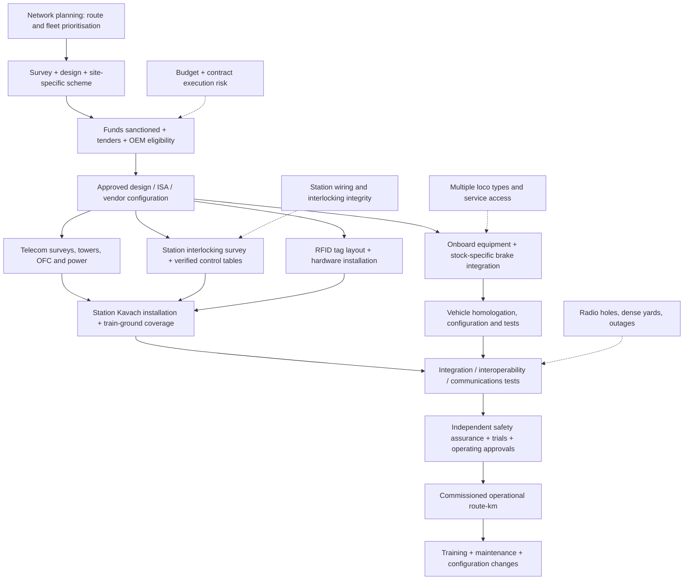

# THE KAVACH RAILWAY REALITY
## Video 27 — Technical, Physics, Procurement and Accident-Forensics Dossier

**Series:** Be Practical with Kishore  
**Research cut-off:** 15 October 2026  
**File type:** Production-ready research notes, **not a finished voice-over script**  
**Evidence hierarchy:** Official RDSO specifications and annexures > Commissioner of Railway Safety (CRS) / Ministry of Railways / Parliament / PIB > contemporaneous reporting > vendor disclosures > engineering estimates.  
**Important provenance note:** This independently assembled research dossier is **not** an export of the separately initiated Deep Research session. It uses publicly accessible sources identified during this chat. Specific claims marked *unverified* or *provisional* must not be presented as established facts in the final video.

---

## EXECUTIVE FINDINGS — WHAT THE VIDEO MUST GET RIGHT

1. **Kavach is an Automatic Train Protection (ATP) system, not an all-purpose train-crash detector.** It supervises movement authority and speed, interfaces with the conventional signalling/interlocking system, and can intervene through brakes within its design conditions. It does not make unsafe interlocking data magically correct. [S1, S4, S9]
2. **As of 31 July 2026, the Ministry reported 2,633 route-km of Kavach 4.0 commissioned on the Delhi–Mumbai and Delhi–Howrah routes:** 1,423 and 1,210 route-km respectively. In September 2026, South Central Railway reported upgrading 108 route-km of the previously Kavach-3.2-equipped Malkajgiri–Kamareddi section to 4.0. Do **not** add these to invent an official all-India aggregate without checking overlap, definitions and reporting date. [S1, S2]
3. **Commissioned ≠ installed ≠ sanctioned ≠ work taken up.** The 31 July 2026 ministry snapshot separately identifies 7,726 route-km of trackside-equipment installation, 11,547 km of optical-fibre cable, 1,721 towers, 1,009 station data centres, and 6,290 locomotives provided with Kavach. None is an interchangeable count of protected operating route-kilometres. [S1]
4. **RDSO approval of Kavach 4.0 was 16 July 2024.** Ministry-listed enhancements include better location accuracy, signalling information for bigger yards, station-to-station interface over optical fibre and a direct interface to electronic interlocking. “4.0 means nationwide 5G-based train control” is **not** supported. [S1, S2, S14]
5. **Balasore (2 June 2023) was a false-proceed / wrong-route failure.** The official accident summary says the UP Home Signal displayed green for the main line while crossover 17A/B was set towards the occupied loop. A standalone claim that Kavach would definitely have prevented, or definitely could never have prevented, this collision is not demonstrated by the publicly examined evidence. [S3]
6. **Kanchanjunga (17 June 2024) involved multiple failures in degraded automatic-signalling procedures.** The CRS action-taken report specifically records the incorrect issue of form **T/A 912 rather than T/D 912** when all signals had failed, absence of a required caution order, missing walkie-talkies, missing train-manager signature and inadequate training. The passenger train was reported to be following the 15-km/h degraded-working procedure; saying Kavach would *automatically enforce 15 km/h in every such failure mode* remains an untested counterfactual. [S3, S10]
7. **SIL-4 is not “zero risk”.** A 10⁻⁹/h figure, when applied, concerns a defined hazardous failure rate and standard/design allocation; it is not a measured collision probability for every complete train trip.
8. **Distance is physics, not marketing.** An emergency brake requires time and distance, and braking performance depends on adhesion, gradient, formation, brake build-up, load, wheel slip and configuration. The calculation table below is illustrative, **not** a certified Kavach braking curve.

---

# DELIVERABLE 1 — TECHNICAL AND FACTUAL VERIFICATION MATRIX

### How the actual system operates

```text
                 Station signalling and interlocking
             [Signals | Point detection | Track occupancy]
                              |
                [Stationary / Station Kavach]
                              |
                 UHF train–ground radio messages
                              |
        [Onboard Kavach vital processing and train database]
             ^                |                    |
             |                |                    v
      Under-train RFID     Speed/odometry     Driver display / alarm
      reads fixed tags     / train position           |
                                              Brake interface
                                                   |
                                          Service/emergency brake

  Optical fibre and station-to-station infrastructure interconnect
  relevant fixed systems; physical tag reads help correct odometry.
```

**Important:** This is a functional schematic, not an OEM wiring or Safety Case diagram. [S4, S6, S7]

| Audited proposition | Finding / documentary-safe formulation | RDSO / official reference | Status |
|---|---|---|---|
| Kavach is ATP | Confirmed: trains are supervised against safe speed/movement limits with automatic braking intervention, subject to proper equipment, data and operating mode. | RDSO/SPN/196/2020, FRS Ver 4.0; MoR PIB 05 Aug 2026 [S1, S4] | **Verified** |
| RFID every 1 km | A publicly indexed RDSO **draft** of specification Ver 4.0 d2 states normal tags should be spaced no more than approximately **1,000 m ± 100 m**, plus special tag sites. Do not infer the final 2024 approved installation drawing from this older draft alone. | RDSO/SPN/196/2020 Ver 4.0 d2, RFID subsection; Annexure H, RFID Tag–TIN Layout Guidelines [S5, S8] | **Provisional: draft/version sensitive** |
| Tags exactly one per km | Misleading: tags also occur by signals, approaches, route-identification points, track sections, exits and potentially duplicates. A government account of the 96-km Bajwa–Ahmedabad deployment reported **2,872 RFID tags**, illustrating why '1 tag per km' is incorrect. | RFID section of RDSO draft; MoR PIB 30 Dec 2025 [S5, S17] | **False oversimplification** |
| RFID passive or powered | Track beacons/labels are generally described as passive RFID; a tag does **not** need a local mains feed like a signalling hut. Before asserting every installed tag's exact powering method, verify the final Annexure F product specification. | RDSO/SPN/196/2020 Ver 4.0, Annexure F; draft tag specification [S5] | **Likely; final hardware detail to confirm** |
| RFID frequency | Indexed RDSO specification gives **865–867 MHz** for the track RFID tag/reader link. This frequency is **not** the station-to-locomotive UHF radio frequency. | RDSO/SPN/196/2020 Ver 4.0 d2, RFID technical requirements [S5] | **Documented in indexed draft** |
| RFID data | Encodes structured location/identity/track information, including tag type, unique ID, absolute position and track identification number (TIN). It is *not* correct to say every tag contains a full live map of the next occupied section; dynamic movement authority arrives from signalling/radio systems. | Annexure D, RFID Tag Data Format, Ver 4.0 Amendment 7 (07 Jun 2024); Annexure C [S7] | **Verified specification-family detail** |
| Station Kavach inputs | Station Kavach connects to signalling/interlocking-related data such as signal aspects, track circuit status, route/point status; application-logic acceptance testing explicitly simulates these field functions. Integration method varies across legacy relay and electronic interlocking sites. | RDSO/SPN/196/2020 Ver 4.0; RDSO SIF-0515 Ver 1.2, 27 Jan 2025 [S6] | **Verified** |
| Station Master interface | A station operation/indication interface is documented, but don't suggest the Station Master manually pilots Kavach or can override safety logic at will. | Annexure Q, Station Master Operation and Indication Panel; RDSO/SPN/196/2020 Ver 4.0 [S12] | **Verified interface; operational details require SOP** |
| Towers 40 m tall every 2–3 km | Telecom towers are essential and thousands are being installed, but a **universal 40-m height and exact 2–3-km separation** was not established by the materials examined. Spacing depends on coverage, terrain, alignment, interference and radio design. | MoR infrastructure progress [S1]; project site specifications needed | **Unverified universal claim** |
| Train–ground radio | A historical RDSO 4.0 draft specifies **UHF 406–470 MHz** full-duplex data modems (25-kHz channel). More recent annexures and approved radio channels must control the statement for current production. | RDSO/SPN/196/2020 Ver 4.0 d2, Annexure E1; Annexure C Amdt-10 (27 Jun 2024) [S5, S7] | **Historical spec supported; check final frequencies** |
| VHF 160 MHz in standard Kavach 4.0 | Not established as the principal Kavach ATP radio link from the examined specifications. Do not conflate railway voice communications with ATP data transport. | RDSO Annexure E1/C [S5, S7] | **Unsupported** |
| 700 MHz LTE-R / 5G already intrinsic to all Kavach 4.0 | Wrong as a blanket assertion. The 2026 Ministry has explicitly sanctioned **LTE-based communication backbone** works for some further routes, but this is **not proof of universal live deployment**, nor confirmation that all train control is 5G. | MoR PIB 15 Jun 2026 and 22 Jun 2026 [S14] | **Partially true about newer sanctioned works** |
| Onboard architecture is 'two vital computers' | SIL-4, fail-safe architectures and onboard vital processing are central, but an exact vendor-independent **dual-VCU arrangement** was not confirmed. A requirement for redundancy is not the same as declaring a fixed board-level architecture for all three OEMs. | RDSO SRS and OEM safety cases [S4, S5] | **Unverified hardware count** |
| Underbody RFID reader | Confirmed technical concept. RDSO draft calls for a reader suitable under a locomotive body, and operation at up to 200 km/h in the specified context. | RDSO/SPN/196/2020 Ver 4.0 d2, RFID reader subsection [S5] | **Documented in draft** |
| Doppler radar + wheel pulse sensors in every locomotive | Train odometry is needed for movement supervision, and RDSO requirements address positioning/speed, but **universal specific sensor pairing** is not established from the reviewed certified BOMs. | RDSO SRS and certified onboard configuration required [S4] | **Unverified universal claim** |
| Brake Interface Unit / automatic braking | Functionally correct: onboard Kavach must interface to locomotive braking and apply interventions when safe limits are threatened. Actual pneumatic/EP command chain varies with vehicle stock and homologation. | FRS/SRS and ministry definition [S1, S4] | **Verified functional claim** |
| DMI / cab display | Functionally confirmed: signalling information, targets, speeds and alerts are available to the driver. 'LP-OCIP' is the document vocabulary, often loosely referred to as DMI. | RDSO Annexure B LP-OCIP, Amdt-3; PIB explainer [S11] | **Verified** |
| SIL-4 means 'failure probability exactly 10⁻⁹/h' | In safety standards a quantitative integrity allocation can involve a **dangerous failure rate band around 10⁻⁹ to below 10⁻⁸ per hour** for high-demand/continuous SIL-4 safety functions under IEC 61508-type framing. Never present 10⁻⁹/h as the measured system-wide accident risk or as an unconditional guarantee. | EN 50126 risk lifecycle; EN 50128 railway control/protection software; EN 50129 safety case for signalling electronics; IEC 61508 framework | **Requires hazard-function-specific qualification** |
| July 2024 4.0 upgrades | The ministry explicitly identifies **increased location accuracy; improved signal aspect information in larger yards; OFC station-to-station interface; direct interface with existing EI**. | MoR PIB, approval **16 Jul 2024** [S1, S2] | **Verified** |
| Automatic route selection in 4.0 | Don't imply ATP substitutes for interlocking route setting. Kavach can interpret the movement authority and relevant track/route information; route selection and securing remain signalling/interlocking functions. | FRS, control tables and signal architecture [S4, S9] | **Correction necessary** |

### Standards glossary

- **EN 50126:** Railway RAMS lifecycle — reliability, availability, maintainability and safety, including hazard management and assurance activities.
- **EN 50128:** Software lifecycle for railway control and protection. Current programmes may reference updated standards and migration arrangements; confirm the exact normative edition in the contract.
- **EN 50129:** Safety-related electronic signalling systems and safety-case evidence. Certification is an assurance process with system boundaries, configurations and assessed functions.
- **SIL-4:** Very stringent assigned safety integrity for defined functions; neither proof of perfect availability nor a promise that every external hazard is detected.
- **Interlocking:** Ensures incompatible routes cannot be validly set; it is the source for signal and point status. ATP supervises movement on the authority it receives. **A false-but-plausible proceed aspect resulting from a wiring failure is a common-cause/interface hazard needing its own safety controls.**

### RDSO document register to retain in the evidence folder

| Document | Identification / edition | Why it matters | Status of inspection |
|---|---|---|---|
| Main functional requirements | **RDSO/SPN/196/2020 — Functional Requirements Specification of KAVACH, Version 4.0** | Supervisory behaviour, high-level functional scope | Indexed; confirm approved amended copy at RDSO |
| System requirements | **RDSO/SPN/196/2020 Version 4.0 d3, Amendment 1, effective 26 May 2023** | Detailed system and interfaces | Direct RDSO link identified [S4] |
| Draft system specification | **RDSO/SPN/196/2020 Version 4.0 d2** | Explicit RFID/UHF and legacy requirements | **Draft: do not represent as 16 Jul 2024 final** [S5] |
| Radio protocol | **Annexure C, Version 4.0 Amendment 10, effective 27 Jun 2024** | Train-ground messages, packet protocol | Edition identified in 2025 railway tender [S7] |
| RFID payload | **Annexure D, Version 4.0 Amendment 7, effective 07 Jun 2024** | Tag identity, track position and structure | Edition identified [S7] |
| RFID installation | **Annexure F, Version 4.0 Amendment 1, effective 27 Jun 2024; Annexure H, Version 4.0 Amendment 5, effective 07 Jun 2024** | Fixing and location conventions | Editions identified [S7, S8] |
| UHF modem | **Annexure E1, Version 4.0, effective 27 Jun 2024** | Modern approved radio requirements | Edition identified; obtain exact annexure [S7] |
| Display | **Annexure B LP-OCIP, Version 4.0 Amendment 3, effective 11 Jul 2024** | Driver interface and presentation | Edition identified [S7] |
| Station interface | **Annexure Q, Version 4.0 Amendment 1, effective 16 Jul 2024** | SM interface | Edition identified [S7] |
| Station logic testing | **RDSO SIF-0515 Version 1.2, 27 Jan 2025** | Independent application logic simulation / factory testing | Official RDSO document [S6] |

**Editorial red line:** Exact clause/page quotations from an approved RDSO document should be added only after obtaining the **correct, approved amendment**. The above is a verified document-number/edition register where possible, **not a fabricated clause-by-clause audit of pages that were not fully inspected**.

---

# DELIVERABLE 2 — TRAIN BRAKING PHYSICS AND SPAD

## Assumptions and equations

These are **engineering demonstrations**, not original Indian Railways emergency-brake acceptance measurements. The 24-coach LHB formation is used only as context; its length, load and brake characteristics do not automatically give one validated deceleration. The 160-km/h case is a Vande Bharat trainset scenario, **not** a 24-coach LHB configuration.

- Convert speed: `v (m/s) = speed (km/h) / 3.6`.
- During assumed detection/communication/actuation delay `t`, travel `d_delay = v × t`.
- After full effective braking at constant deceleration `a`, distance `d_brake = v² / (2a)`.
- Toy model: `d_total = v × t + v²/(2a)`.
- Assumed *effective* emergency deceleration for passenger stock: **0.45–0.80 m/s²**, central illustrative **0.60 m/s²**.
- Assumed *effective* emergency deceleration for loaded freight: **0.25–0.45 m/s²**, central illustrative **0.35 m/s²**.
- Assumed pre-deceleration delay: **3 seconds** for passenger scenarios, **5 seconds** for freight. These are **not measured Kavach reaction times**; they lump detection, processing and brake build-up into a simplified demonstration.
- Level, straight track; no gradient adjustment; no variable adhesion or dynamic braking; air-brake propagation and build-up are simplified.

| Formation | Start speed | Speed in m/s | Assumed delay | Delay distance | Central effective deceleration | Central total stopping distance | Sensitivity range (faster–slower braking) |
|---|---:|---:|---:|---:|---:|---:|---:|
| 24-coach LHB passenger — example | 110 km/h | 30.56 | 3 s | 92 m | 0.60 m/s² | **870 m** | **675–1,129 m** |
| 24-coach LHB passenger — example | 130 km/h | 36.11 | 3 s | 108 m | 0.60 m/s² | **1,195 m** | **923–1,557 m** |
| Vande Bharat trainset — example | 160 km/h | 44.44 | 3 s | 133 m | 0.60 m/s² | **1,779 m** | **1,368–2,328 m** |
| 5,000-tonne freight — example | 75 km/h | 20.83 | 5 s | 104 m | 0.35 m/s² | **724 m** | **586–972 m** |

**Calculation quality:** Formula-valid under stated simplistic assumptions, but **not a field-calibrated EBD**. An official braking curve would require vehicle-specific brake rates, emergency-braking test results, reaction-time distribution, slip/slide performance, gradient margins, traction cut-out, safety factors and target geometry. Actual emergency braking is not constant acceleration throughout the speed range. Passenger/freight braking figures should be revalidated using RDSO/IR braking trial records before giving precision in narration.

### Why delay matters even with automated protection

At 160 km/h, **one second before meaningful deceleration is about 44.4 metres travelled**. Five extra seconds is about **222 metres**. The key question is therefore not whether electronics respond 'instantly', but whether the train gets a trustworthy movement limit sufficiently early to build a safe *speed-versus-distance* profile. A competent ATP system does not merely wait until a red signal is physically reached and then decide to brake.

### SPAD: official evidence and limits

The CRS **Accident-II action-taken summary** for Kanchanjunga specifically quotes **208 SPAD incidents between 1 April 2019 and 31 March 2024**, of which **12 resulted in collision**. This is the figure reproduced in that inquiry context; verify its network coverage and classification against the supporting safety database before saying it describes every SPAD in every Indian Railway reporting category. [S3]

Fog affects how soon a locomotive pilot can read lineside aspects, notice obstructions and judge distance. Cab indication and automatic supervision are important precisely because sighting distance may become unreliable. However, **cab protection does not establish that the route is physically clear** if the underlying interlocking or occupancy inputs are false, absent or not in the protected design envelope.

---

# DELIVERABLE 3 — PROCUREMENT AND ROLLOUT BOTTLENECK: THE ~69,000-KM REALITY

## First define the denominator

The **Indian Railways Year Book 2023–24** provides these *historical, same-year* figures. Do not mix three different kilometre definitions in a single percentage [S16]:

| Metric, as at FY 2023–24 | Value | Meaning |
|---|---:|---|
| **Route-km, all gauges** | **69,181 km** | Length of unique geographic routes, counting parallel tracks once |
| **Running track-km, all gauges** | **109,748 km** | Main running tracks, with parallel lines counted separately |
| **Total track-km, all gauges** | **135,207 km** | Running tracks plus sidings, loops, yards and similar |
| **Electric locomotives** | **10,675** | Recorded electric fleet |
| **Diesel locomotives** | **4,397** | Recorded diesel fleet |
| **Steam locomotives** | **38** | Recorded stock, not ordinary ATP fitment denominator |
| **Total locomotives** | **15,110** | Fleet inventory at this date; not a 2026 live active-fleet number |
| **Passenger carriages (including DEMU/DHMU)** | **66,687** | Coach inventory subclass |
| **EMU/MEMU coaches** | **12,229** | Separate subclass |
| **All coaching vehicles, combined** | **91,948** | Includes categories beyond passenger carriages |

The frequently repeated **'102,000-plus track-km'** does not equal India's total track length. For 2023–24, even running track was **109,748 km**, while total track length was **135,207 km**. Most Kavach ministry statements use **route-km** for coverage.

## Dated rollout snapshots — comparable only within each category

| Reporting date | What the ministry actually said | How to use it |
|---|---|---|
| Before Kavach 4.0 upgrade: SCR base | **1,465 route-km** of Kavach 3.2 in South Central Railway | Historical reference, not incremental 2026 commissioning [S1, S2] |
| 11 Mar 2026 | **1,452 route-km of Kavach 4.0 commissioned** on named busy routes | Dated 4.0 snapshot [S18] |
| 31 Jul 2026 | **2,633 route-km of Kavach 4.0 commissioned** on Delhi–Mumbai (1,423) and Delhi–Howrah (1,210) | Most recent explicit network-scale 4.0 commissioning total located in this research [S1] |
| 31 Jul 2026 | **7,726 route-km trackside equipment installed**, **6,290 locos provided with Kavach**, **1,721 telecom towers**, **11,547 km OFC** | Progress components, **not equivalent to route commissioning** [S1] |
| 31 Jul 2026 | Work on **21,794 route-km** of further trackside rollout; further installation work taken up in **7,190 locos** and **1,200 EMU/MEMU trains** | Work taken up, **not commissioned protection** [S1] |
| 23 Sep 2026 | SCR upgraded **108 route-km Malkajgiri–Kamareddi** from 3.2 to 4.0 | Confirmed later conversion; count only with explicit scope [S2] |
| 28 Sep 2026 | **614.75 route-km** sanctioned in Varanasi Division for ₹223 crore | Approved project, **not operational yet** [S19] |

**Critical arithmetic trap:** `(2,633 / 69,181) ≈ 3.81%` can be stated only as **a simple cross-year comparison of the July 2026 reported 4.0 corridor figure to a FY2023–24 all-gauge historical network route length**. It is **not** an audited national Kavach-protected percentage as of October 2026 (older Kavach 3.2 coverage, overlapping routes, gauge policy, reporting cut-off and other configurations matter). Avoid presenting this as '96.2% is unprotected' without qualification.

## Cost, money and scope

| Item | Documented number | Important qualification |
|---|---:|---|
| Kavach trackside/station equipment | **About ₹50 lakh per route-km** | Indicative ministry estimate, not uniform tender cost or total life-cycle cost [S13, S18] |
| Loco Kavach equipment | **About ₹70 lakh/loco** (early 2024 statement) / **about ₹80 lakh/loco** (2025–26 statements) | Different snapshots; tender scope and taxes matter [S13, S18] |
| 2024–25 Kavach allocation | **₹1,112.57 crore** | Ministry answer; do not conflate with total national railway safety budget [S15] |
| 2025–26 Kavach allocation | **₹1,673.19 crore** | Ministry answer [S18] |
| 2026–27 Kavach allocation | **About ₹2,066 crore** | Reported August 2026 [S1] |
| Funds utilised on Kavach works through June 2026 | **About ₹3,875 crore cumulative** | Cumulative multi-year project expenditure, **not FY2026–27 spending** [S1] |
| Entire railway safety expenditure, FY2023–24 | **₹1,01,662 crore** | **Not** a Kavach-exclusive allocation [S1] |
| Entire railway safety expenditure, FY2024–25 | **₹1,14,022 crore** | **Not** a Kavach-exclusive allocation [S1] |
| Entire railway safety expenditure/budget, FY2025–26 | **₹1,17,693 crore** | **Not** a Kavach-exclusive allocation [S1] |
| European ETCS Level 2 '₹2.5–3 crore/km' | **Not independently validated as a like-for-like benchmark** | Civil works, GSM-R/FRMCS, interlocking changes, signalling geography, quantity, price year, foreign exchange and onboard fleet scope differ |
| Kavach FY2023–24 exclusive allocation | **Not established by sources reviewed here** | Insert only against official budget head / parliamentary breakdown |

**Procurement example illustrating contract-versus-unit-price risk:** Quadrant Future Tek's prospectus states that it had a December 2024 purchase order for fitting **1,200 locomotives** with onboard Kavach aggregating about **₹978.606 crore including taxes**, with final RDSO approval and installation/testing conditions. This order size or order value is **not proof** of operational commissioning or its final cost per train across all OEMs. [S20]

### OEM approval is not the same as an expression of interest

| Vendor / category | Audited status and script wording |
|---|---|
| **Medha Servo Drives** | One of the original three approved suppliers of Kavach 3.2 [S1, S21] |
| **HBL Engineering / HBL Power Systems** | One of the original three; use current legal company naming when quoting an order [S21] |
| **Kernex Microsystems** | One of the original three approved suppliers [S21] |
| **GG Tronics** | Identified among later developmental / trial vendors in a 2025 railway tender [S21] |
| **Quadrant Future Tek** | Developmental / field-trial and contracted activity confirmed; **do not assume unrestricted production certification in 2026** based on a purchase order or an IPO prospectus alone [S20, S21] |
| **Siemens, Alstom, BHEL** | Market interest, projects or development claims are **not equivalent to full RDSO Kavach 4.0 approval**. Confirm each against a dated RDSO approved-vendor directory, part number, ISA assessment and applicable version before citing certification. |

**Manufacturing-capacity gap:** A defensible **sum of certified annual manufacturing capacity versus annual installed/commissioned targets** was not possible from the reviewed consolidated official records. Vendor press releases about planned units, awarded orders, manufacturing throughput and commissioning capacity are *different numerators*. Obtain latest RDSO category-by-category certified vendor capacities and Railway Board annual targets before claiming there is a verified exact capacity shortfall.

### Bottleneck flowchart



**The documentary's strongest procurement angle:** Steel, radios and RFID tags can be manufactured before a corridor becomes an **operational safety system**. Integration into legacy station signalling, correct control tables, field radio testing, braking compatibility, route-by-route proof and independent assurance are commissioning bottlenecks in their own right. The bottleneck **cannot** be reduced to a single raw annual-kilometre manufacturing promise.

---

# DELIVERABLE 4 — DISASTER FORENSICS: BALASORE VS KANCHANJUNGA

## Side-by-side root-cause matrix

| Dimension | **Balasore / Bahanaga Bazar — 2 Jun 2023** | **Kanchanjunga / Rangapani–Chatterhat — 17 Jun 2024** |
|---|---|---|
| Trains and collision | Coromandel Express entered an occupied loop line and struck standing goods train; consequent side collision with Bengaluru–Howrah train | Freight/container train struck Kanchanjunga Express from behind |
| Nature of failure | **Wrong-route/false signalling condition** following signalling-circuit alteration lapses | **Degraded-operation / automatic-signalling failure** plus procedural and communication lapses |
| Official mechanism | UP Home Signal indicated **green for run-through on the main line**, while crossover **17A/B was set towards the loop** occupied by the goods train | CRS listed **T/A 912 issued instead of T/D 912** in all-signals-failed circumstances, missing caution order, unavailable walkie-talkies, missing required train-manager signature, training deficiencies |
| Responsible safety layer | Physical point state, field wiring/indication, interlocking integrity and maintenance testing | Procedure for automatic signalling failure, station-issued authority, speed compliance, train separation and communication |
| Was Kavach present? | No operational installed protection at the crash location was established in the referenced accident record | No Kavach protection commissioned there at the time is indicated in reviewed contemporaneous material |
| What Kavach *can* do in principle | If movement authority or correct restrictive information is available, supervise speed/authority and intervene; BUT no basis to promise detection of falsely healthy interlocking inputs | Where commissioned, healthy and correctly configured, ATP may enforce trustworthy movement limits and supervision rather than relying exclusively on driver sighting and instructions |
| Counterfactual limit | **Cannot assert Kavach definitely prevents this specific wrong-route accident** if it receives plausible but false proceed data; likewise 'could not possibly' is too categorical without design-specific track discrimination and hazard analysis | **Cannot assert universal automatic 15-km/h clamping** under every 'signals failed' contingency without exact onboard mode, availability of movement authority and rule-to-mode implementation |
| Primary source | CRS accident finding / action-taken summary, Accident-I [S3] | CRS accident finding / action-taken summary, Accident-II [S3] |

## Balasore: the precise lesson

Official CRS text points to **earlier and contemporaneous failures in signalling-circuit alterations** near Bahanaga Bazar. The green aspect was **not truthful about the physically aligned route**. This distinction matters for ATP: a protection computer supervising a proceed aspect does not necessarily have independent, safety-rated knowledge of the turnout's *real* position. Specific Kavach capabilities such as RFID-based line recognition may influence behaviour in a particular deployment, but without the approved hazard log, tag placement, train state and route data for this hypothetical site, a definitive prevention claim is unwarranted. [S3]

**Safe script phrase:** “Kavach is designed to catch dangerous train movement, but Balasore exposes a different and deeper question: what if the very signalling data given to the protection system is wrong? The fix also requires verified interlocking, wiring discipline and independent safety checks.”

## Kanchanjunga: failure of the degraded-working safety chain

The official CRS accident summary calls this an **'Error in Train Working'** event involving lapses at multiple levels in handling automatic signal failures. The prescribed authority and caution-order failures matter; this should not be reduced to a moral story about one careless driver. [S3]

Contemporaneous reporting of the provisional CRS inquiry says **Kanchanjunga Express followed the maximum 15-km/h rule and stopped one minute at defective signals**, while different trains in the section acted inconsistently. The inquiry distinguished procedures under signal failures and faulted deficient coordination and training. This evidence does *not* prove every Kavach mode in defective signalling automatically issues a safe, occupancy-aware authority. [S10]

**Safe script phrase:** “In the Kanchanjunga case, the danger was not just a red light. It was a failed signalling system, ambiguous or incorrectly issued authority, missing caution instructions and communication breakdown. ATP can reduce dependence on human compliance—but it must know which movement is actually permitted.”

### Stop making these five unsupported video claims

1. **“Balasore would definitely never have happened if Kavach was installed.”** Too strong; depends on what inputs the ATP trusted.
2. **“Balasore proves Kavach is useless.”** Equally wrong; it illustrates the limits of one safety layer and the need for trustworthy interlocking.
3. **“Kanchanjunga's freight loco was legally allowed to run at full speed because TA 912 was issued.”** An authority to pass a failed signal does **not**, by itself, remove applicable restrictive working rules; the CRS criticised the authority and caution-order procedures.
4. **“Kavach 4.0 always means LTE-R / 5G.”** Radio technology, installed network and future LTE-backbone projects need separate explanation.
5. **“All 69,000 route-km will be covered as soon as the government purchases enough tags.”** Installation requires working station signalling, radio coverage, integrated locomotives, tested movement authority and safety acceptance.

---

# DOCUMENTARY STORY SPINE (NON-VOICE-OVER OUTLINE)

**Act 1 — The promise (0:00–1:30):** Show a locomotive approaching a restrictive movement authority and the driver's in-cab display. Explain what ATP can actually command; do not claim it can see every obstacle.

**Act 2 — The machinery (1:30–4:00):** Film sleeper RFID tags, a genuine onboard reader, interlocking diagram, station Kavach hut, UHF antenna and brake hardware. Clearly distinguish real footage from a conceptual animation. Overlay the verified radio / tag frequencies without conflating them.

**Act 3 — The uncomfortable physics (4:00–5:30):** A 130-km/h moving train covers ~36 m each second. Animate the modelled ~1.2-km illustrative stop with a visible disclaimer: not a certified braking figure.

**Act 4 — Two crashes, two different failure classes (5:30–8:30):** For Balasore show incorrect mainline green against crossover set to loop. For Kanchanjunga show failed automatic-signalling operating authority and missing caution instructions. Explain bounded rather than sensational counterfactuals.

**Act 5 — The rollout audit (8:30–11:00):** Put a date on every kilometre figure; contrast installed equipment and actually commissioned routes. End with the key public-interest question: 'How do we verify a complete, tested train-protection chain—not just a purchased equipment list?'

### Footage and graphic requirements

- Visualise **route-km / running track-km / total track-km** as three different network maps; never reuse the same denominator.
- For braking animation, show **assumed deceleration + delay**, and only then the modelled stopping distance.
- For Balasore, avoid invented cockpit conversations, made-up electronic log entries, or fabricated CRS quotations.
- For Kanchanjunga, clearly show **T/A 912 and T/D 912 as distinct authorities**; do not manufacture scans of actual forms or depict them as identical.
- For procurement, animate **planned → equipped → tested → commissioned** as discrete pipeline stages.

---

# SOURCE REGISTER — LINKS AND WHAT EACH SUPPORTS

**Primary government / standards sources**

- **[S1]** Ministry of Railways / PIB, **5 August 2026**, “Indian Railways Utilises More Than ₹1.14 Lakh Crore…”, Kavach 4.0 and corridor tables; 31 July snapshot, equipment, costs and funding: https://www.pib.gov.in/PressReleasePage.aspx?PRID=2294805&lang=1&reg=48
- **[S2]** Ministry of Railways / PIB, **23 September 2026**, upgrade of 108 route-km Malkajgiri–Kamareddi, South Central Railway: https://www.pib.gov.in/PressReleasePage.aspx?PRID=2313758&lang=1&reg=3
- **[S3]** **Commission of Railway Safety**, *Action Taken Report* published by CRS (PDF title `ATR-2025.pdf`), **pp. 1–4** covering Balasore (Accident-I) and Kanchanjunga (Accident-II), plus SPAD finding on p. 5: https://crs.gov.in/wp-content/uploads/2026/01/ATR-2025.pdf
- **[S4]** **RDSO**, *System Requirement Specification of Kavach*, **RDSO/SPN/196/2020, Version 4.0 d3, Amendment 1 (26 May 2023)**: https://rdso.indianrailways.gov.in/uploads/files/System%20Requirement%20Specification%20of%20Kavach%20%28The%20Indian%20Railway%20ATP%29%20Amdt-1-26-05-2023.pdf
- **[S5]** **RDSO**, Version 4.0 **d2 draft**, detailed RFID / UHF specifications, **use only as a draft-era reference**: https://rdso.indianrailways.gov.in/uploads/files/Kavach%20%28The%20Indian%20Railway%20ATP%20System%29-RDSO-SPN-196-2020%20version%204-0d2.pdf
- **[S6]** **RDSO**, *Factory Acceptance Test Scheme for Stationary KAVACH Application Logic*, **SIF-0515 Version 1.2, 27 Jan 2025**: https://rdso.indianrailways.gov.in/uploads/2025-01-28-Final%20FAT%20Testing%20Procedure%20Ver%201_2%20Dated%2027-01-2025.pdf
- **[S7]** Publicly indexed Southern Western Railway Kavach developmental tender, 31 May 2025, with exact approved RDSO **Annexures B/C/D/E1/F/G/H/P/Q** version register (secondary host; confirm official document against the procurement portal): https://www.scribd.com/document/885655226/v1-24062025-Reach-8
- **[S8]** **RDSO**, *Annexure H: RFID Tag–TIN Layout Guidelines*, indexed prior Amendment 4 (for pattern reference, do not substitute for Amendment 5): https://rdso.indianrailways.gov.in/uploads/files/Annexure-H%20-KAVACH%20RFID%20Tag-TIN%20Layout%20guidelines%20Admt-4_0.pdf
- **[S9]** **RDSO**, *KAVACH Control Table Guidelines*, Amendment 5 archived example of actual station control table mapping: https://rdso.indianrailways.gov.in/uploads/Specification%20of%20KAVACH%20%28The%20Indian%20Railway%20ATP%29-KAVACH%20Control%20Table%20Guidelines-%20Amdt-5.pdf
- **[S11]** Ministry of Railways / PIB explainer of ATP cab signalling and movement/target information, Feb 2026: https://www.pib.gov.in/PressNoteDetails.aspx?ModuleId=3&NoteId=157230&lang=1&reg=48
- **[S12]** Station-master-operation panel Annexure Q version register: see the 31 May 2025 railway tender at [S7].
- **[S13]** Ministry of Railways / PIB, early **2024** written reply, trackside ~₹50 lakh/km and loco ~₹70 lakh: https://www.pib.gov.in/PressReleaseIframePage.aspx?PRID=2003511&lang=2&reg=48
- **[S14]** Ministry of Railways / PIB, **15 Jun 2026**, Ahmedabad work approved under an **LTE-based communication backbone** programme (not commissioned-LTE national assertion): https://www.pib.gov.in/PressReleasePage.aspx?PRID=2272922&lang=1&reg=3
- **[S15]** Ministry of Railways / PIB, 2024–25 Kavach allocation **₹1,112.57 crore**, cumulative utilisation reported in 2024: https://www.pib.gov.in/Pressreleaseshare.aspx?PRID=2078090&lang=2&reg=48
- **[S16]** **Indian Railways Year Book 2023–24**, official statistical table, route/running/total track and rolling-stock totals: https://rdso.indianrailways.gov.in/railwayboard/uploads/directorate/stat_econ/2025/IR%20Year%20Book%202023-24-English.pdf
- **[S17]** Ministry of Railways / PIB, **30 Dec 2025**, 96-km Bajwa–Ahmedabad project with 2,872 RFID tags: https://www.pib.gov.in/PressReleasePage.aspx?PRID=2209720&lang=1&reg=3
- **[S18]** Ministry of Railways / PIB, **11 Mar 2026**, 1,452 route-km Kavach 4.0 commissioned; ~₹80 lakh/loco; 2025–26 allocation ₹1,673.19 crore: https://www.pib.gov.in/PressReleasePage.aspx?PRID=2238425&lang=2&reg=48
- **[S19]** Ministry of Railways / PIB, **28 Sep 2026**, approval for 614.75 route-km in Varanasi Division, ₹223 crore: https://www.pib.gov.in/PressReleasePage.aspx?PRID=2316065&lang=1&reg=6
- **[S20]** **Quadrant Future Tek** prospectus, Dec 2024 CLW on-board Kavach order terms and RDSO final approval condition: https://www.quadrantfuturetek.com/assets/frontend/pdf/Prospectus.pdf
- **[S21]** Railway tender identification of original three and further field-trial OEMs (developmental-vendor status distinct from approval): https://www.scribd.com/document/885655693/Reach-9-Technical-Bid-New-Vendor-Kavach-SWR

**Crash-related corroboration**

- **[S10]** *The Indian Express*, July 2024 discussion of preliminary CRS Kanchanjunga findings on 15-km/h working and procedures: https://indianexpress.com/article/cities/kolkata/railway-safety-report-points-failure-automatic-signal-lapses-multiple-level-train-accident-darjeeling-9457597/
- Additional parliamentary reproduction of Balasore CRS cause (for redundancy): https://sansad.in/getFile/annex/260/AU309.pdf?source=pqars
- Parliamentary discussion of June 2024 Kanchanjunga collision: https://sansad.in/getFile/debatestextmk/18/III/11122024.pdf?source=loksabhadocs

---

# UNRESOLVED EVIDENCE REQUESTS BEFORE LOCKING THE SCRIPT

- Obtain **approved, consolidated RDSO/SPN/196/2020 Version 4.0 (July 2024)** with all final annexures and clause/page pointers; the readily accessible d2/d3 versions are not safe substitutes for every 2024 approved requirement.
- Obtain **ISA/SIL-4 safety case** per certified OEM and precise hazardous-function definition, including actual odometry sensors and redundant-vital-controller configuration.
- Obtain section-specific **radio coverage design**, tower drawings and confirmed radio bands, explicitly distinguishing UHF data radio from LTE backbone upgrades and railway voice radio.
- Obtain **rolling-stock braking curves** for representative 24-coach LHB, Vande Bharat at 160 km/h and 5,000-tonne freight trains on defined gradients and adhesion conditions.
- Obtain year-wise **2023–24 exclusive Kavach** budget head, latest yearly vendor **certified output capacities** and deployment targets; avoid inventing national aggregate manufacturing capacity.
- Obtain current **RDSO approved-vendor directory** distinguishing developmental, approved-for-prototype, and approved-for-supply statuses for Medha, HBL, Kernex, Quadrant, GG Tronics, Siemens, Alstom and BHEL.
- Obtain full CRS crash reports, not only official action-taken summaries, before asserting any **specific Kavach counterfactual**.
- Obtain an official **October 2026** nationwide commissioned route-km reconciliation; the most recent explicit ministry corridor total independently verified for this report is as of **31 July 2026**, supplemented by the distinct SCR 108-km upgrade of 23 September.

---

**Final editorial rule:** For Be Practical with Kishore, the film should neither sell Kavach as magical collision immunity nor dismiss it because it cannot fix all signalling failures. Explain the precise barrier it adds, where the inputs can fail, why trains take distance to stop, and why a properly commissioned ATP corridor is much more than tags or towers.
