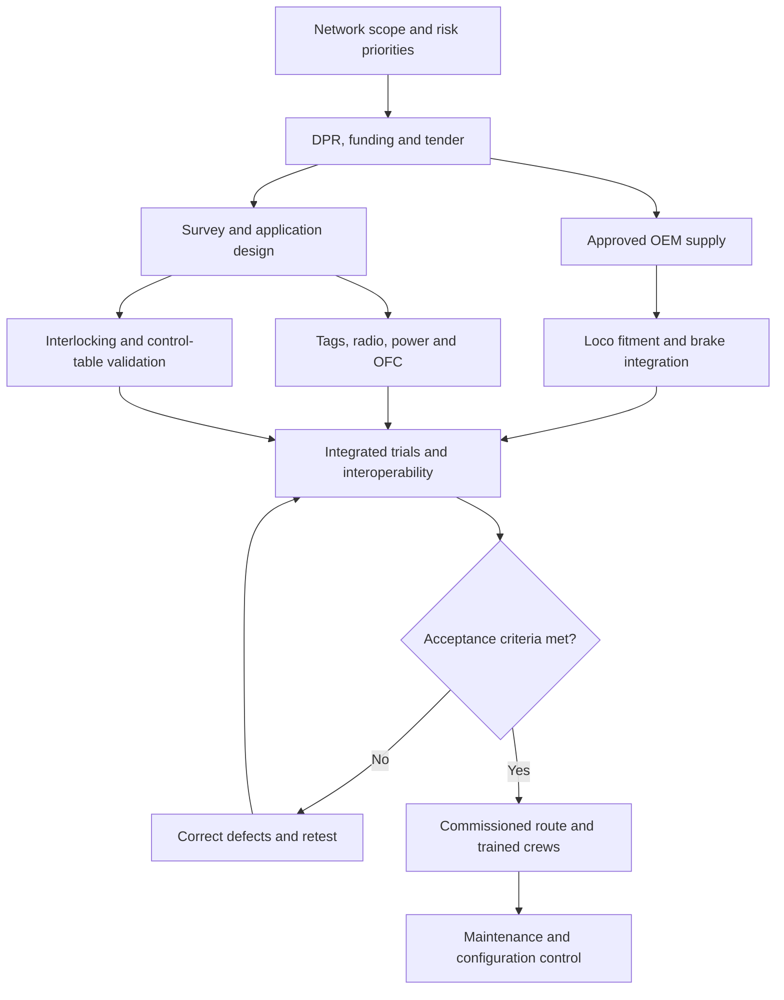

# Video 27 — The Kavach Railway Reality

Technical, braking-physics, procurement and accident-forensics audit for **Be Practical With Kishore**.

Research cut-off: **15 October 2026, India time**. Every rollout figure below retains its own reporting date. This is a documentary research dossier, not an operating instruction or a railway safety certification.

## Editorial finding

Kavach is a substantial additional protection layer against excessive speed and exceeding a valid movement authority. Its effectiveness depends on the equipped train, commissioned infrastructure, trustworthy application data, operating mode and available braking distance. Neither “Kavach prevents every collision” nor “a green signal makes Kavach completely blind” is an adequate technical description.

The supplied prompt contains assumptions that should be corrected before scripting:

1. RFID spacing is a **maximum-distance and location-specific layout rule**, not one tag exactly every kilometre.
2. The established Kavach train–trackside data radio uses UHF; 160 MHz voice radio and 700 MHz railway LTE are different layers. Version 4.0 is not evidence that every installation uses LTE or 5G.
3. Minimum 2-out-of-2 vital processing is a safety architecture, not simply two ordinary computers with a spare.
4. SIL-4 is about specified safety functions, their failure-rate targets and development assurance. It does not promise a network-wide accident interval.
5. A 24-coach locomotive-hauled LHB train and Vande Bharat are different braking configurations. Speed, mass and coach count cannot establish exact EBD.
6. The Balasore counterfactual cannot be settled by saying Kavach definitely would, or definitely could not, prevent the accident.
7. An automatic-signal failure does not, by itself, prove universal automatic enforcement of 15 km/h in every Kavach mode.
8. Installed trackside hardware, commissioned route coverage, older-version coverage and awarded works are different quantities.

Evidence labels: **Verified** means supported by the identified primary source; **Qualified** means a narrower statement is supported; **Calculated** means transparent arithmetic using stated assumptions; **Unresolved** means the evidence retrieved does not establish the requested fact.

---

## Deliverable 1 — Technical and factual verification matrix

### 1A. Trackside architecture

| Prompt claim | Audit result | Technical finding | Document reference / evidence |
|---|---|---|---|
| RFID tags every 1 km | Qualified | The maximum interval between consecutive tags in the cited 4.0 layout is 1,000 m. Signals, turnouts, boundaries and other locations require additional tags. This is not a fixed installation density. | RDSO/SPN/196/2020, Annexure-H, RFID Tag–TIN Layout Guidelines, Amdt-5, 03 June 2024 [S1]; independently corroborated by IRISET-hosted June 2026 presentation, slide 10 [S2]. |
| Tags need external power | Incorrect | Trackside RFID tags are passive. The onboard reader supplies interrogation energy. Powered readers, radios and computers must not be confused with the tags. | Southern Railway, “Features of Kavach,” 17 April 2024, architecture paragraphs [S3]. |
| Every tag stores distance to next signal and turnout | Overstated | Tag ID, track identity and location/direction-related data support localization. Approaching-signal information and movement authority are supplied by stationary Kavach and its application database. Do not depict a passive tag as a live red/green signal transmitter. | [S3]; RDSO radio protocol profile packets [S4]. Exact current Annexure-D bit-field contents remain an evidence gap. |
| Station Kavach interfaces with EI and relay interlocking | Verified, with interface caveat | It acquires signaling/route/occupancy information through approved interfaces. Remote Interface Units can bring distant signaling inputs over OFC. An EI data interface and relay-contact acquisition have different implementation details. | RDSO Annexure-I, Amdt-6, effective 07 June 2024, clauses I.2.2 and I.2.6–I.2.8 [S5]; CAMTECH §2.2.1.4 [S6]. |
| Station Master desk operates Kavach | Qualified | SM-OCIP provides health indications and emergency SOS generation/cancellation. Do not show it as a replacement for the station’s route-setting/interlocking controls. | CAMTECH §2.2.1.3, printed p.24 [S6]; RDSO type-test §5.4.3.2 [S7]. |
| Every mast is 40 m, every 2–3 km | Not a universal rule | The handbook describes typical 40 m towers, also mentions 30/40 m structures, and places radio sites according to coverage and signaling locations. The fixed 2–3 km assertion is not established by the retrieved specification. | CAMTECH §§3.5 and 3.11, printed pp.32 and 42 [S6]. |

RFID is a track-location reference. Between tag reads, odometry estimates movement; the next validated reference constrains accumulated error. A railway yard needs line identity, direction, track topology and route-specific data, because nearby parallel tracks cannot safely be treated as one geographical corridor.

### 1B. Keep the communications layers separate

| Layer | Verified role / frequency | What the video should say |
|---|---|---|
| Kavach UHF safety-data radio | RDSO Annexure-C §C.3.1.3 specifies equipment suitable for **406–470 MHz**; §C.3.1.2 gives a 2,000 ms multiple-access frame in the cited revision. | This is a supported equipment band, not permission to use any arbitrary frequency in it. Actual channels require the approved frequency plan. [S4] |
| Railway VHF voice sets | Separate operational communication equipment. | Do not label approximately 160 MHz voice radio as Kavach’s standard UHF ATP data bearer. Missing walkie-talkies can be operationally serious without being a Kavach radio failure. |
| GSM/GPRS and LTE connections | Can serve monitoring, key management or other defined interfaces. | A cellular antenna alone does not establish that the safety movement-authority link runs over LTE. [S6, S7] |
| Railway LTE in 700 MHz | Cabinet approved 5 MHz spectrum allotment in the 700 MHz band in June 2021. | Spectrum allocation is enabling infrastructure, not proof that a particular corridor is commissioned with LTE Kavach. [S8] |
| Version 4.0 interface provision | Type-test material includes Ethernet interfacing for radio communication labelled LTE/5G. | Interface provision, product approval, bearer deployment and operational commissioning are separate milestones. [S7] |

The engineering question in a dense corridor is whether the approved bearer, radio coverage, message scheduling, handover and failure behavior support the required traffic and safety functions. “It has 5G, so collisions are impossible” is not an engineering argument.

### 1C. Onboard architecture

| Component | Finding | Exact reference available in the retrieved record |
|---|---|---|
| Vital computer | Minimum **2-out-of-2** architecture. Both safety channels must support a permissive decision; fault detection must prevent unsafe outputs within the validated design. This does not make common erroneous external data harmless. | RDSO 4.0 hardware type-test template, §5.4.3.3, referencing SRS §3.5.2.1; stationary equivalent §5.4.3.1 / SRS §3.4.4.1. [S7] |
| RFID readers | Two onboard readers are specified; underframe mounting interrogates track tags. | SRS Ver.4.0 d3, 03 June 2022, §3.5.1(b) and §4.1.1(c); draft baseline, not represented here as the final July 2024 issue. [S9] |
| Speed and distance | Direction-sensing speed/pulse-generator inputs are evidenced. **Universal mandatory Doppler radar is not established** by the retrieved material. | [S9], §4.1.1(g); [S7], §5.4.3.3 referencing SRS §3.5.2.3. |
| Brake interface | Kavach commands the existing brake system; the interface supports traction cut-off and pressure feedback. Brake-system variants need their approved integration. | [S7], SRS §3.5.2.3 references; locomotive-specific RDSO/CoE interface material [S10]. |
| BIU and pneumatic action | Normal/service/emergency commands are distinguished. In a conventional automatic air-brake system, reducing brake-pipe pressure commands distributors to apply brakes from stored air; Kavach does not invent extra wheel–rail adhesion. | CAMTECH §2.3.5, printed p.30 [S6]; pneumatic explanation is engineering interpretation. |
| DMI / LP-OCIP | Presents current/permitted/target speed, movement authority, signal aspects, mode and warnings. Available protections must be understood in the displayed mode. | SRS d3 §3.5.1(e), §4.1.1(a) [S9]; CAMTECH §2.3.4 [S6]. |

For animation, show the physical chain: verified route/occupancy inputs → stationary safety logic → authenticated radio information → onboard localization and speed supervision → brake command → pneumatic/electropneumatic brake response. The stopping process continues after the computer issues the command.

### 1D. SIL-4 and the CENELEC standards

| Standard family | Meaning for the documentary | Source |
|---|---|---|
| EN 50126 | Lifecycle process for reliability, availability, maintainability and safety, including system risk work and demonstration. | Standards publisher BSI [S11]. |
| EN 50128 | Software-development process and technical requirements for railway control/protection software. | BSI [S12]. |
| EN 50129 | Safety-related electronic signaling systems and their safety justification/acceptance. | BSI [S13]. |

The commonly cited railway SIL-4 band is **10⁻⁹ ≤ THR/TFFR < 10⁻⁸ per hour per safety function**, using the terminology appropriate to the standard edition. A specific project may allocate a more stringent target. A research paper’s allocation table documents the distinction between failure-rate and hazard-rate formulations [S14].

Interpret this as quantitative assurance for defined functions combined with rigorous design, verification and assessment. It is **not** the probability of any possible accident on Indian Railways in the next hour. Ordinary equipment faults, safe shutdowns and dangerous undetected failures are different events. Systematic software/configuration failures also require lifecycle controls; one cannot validate them by simply waiting a billion hours.

Use the editions named in the actual certificate and safety case. BSI marks EN 50128:2011+A2:2020 withdrawn in November 2023 [S12]; the existence of a later standard does not, by itself, invalidate an earlier contractual certificate. This audit did not retrieve every OEM’s full 4.0 safety certificate, scope, software baseline and application conditions. Therefore it does not certify that all marketed hardware or all modes are covered identically.

### 1E. Version 3.2 → 4.0

**Verified approval date: 16 July 2024, by RDSO.** Do not substitute “Railway Board approved 4.0 in July” for the more precise attribution unless the separate Board instrument is cited. Government’s stated upgrades are better location accuracy, improved signal-aspect information in larger yards, station-to-station OFC interface and direct EI interface [S15].

An IRISET-hosted HBL presentation dated 29 June 2026 supplies additional implementation detail: RF-based linking across tag types; a changed start-of-mission transition to On Sight and then Full Supervision; and degraded-mode transitions when radio communication or tag validation is lost. Its discussion of an unknown/foreign tag includes brake action and SOS behavior [S2]. This is valuable training material, but is not a substitute for the governing RDSO specification and its current amendments.

“Automatic route selection” needs careful wording. **Interlocking/traffic control sets the route; Kavach identifies and supervises the applicable route.** Improved yard information does not mean Kavach independently moves the points to choose a destination.

---

## Deliverable 2 — Braking physics, reaction distance and SPAD

### 2A. What can actually be calculated

An exact EBD requires an approved formation-specific brake model or matching trials. A statement such as “5,000 tonnes at 75 km/h” does not specify brake power, train length, loaded/empty brake setting, adhesion, gradient or brake propagation.

For an educational constant-deceleration model:

\[
v=V/3.6,\quad d_b=\frac{v^2}{2a},\quad d_{delay}=v t_b,
\]
\[
d_{command\to stop}=v t_b+\frac{v^2}{2a},\qquad
t_{command\to stop}=t_b+\frac{v}{a}.
\]

An added human recognition/reaction time gives **d_h = v t_h**. Here the brake delay is represented conservatively as an equivalent no-deceleration interval; real brake force builds progressively. These formulas exclude rotational-inertia corrections, variable deceleration, speed-dependent resistance, adhesion variation and controller margins.

### 2B. Transparent calculation table — illustrative, not measured EBD

Assumptions: level tangent track; constant effective deceleration after an equivalent delay; maintained adhesion; optional additional human reaction **2 seconds**. LHB example: a = 0.70 m/s², delay = 5 s. Vande Bharat example: a = 1.00 m/s², delay = 1.5 s. Freight example: a = 0.30 m/s², delay = 10 s. **These decelerations and equivalent delays are analyst-selected scenarios, not asserted test results or approved Kavach settings.**

| Formation scenario | Speed km/h | Speed m/s | Braking-only distance m | Equivalent brake-delay travel m | Command-to-stop distance m | Command-to-stop time s | Extra 2 s human reaction m |
|---|---:|---:|---:|---:|---:|---:|---:|
| 24-coach LHB illustration | 110 | 30.56 | 667 | 153 | **820** | 48.7 | 61 |
| Same LHB model | 130 | 36.11 | 931 | 181 | **1,112** | 56.6 | 72 |
| Same LHB model, hypothetical speed | 160 | 44.44 | 1,411 | 222 | **1,633** | 68.5 | 89 |
| Vande Bharat, separate illustration | 160 | 44.44 | 988 | 67 | **1,054** | 45.9 | 89 |
| 5,000-tonne freight illustration | 75 | 20.83 | 723 | 208 | **932** | 79.4 | 42 |

Rounding is to the nearest metre; differences from summing rounded columns are normal. Add the final column only when modeling detection by a human with that assumed reaction delay. It is not part of the measured/required braking distances in the next table. Automated intervention also has sensing, processing, communications and actuation latency; do not portray its reaction time as zero.

The LHB 160 km/h row is a mathematical illustration, **not authority for a specific 24-coach formation to operate at 160 km/h**. A Vande Bharat trainset cannot inherit the stopping behavior of a locomotive-hauled rake merely because both use LHB-derived construction.

### 2C. Official anchors — keep these distinct from the model

| Source | Verified number | Proper interpretation |
|---|---|---|
| RDSO speed certificate LHB/WAP7 formation, **LH/EO/VAR/78**, 09 December 2020, §2.3.1, printed p.3 | **940 m at 130 km/h**, 24 loaded LHB coaches plus one WAP7, level tangent track | **Full-service** braking trial result in the certificate, not an emergency-braking result and not a universal figure for every LHB rake. [S16] |
| ICF MD SPEC-398, issue 01 / rev 00, 04 April 2022, §2.6.4, printed p.23 | Vande Bharat emergency stop from 160 km/h in **less than 1,250 m** | Procurement requirement for the specified train, not a declaration of what every operating Vande Bharat actually achieves. §3.48.9 identifies the loading/track basis. [S17] |
| RDSO-hosted 2021 LHB air-brake handbook | Indexed text gives an emergency-braking benchmark of **within 1,200 m from 160 km/h** | The full formation qualification could not be inspected in this retrieval. Do **not** apply this to the requested 24-coach rake. Hold from narration pending the complete passage. [S18] |

No matching verified trial EBD was established here for the requested 24-coach LHB rake at 110, 130 and 160 km/h, or the specified 5,000-tonne freight train at 75 km/h. The calculation table supplies reproducible scenarios in their place.

### 2D. The physical lessons

At unchanged deceleration, increasing speed from 130 to 160 km/h increases braking-only distance by **about 51.5%**, since it scales with v². A 5,000-tonne mass at 75 km/h carries approximately **1.085 GJ** of translational kinetic energy; this does not include rotating components.

Mass does not alone determine stopping distance. In d = mv²/(2F), mass cancels if braking force scales proportionally with mass. Actual loaded freight behavior depends on brake force per tonne, available adhesion and train-brake response.

For the illustrative freight model, a 1-in-100 falling gradient changes effective deceleration from 0.30 to approximately 0.202 m/s² if all other modeled forces are held fixed. Command-to-stop distance then rises from about 932 m to **1,283 m**. This is an explicit sensitivity calculation, not a route-specific prediction.

Kavach’s main advantage is braking **early enough against the supervised target**, rather than waiting until the driver visually discovers an obstacle. It cannot reverse the energy already present or guarantee a stop after danger is discovered inside the physical stopping distance.

### 2E. SPAD and fog

The Commission of Railway Safety’s 2024–25 accident abstract records **208 SPAD cases from 1 April 2019 to 31 March 2024; 12 resulted in collisions**. Locator: Accident XI, recommendation 3.4, printed p.50 / PDF page 59 [S19]. This is a five-year historical window, not a 2026 annual count. SPAD should not be equated with every rules-authorized passage of a signal at danger.

Visibility arithmetic illustrates the limitation: if a usable indication becomes recognizable only 100 m away, time available is 3.27 s at 110 km/h, 2.77 s at 130 km/h and 2.25 s at 160 km/h. Two seconds of human reaction at 130 km/h consumes about 72 m before brake action begins. **The 100 m visibility and 2 s reaction are scenarios, not measurements of a particular fog event or driver.**

The point applies to fog-prone northern and eastern corridors: additional cab information and automatic supervision reduce reliance on visual detection alone. Fog Safety Devices and ATP are distinct; a location-based landmark warning is not itself a live signal authority. Government separately lists these technologies [S20]. Do not imply that trains must run at normal clear-weather speeds in fog, or that Kanchanjunga’s June crash was a winter-fog accident.

---

## Deliverable 3 — Procurement and rollout: the network-scale reality

### 3A. Correct the denominator

The Indian Railways Year Book 2024–25 gives the following **as of 31 March 2025**, not October 2026 [S21]:

| Measure | Official series | Meaning |
|---|---:|---|
| Route length, all gauges | **69,439 route km** | Each route counted once. |
| Broad-gauge route length | **67,372 route km** | More relevant baseline for broad-gauge deployment discussion. |
| Running track length | **111,641 track km** | Includes parallel running lines. |
| Total track length | **137,522 track km** | Includes other tracks/yards/sidings in the published series. |
| Diesel locomotives, summary table | **4,296** | Stock count, not same-day available active fleet. |
| Electric locomotives, summary table | **11,762** | Same definition caveat. |
| Diesel + electric, calculated | **16,058** | Excludes 34 steam locomotives; total including steam is 16,092. |
| Passenger carriages, including DEMU/DHMU | **70,969** | Not all coaching stock. |
| EMU/MEMU coaches | **13,263** | Separate published category. |
| Total coaching stock | **98,173** | Includes 13,935 other coaching vehicles and 6 rail cars. |

Source locators: summary table printed p.4 / PDF page 6; network printed p.61 / PDF page 63. The same yearbook’s traction chapter, printed p.92, separately reports **12,308 electric locomotives**, conflicting with its 11,762 summary entry. Do not silently combine these series or claim an exact “active fleet.” The discrepancy requires reconciliation with the underlying statistical statement.

“About 68,000 route km” is a dated shorthand. “102,000 total track km” confuses an older running-track series with total track length. More coaches do not mean one onboard Kavach computer is installed in every unpowered passenger coach; fitment is organized around locomotives and trainsets.

### 3B. Deployment ledger — dates and scope retained

| Reporting point | Figure | Audit interpretation | Source |
|---|---:|---|---|
| Mid-2024 baseline, confirmed in 07 August 2024 parliamentary answer | **1,465 route km; 144 locomotives on SCR** | Historical deployed baseline. | [S22] |
| Same parliamentary answer, Delhi–Mumbai / Delhi–Howrah works | About **3,000 route km** project; **1,384 route km** trackside equipment | Project and component progress, not 3,000 km commissioned. Also 4,275 km OFC, 364 towers, 285 station-equipment locations, 319 loco-equipment installations in that project report. | [S22] |
| 13 February 2026 release | **1,297 route km of version 4.0** | Dated commissioned figure; do not combine casually with other February releases using different section lengths. | [S23] |
| **31 July 2026**, reported 05 August | **2,633 route km of version 4.0 commissioned** | Clearly dated national 4.0 snapshot retrieved: **1,423 km Delhi–Mumbai grouping; 1,210 km Delhi–Howrah grouping**. | [S24] |
| Same August release | **7,726 route km** trackside equipment; **6,290 locos** equipped | Component completion does not equal operational route coverage. | [S24] |
| Same August release | **11,547 km OFC; 1,721 towers; 1,009 station data centres** | Different units; OFC length may include separate cables/routes and is not commissioned railway route length. | [S24] |
| Same August release | Works taken up on **21,794 route km**; installation work on **7,190 locos and 1,200 EMU/MEMU** | Works pipeline, not additional commissioned coverage. | [S24] |
| **23 September 2026** | **108 route km, Malkajgiri–Kamareddi** | Explicitly an **upgrade from 3.2 to 4.0**. New 4.0 coverage but not 108 newly protected route km across all versions. | [S15] |
| October regional update | Pagidipalli–Vishnupuram 131 route km reported | A later regional announcement is a lead for refreshing the ledger, not a substitute for a reconciled national census. Primary commissioning record was not retrieved in this audit; exclude from an exact national sum. | Evidence gap |

The 2,633 km figure is **not presented as the exact all-version total on 15 October 2026**. Neither is 2,633 + 1,465 automatically a verified current total: upgrades, interfaces, scope and operational availability need a section-level reconciliation.

The August grouping even includes the Vadodara–Ahmedabad branch; therefore a 1,423/1,500 calculation is not a valid percentage for the exact Delhi–Mumbai end-to-end alignment.

### 3C. Vendor ecosystem

| Firm | What the retrieved primary record supports | What it does not establish |
|---|---|---|
| Medha Servo Drives | Original development/vendor ecosystem. SCR records developmental approval dated 23 March 2018. | A current unrestricted 4.0 approval scope and annual accepted output are not inferred from the historical approval. [S25] |
| HBL Power Systems, now HBL Engineering | Original ecosystem; historical approval dated 31 December 2018. Its 2025–26 annual report discusses ongoing Kavach business and wayside execution variability. | Group sales and an order book do not reveal certified production throughput. [S25, S26] |
| Kernex Microsystems | Original ecosystem; historical approval dated 17 April 2019. Official company news records a December 2024 CLW 4.0-or-latest supply/install/test/commission order. | A historical developmental approval, an ISA certificate and unrestricted current product approval are different records. [S25, S27] |
| Siemens | Siemens’ 15 October 2025 release included Kavach in its IREE signaling showcase. | A showcase does not establish full RDSO commercial approval or a dated production capacity. [S28] |
| BHEL | Primary records show development-partner solicitation and a later SWR Reach-8 field integration tender covering FAT, SAT, training, approval liaison and ISA assessment. | Project participation is not by itself an unrestricted OEM product certificate. [S29, S30] |
| Quadrant Future Tek | **26 May 2026 exchange filing:** permission to start passenger trials, described as a final phase toward commercial approval. | Passenger-trial permission must not be reported as completed final commercial certification. No later approval was established by the retrieved primary evidence. [S31] |
| Alstom | Named in the supplied prompt. | This audit did not establish a primary RDSO certificate or a dated company statement confirming final Kavach 4.0 OEM approval. Treat that status as unresolved. Do not substitute an Alstom ETCS contract as evidence of Kavach approval. |

These are evidence-backed status descriptions at the cited dates, not a certified exhaustive list of every approved supplier on the research cut-off date. A definitive current roster needs RDSO/UVAM records for onboard, stationary and associated product categories, including approval validity and conditions.

### 3D. Manufacturing capacity versus commissioning capacity

Kernex’s 24 March 2025 investor presentation, slide 5, states **450 Kavach units per month** [S32]. Annualizing gives **5,400 units/year** if sustained. “Unit” is not established there as one complete accepted locomotive installation or one route kilometre. Do not convert it into 5,400 locos commissioned per year.

| Capacity measure | Finding |
|---|---|
| Kernex stated nameplate production | 450 units/month, with the unit-definition caveat above. |
| Medha comparable current annual capacity | Not verified in a primary disclosure retrieved here. |
| HBL comparable current annual capacity | Not established by the inspected annual-report passages. |
| Other entrants | Do not add unapproved production lines to the accepted supply base. |
| National annual installation target | No single like-for-like, dated factory-capacity versus annual commissioned-route target was established. |
| Government project scale | March 2025 release described a **10,000-locomotive project**, 69 prepared sheds, and trackside bids over roughly 15,000 route km. Those are program totals, not annual factory capacity. [S33] |

The useful comparison is **accepted, installed, integrated and commissioned output per year**, measured separately for locos, stations and route km. A factory can have spare assembly capacity while a corridor waits for interlocking data, field testing, locomotive availability or commissioning windows.

### 3E. Funds and unit costs

| Financial year | Verified Kavach allocation | Basis and caution |
|---|---:|---|
| 2023–24 | **₹710.12 crore** | Ministry parliamentary-reply release, 02 August 2023. [S34] |
| 2024–25 | **₹1,112.57 crore** | Ministry release, 19 March 2025, reporting that year’s allocation. [S33] |
| 2025–26 | **₹1,673.19 crore** | Rajya Sabha reply, 01 August 2025; reiterated February 2026. [S35, S23] |

These are specifically reported allocations. This audit has not reconstructed every original BE, RE, supplementary grant and final year-end actual from budget ledgers. Do not label them all “original Union Budget BE” without that reconciliation. Railway allocations sit within the Union Budget, rather than a separate contemporary Railway Budget presentation.

The often-repeated **₹1,216.77 crore in July 2024 is cumulative spending**, not necessarily spending in FY2023–24 [S20]. Similarly ₹2,573.36 crore through December 2025 [S23] and approximately ₹3,875 crore through June 2026 [S24] are cumulative, differently dated totals. Total railway safety expenditure is not the Kavach budget.

Official approximate unit estimates:

| Item | Verified estimate | Boundary |
|---|---:|---|
| Trackside **including station** equipment | **₹50 lakh/km** | A government planning estimate, not a fixed all-in price for every route. [S34, S35] |
| Loco equipment, 2023 statement | **₹70 lakh/loco** | Dated estimate. [S34] |
| Loco equipment, 2025/2026 statements | **₹80 lakh/loco** | Later planning estimate. [S35, S23] |
| ETCS Level 2 at ₹2.5–3 crore/km | **Not validated on a matched scope** | Hold the numeric comparison pending actual tenders covering the same items, date, taxes, civil/telecom work, maintenance and onboard fitment. |

For scale only, 68,000 × ₹0.5 crore = **₹34,000 crore** trackside; the 2025 broad-gauge denominator gives **₹33,686 crore**. This is arithmetic, not a sanctioned nationwide DPR. Applying ₹0.8 crore to 16,058 diesel/electric locomotives gives **₹12,846.4 crore**, again a gross scenario before existing fitments, fleet changes, trainsets, maintenance, taxes and scope adjustments. Do not combine these as an audited funding requirement.

### 3F. Procurement and rollout bottleneck flowchart

This is an engineering synthesis, supported by the RDSO application-data, testing and project-integration documents [S5, S7, S30, S36]. It is not an allegation that any named vendor caused a particular delay. The bottleneck is the slowest required dependency, not necessarily the smallest electronics factory.

Useful commissioning audit metrics: accepted locos/month; route km commissioned/month; failed acceptance tests by cause; unresolved EI-interface cases; route-data rework; operating-mode/isolation exposure; tag/radio/BIU fault rates; and maintained versus newly commissioned coverage. The retrieved releases do not provide a complete public dataset for these measures.

---

## Deliverable 4 — Accident forensics: Balasore versus Kanchanjunga

### 4A. Official factual comparison

The following is condensed from the **official CRS 2024–25 statutory inquiry abstracts**, not a reconstruction from social media [S19].

| Question | Balasore / Bahanaga Bazar | Kanchanjunga / Rangapani–Chatterhat |
|---|---|---|
| Date | 02 June 2023 | 17 June 2024 |
| Failure chain | Signaling-circuit alterations produced a green UP-main indication while crossover 17A/B led to the occupied loop. | Automatic-signal failure was managed with defective authority/procedural arrangements; following freight struck the express. |
| Critical official details | Coromandel approached at about 128 km/h. | Freight reached 78 km/h; collision about 40 km/h. |
| Findings | Wrong signaling following alteration/maintenance lapses. | Wrong T/A912 rather than T/D912; missing caution order, communication equipment and procedural/training deficiencies. |
| Source locator | Accident III, printed p.10 / PDF page 19. | Accident XI, printed pp.48–49 / PDF pages 57–58. |

### 4B. Balasore — what ATP can know

**Engineering counterfactual, not a CRS finding:** if the additional protection system receives the same falsely permissive route/point information, it may calculate a permissive authority consistent with that false input. Certifying the downstream computer does not independently prove that a field point is physically aligned as the input claims.

However, Kavach is not merely a repeater of the visible signal lamp. Route/topology checks, tag validation, independent train-location exchange and SOS may supply other evidence. The 4.0 training material’s foreign-tag behavior is an example [S2]. Whether such evidence would arrive early enough before the parked train is a separate braking-distance question.

Therefore, replace “Kavach could not have prevented Balasore” with:

> Balasore exposed a false-safe signaling failure. Kavach cannot be assumed to cure the same corrupted ground-truth input. Whether independent Kavach checks would have prevented or reduced this specific collision requires a configuration-specific replay and braking analysis.

Likewise, a 2026 feature demonstration must not be retroactively treated as a certified 2023 counterfactual. Use “crossover was set toward the loop,” the wording the inspected official abstract supports. “Mechanically locked toward the loop” needs the detailed point-machine/locking evidence, not just the abstract.

A defensible simulation would need as-built wiring, actual EI/relay inputs to Kavach, validated topology and tag layout, parked-train identity/equipment, communication timing, point-to-obstacle distance and matched brake performance. Without those, a categorical prevention claim is unsupported.

### 4C. Kanchanjunga — the speed-enforcement opportunity

The affected location was not an operational Kavach-protected section in the accident account. The retrieved record does not establish a section-specific procurement decision explaining **why** it had not yet been equipped. Distinguish that unanswered allocation question from the observed absence of protection.

**Engineering counterfactual:** with equipped trains, commissioned infrastructure, correct route/occupancy information and the applicable supervision active, Kavach could provide an independent barrier against exceeding authority or an enforced restrictive speed. That directly addresses a different failure path from Balasore’s false-safe route information.

The 15 km/h assertion needs qualification. Annexure-I §I.2.11.17 ties On Sight authorized speed past a defective signal to railway operational rules; §I.2.11.18.1(vii) covers authorized speed on train detection in a block, and §I.2.11.20 covers maximum permitted speed on On Sight registration [S5]. Paper T/A912 is not automatically digitized into a uniform Kavach speed command.

An isolated, switched-off or failed onboard system, an unequipped train, Staff Responsible mode, Override, Full Supervision and On Sight cannot all be assigned the same capabilities. Even restrictive-speed supervision does not independently prove the track ahead is clear; the operational obligations of the mode still apply.

Use this wording:

> Correctly commissioned and active Kavach could enforce the applicable movement authority and restrictive speed. A claim that it would automatically impose exactly fifteen kilometres per hour throughout every failed-signal situation needs the relevant mode, configuration and working-rule evidence.

Do not reduce the accident to one driver’s “speed misjudgment.” That hides the authority, communication and organizational failures identified in the official inquiry.

### 4D. The documentary’s technical distinction

| Hazard | Additional ATP value | Residual dependency |
|---|---|---|
| Driver misses a valid restrictive signal/authority | Supervised braking can intervene before the target. | Correct localization, data, mode, braking model and adequate distance. |
| Interlocking supplies falsely safe route information | Independent checks may expose inconsistency. | Cannot assume the same corrupt input becomes true when processed by another SIL-4 computer. |
| Failed signals and degraded working | Restrictive authority/mode supervision can reduce exposure. | Correct degraded-working procedure, available equipment and actual supervision state. |
| Sudden obstruction, track failure or derailment | Braking may mitigate if an appropriate warning is available in time. | Kavach is not a universal physical-obstacle or rail-integrity detector. |

---

## Claims to hold before the voice-over is locked

| Proposed line | Research status / replacement |
|---|---|
| “Kavach 4.0 runs on 5G.” | Replace with the actual bearer on the corridor; explain LTE-ready interfaces separately. |
| “There is a tag exactly every kilometre.” | Say maximum spacing plus denser location-specific placement. |
| “SIL-4 means one accident in a billion hours.” | Explain defined safety functions and dangerous-failure targets. |
| “A freight train always needs X km.” | Use a sourced matched trial or clearly labelled physics scenario. |
| “Kavach definitely could not stop Balasore.” | Use the conditional false-safe explanation and acknowledge independent checks. |
| “Signal failure automatically means a 15 km/h Kavach clamp.” | State the mode/configuration dependency. |
| “7,726 km is operational Kavach coverage.” | That is reported trackside equipment progress in the August snapshot. |
| “All Siemens/Alstom/BHEL/Quadrant systems are finally certified.” | Require current product-specific RDSO approval records. |
| “Kavach costs one-fifth of equivalent ETCS Level 2.” | Require scope-matched procurement evidence first. |
| “₹1,216.77 crore was spent in 2023–24.” | Retrieved primary explanation describes cumulative spending by July 2024. |

## Primary source register and retrieval limitations

References below are source links for the production handoff. PDF page means the 1-based page in a viewer; printed page can differ. Files with “4.0 d3” in the body are drafts/baselines and must not be passed off as the final July 2024 specification. An indexed document whose full body timed out is explicitly identified.

- **S1 — RDSO Annexure-H, RFID Tag–TIN Layout Guidelines, Amdt-5, 03 June 2024.** [Official PDF](https://rdso.indianrailways.gov.in/uploads/files/Annexure-H%20-KAVACH%20RFID%20Tag-TIN%20Layout%20guidelines%20Admt-5_0.pdf). Maximum-spacing passage retrieved through indexed official text; full PDF retrieval timed out. No uninspected subclause number is invented.
- **S2 — HBL presentation hosted by IRISET, Major Enhancements in Kavach V4.0 over V3.2, 29 June 2026.** [PDF](https://iriset.railnet.gov.in/data/resources/webinars/oemhblprest.pdf). Slides 4–5 and 10; text inspected. OEM training evidence, not the controlling specification.
- **S3 — Southern Railway, Features of Kavach, 17 April 2024.** [Release](https://sr.indianrailways.gov.in/view_detail.jsp?dcd=15738&did=171332915842384AF68B6FE8285733809E00B5B8F471D&id=0%2C4%2C268&lang=0). Architecture paragraphs inspected.
- **S4 — RDSO Annexure-C, Multiple Access Scheme & Radio Communication Protocol, October 2022 baseline.** [PDF](https://rdso.indianrailways.gov.in/uploads/Annexure-C-R12%2012-10-2022%20with%20amendment-1d.pdf). §§C.3.1.2–C.3.1.3 and track-profile packet passages inspected. Body has draft/version amendment markings; do not treat it as the final 2024 Annexure-C amendment set.
- **S5 — RDSO Annexure-I, Kavach Control Table Guidelines, Amdt-6, effective 07 June 2024.** [PDF](https://rdso.indianrailways.gov.in/uploads/Final%20Annexure_I_KAVACH_TOC%20Amdt-6.pdf). §§I.2.2, I.2.6–I.2.8, I.2.11.17, I.2.11.18.1(vii), I.2.11.19 and I.2.11.20 inspected. Main guidelines start printed p.5.
- **S6 — CAMTECH/S&T/2023-24/TELE-KAVACH/1.0, October 2023.** [Handbook](https://indianrailways.gov.in/railwayboard/uploads/directorate/eff_res/camtech/S%26T%20Engineering/YearWise/Handbook%20on%20different%20types%20of%20telecom%20techniques%20used%20in%20KAVACH.pdf). Training handbook; explicitly subordinate to governing manuals/RDSO instructions.
- **S7 — RDSO Common Type Test Format for Kavach Version 4.0, uploaded 08 November 2024.** [PDF](https://rdso.indianrailways.gov.in/uploads/files/08_11_2024-Template%20Common%20Type%20test%20%20Format%20for%20KAVACH%20Version%204_0.pdf). §§5.4.3.1–5.4.3.3, printed pp.20–22; template contains blank effective-date/firm fields. Evidence of test requirements, not an executed OEM certificate.
- **S8 — Cabinet / PM India, spectrum allotment, 09 June 2021.** [Release](https://www.pmindia.gov.in/en/news_updates/cabinet-approves-allotment-of-5-mhz-spectrum-in-700-mhz-band-to-indian-railways/).
- **S9 — RDSO System Requirement Specification, RDSO/SPN/196/2020 Ver.4.0 d3, effective 03 June 2022.** [PDF](https://rdso.indianrailways.gov.in/uploads/File/System%20Requirement%20specification%20of%20KAVACH.pdf). Relevant pages visually inspected: printed pp.4, 7, 9 and 14. Draft baseline is explicitly identified.
- **S10 — RDSO/IRISET, approved EF12K Kavach interface/layout material.** [PDF](https://iriset.railnet.gov.in/content/CoE/docs/EF%2012K%20RDSO%20approved%20Kavach%20Interface%20and%20layout.pdf). Indexed primary reference; not used to assert universal architecture for all locomotive brake systems.
- **S11 — BSI, EN 50126 family.** [Publisher catalog](https://landingpage.bsigroup.com/LandingPage/Series?UPI=BS+EN+50126).
- **S12 — BSI, EN 50128:2011+A2:2020.** [Publisher catalog](https://knowledge.bsigroup.com/products/railway-applications-communication-signalling-and-processing-systems-software-for-railway-control-and-protection-systems-1). Scope and withdrawal status inspected.
- **S13 — BSI, EN 50129:2018.** [Publisher catalog](https://knowledge.bsigroup.com/products/railway-applications-communication-signalling-and-processing-systems-safety-related-electronic-systems-for-signalling-1). Used for standard purpose, not a claim that this edition governs every current Kavach contract.
- **S14 — WCRR 2001 research paper, Experience with Safety Integrity Level Allocation in Railway Applications.** [Paper](https://www.eic2.com/pdf/publ_2001_experience_with_safety_integrity_level_allocation_in_railway_applications.pdf). Table 1, p.4, inspected; historical research evidence, not a purchased current standard text.
- **S15 — Ministry of Railways / PIB, 23 September 2026, PRID 2313758.** [Release](https://www.pib.gov.in/PressReleasePage.aspx?PRID=2313758&lang=1&reg=3). Explicit 108 km upgrade and four major 4.0 improvements.
- **S16 — RDSO LH/EO/VAR/78, 09 December 2020.** [Speed certificate](https://rdso.indianrailways.gov.in/uploads/files/lh-eo-var-78.pdf). §2.3.1, printed p.3, visually inspected; distinguishes full-service trial data from emergency braking.
- **S17 — ICF MD SPEC-398, issue 01 / rev 00, 04 April 2022.** [Vande Bharat specification](https://indianrailways.gov.in/railwayboard/rb/tender/1651132598426_4_SpecificationsandStandardsforVandeBharatTrains_TrainsetspecMDspec39804-04-22.pdf). §§2.6.2–2.6.5, 3.48.9–3.48.11 inspected.
- **S18 — RDSO-hosted revised LHB air-brake handbook, 27 October 2021.** [PDF](https://rdso.indianrailways.gov.in/uploads/1_7%20Approved_Final%20corrected%20copy%20of%20handbook%20on%20LHB%20Brake%20system.pdf). Indexed braking benchmark only; formation-specific application held pending full inspection.
- **S19 — Commission of Railway Safety, Abstracts of Statutory Inquiry Reports, 2024–25, posted May 2026.** [Official PDF](https://crs.gov.in/wp-content/uploads/2026/05/Abstract-2024-25-Final-pdf-English-12-5-26complete.pdf). Accident III printed pp.10–14; Accident XI printed pp.48–52. Findings and SPAD passage inspected. These are abstracts, not the complete underlying inquiry files.
- **S20 — PIB, railway safety explanatory note, 2024, NoteId 151988.** [Official note](https://www.pib.gov.in/PressNoteDetails.aspx?ModuleId=3&NoteId=151988&lang=2&reg=3). July 2024 cumulative spending and separate fog/LTE measures.
- **S21 — Indian Railways Year Book 2024–25.** [Official PDF](https://indianrailways.gov.in/railwayboard/uploads/directorate/stat_econ/2026/INDIAN%20RAILWAYS%20YEAR%20BOOK%2C%202024-25%20ENGLISH.pdf). Network and rolling-stock tables inspected; internal electric-loco discrepancy retained.
- **S22 — Lok Sabha Unstarred Question 2597, 07 August 2024.** [Official answer](https://sansad.in/getFile/loksabhaquestions/annex/182/AU2597_grjU25.pdf?source=pqals).
- **S23 — PIB, 13 February 2026, PRID 2227687.** [Release](https://www.pib.gov.in/PressReleasePage.aspx?PRID=2227687&lang=1&reg=1).
- **S24 — PIB, 05 August 2026, PRID 2294805.** [Release](https://www.pib.gov.in/PressReleasePage.aspx?PRID=2294805&lang=1&reg=1). Status expressly as of 31 July; cumulative spending through June.
- **S25 — South Central Railway, Brief Overview of Kavach / TCAS.** [Official PDF](https://scr.indianrailways.gov.in/cris/uploads/files/1684491301474-11A-KAVACH-TCAS.pdf). Original vendor names, historical developmental approvals and conditions; not a current approval roster.
- **S26 — HBL Engineering Annual Report 2025–26.** [Company PDF](https://www.hbl.in/reports/hblannualreport2026.pdf). Kavach management discussion, printed p.5 / PDF page 7.
- **S27 — Kernex, News & Events.** [Company record](https://www.kernex.in/news-events/). December 2024 CLW order for onboard equipment, wiring, fitment, testing and commissioning.
- **S28 — Siemens, IREE 2025 release, 15 October 2025.** [Company release](https://press.siemens.com/in/en/pressrelease/siemens-showcases-cutting-edge-rail-technologies-driving-indias-rail-transformation).
- **S29 — BHEL, Kavach technology-partner solicitation, 2023.** [Primary PDF](https://www.bhel.com/sites/default/files/Extension%20of%20due%20date_RfP%20for%20selection%20of%20technology%20partner%20for%20KAVACH%20.pdf).
- **S30 — BHEL NIT_95944, SWR Reach-8 Kavach integration, November/December 2025.** [Tender](https://tenders.bhel.com/system-integration-works-reach-8-kavach-field-execution). Scope inspected.
- **S31 — Quadrant Future Tek exchange filing, 26 May 2026.** [NSE-hosted PDF](https://nsearchives.nseindia.com/corporate/QUADRANT_26052026132401_Intimation_KAVACH.pdf). Passenger-trial permission; not final commercial approval.
- **S32 — Kernex investor presentation, 24 March 2025.** [Company PDF](https://www.kernex.in/wp-content/uploads/2025/03/Investors-Presentation-24th-March-2025.pdf). Slide 5 / PDF page 5: 450 Kavach units/month. This is a company claim, not independently audited commissioning throughput.
- **S33 — PIB, 19 March 2025, PRID 2112824.** [Release](https://www.pib.gov.in/PressReleasePage.aspx?PRID=2112824&lang=2&reg=3). Project totals, shed preparation and 2024–25 allocation.
- **S34 — PIB, 02 August 2023, PRID 1945084.** [Release](https://www.pib.gov.in/PressReleasePage.aspx?PRID=1945084&lang=2&reg=48). 2023–24 allocation and contemporary cost estimates.
- **S35 — Rajya Sabha Unstarred Question 1555, 01 August 2025.** [Official answer](https://sansad.in/getFile/annex/268/AU1555_h4Gp0n.pdf?source=pqars). ₹1,673.19 crore allocation and unit estimates.
- **S36 — RDSO, Factory Acceptance Test Scheme for Stationary Kavach Application Logic, Version 1.2, 27 January 2025.** [Official PDF](https://rdso.indianrailways.gov.in/uploads/2025-01-28-Final%20FAT%20Testing%20Procedure%20Ver%201_2%20Dated%2027-01-2025.pdf). Indexed primary reference for application-data testing; not used to claim a particular project passed FAT.

### Remaining evidence needed for a fully closed audit

Obtain the current consolidated FRS/SRS and Annexures C/D/H/I/A3, their amendment register, the OEM-specific ISA and RDSO approval scopes, a reconciled national section-level commissioning ledger after July 2026, matched EBD trials, current annual accepted manufacturing output by subsystem, and scope-matched Kavach/ETCS tender schedules. The audit has identified these gaps explicitly rather than supplying plausible-looking numbers.

Suggested documentary thesis: **Kavach’s value lies in enforcing safe movement early and consistently. The hard part is making the train, trackside infrastructure, signaling data, braking model and operating rules work together across an enormous network.**
